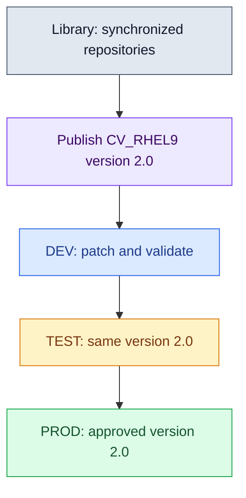

# Red Hat Satellite: RHEL 9 and RHEL 10 Patching Guide

**Purpose:** Learn Satellite architecture, configure approved software sources, register RHEL clients, and patch through DEV, TEST, and PROD.

**Documentation baseline:** Red Hat Satellite 6.19; package-mode RHEL 9 and RHEL 10, x86_64. Prepared 21 October 2026. This is a configuration and operations guide for an **already installed** Satellite server. It does not install Satellite itself.

**Execution status:** Commands are worked examples checked against the official documentation; they have not been run against your Satellite or clients. Discover actual IDs and repository variants before changing your environment. Satellite and Hammer options can differ between releases; use the installed command's `--help` if needed.

**Files:** Keep this Markdown file and `satellite-architecture.jpg` in the same directory. The image below uses a Git-friendly relative link. The ZIP contains both.


## Contents

1. [What Satellite is](#1-what-satellite-is)
2. [Why use Satellite for patching](#2-why-use-satellite-for-patching)
3. [Architecture and client connections](#3-architecture-and-client-connections)
4. [Terms and lifecycle theory](#4-terms-and-lifecycle-theory)
5. [Example lab and naming](#5-example-lab-and-naming)
6. [Prerequisites and connectivity](#6-prerequisites-and-connectivity)
7. [Hammer login and organization](#7-hammer-login-and-organization)
8. [Import the subscription manifest](#8-import-the-subscription-manifest)
9. [Enable the RHEL 9 repositories](#9-enable-the-rhel-9-repositories)
10. [Synchronize content and configure a sync plan](#10-synchronize-content-and-configure-a-sync-plan)
11. [Create the lifecycle environments](#11-create-the-lifecycle-environments)
12. [Create and publish the RHEL 9 content view](#12-create-and-publish-the-rhel-9-content-view)
13. [Create activation keys and host collections](#13-create-activation-keys-and-host-collections)
14. [Register a RHEL 9 client](#14-register-a-rhel-9-client)
15. [Patch and install software from the client](#15-patch-and-install-software-from-the-client)
16. [Configure and use remote execution](#16-configure-and-use-remote-execution)
17. [Patch and install software from the UI](#17-patch-and-install-software-from-the-ui)
18. [Run a monthly patch campaign](#18-run-a-monthly-patch-campaign)
19. [Build the separate RHEL 10 content workflow](#19-build-the-separate-rhel-10-content-workflow)
20. [Change an existing host's lifecycle assignment](#20-change-an-existing-hosts-lifecycle-assignment)
21. [Filters and urgent security fixes](#21-filters-and-urgent-security-fixes)
22. [Optional custom software repository](#22-optional-custom-software-repository)
23. [Optional Capsule for another site](#23-optional-capsule-for-another-site)
24. [Minor releases, EUS, and major upgrades](#24-minor-releases-eus-and-major-upgrades)
25. [Recovery and rollback limits](#25-recovery-and-rollback-limits)
26. [Monitoring and troubleshooting](#26-monitoring-and-troubleshooting)
27. [Operational checklist and UI map](#27-operational-checklist-and-ui-map)
28. [Official documentation](#28-official-documentation)

## 1. What Satellite is

Red Hat Satellite is a central management platform for Red Hat Enterprise Linux systems. It collects software content, controls which versions systems can access, records host inventory, and helps administrators run patch and software-management jobs.

For patching, think of Satellite as an internal software distribution center:

1. Red Hat publishes RPM packages and advisories.
2. Satellite synchronizes the selected repositories.
3. An administrator publishes a versioned collection of that content.
4. The version is tested and approved through lifecycle environments.
5. A client uses DNF to install software available in its assigned environment.

DNF still performs package dependency resolution and installation on each client. Satellite controls the source and approved content. A remote job can start DNF on the client.

**Example:** You have 100 RHEL servers. You test a monthly patch set on five DEV servers, then ten TEST servers, then production. Production keeps its previous approved content until you promote the next version. The number of clients does not change the basic process.

Satellite also supports provisioning, configuration management, and compliance integrations. You can begin with patching existing machines without configuring PXE, DHCP, or OS installation.

## 2. Why use Satellite for patching

| Requirement | What Satellite provides | Practical benefit |
| --- | --- | --- |
| Consistent patch content | Versioned content views | DEV and production can use the same approved repository snapshot |
| Controlled rollout | Lifecycle environments | Test before exposing content to production |
| Reduced repeated downloads | Central content storage and optional Capsules | Clients obtain content from your infrastructure |
| Central visibility | Host inventory and errata information | See installed software and outstanding updates |
| Targeted deployment | Host collections and remote execution | Patch a chosen application group or maintenance batch |
| Change traceability | Publish descriptions, promotion tasks, job output | Record what was approved and which operations succeeded |
| Segmented or remote sites | Capsules | Deliver content near clients and run jobs locally |
| Limited client internet access | Internal repositories | Clients can consume internal content without direct CDN access |
| Separate OS generations | Independent RHEL 9 and RHEL 10 views | Maintain different release schedules |
| Delegated administration | Organizations, locations, roles | Give teams appropriate access |

A plain internal DNF mirror can deliver RPMs. Satellite adds lifecycle control, registration, inventory, reporting, and centrally initiated jobs.

### 2.1 What Satellite does not automatically guarantee

- A successful promotion does not mean that any host has installed the new packages.
- A successful package job does not prove that the application works; application checks are still required.
- An old content-view version is a repository snapshot, not a backup of the running operating system.
- Software from unrelated third-party repositories can affect the transaction; include those sources in your patch design.
- A Satellite subscription or evaluation does not automatically grant every RHEL content entitlement. Confirm available content in your account and manifest.

## 3. Architecture and client connections

### 3.1 Main components

| Component | Simple explanation | Role in this guide |
| --- | --- | --- |
| Satellite server | Central management server | UI, API, host records, content policies, jobs |
| Foreman | Management and orchestration foundation | Host inventory, provisioning interfaces, job management |
| Katello | Content and lifecycle management integration | Products, repositories, content views, activation keys |
| Pulp | Content storage and repository services | Synchronizes and serves repository content |
| Candlepin | Subscription and content-access service | Consumer registration and content authorization |
| PostgreSQL | Database services | Stores application metadata and state |
| Integrated Capsule | Capsule services on the Satellite server | Allows a small lab to serve clients directly |
| External Capsule | Optional additional site server | Replicates selected content and provides local services |
| Client | A registered RHEL machine | Runs subscription-manager, DNF, and optional host tools |
| Hammer | Satellite's command-line client | Configures the same objects available through the UI |

These are logical responsibilities. Use Satellite's supported administration tools rather than modifying component databases or content files directly. See [S1](#s1).

### 3.2 How a client connects

**Registration:** The client contacts Satellite, or a configured registration Capsule, using a generated registration command. The activation key establishes its content-view/environment assignment and repository defaults.

**Content:** DNF reads repository definitions generated through Subscription Manager. Requests go to the assigned Satellite/Capsule content source over HTTPS. Packages travel back in the HTTPS response.

**Inventory:** Client tooling reports information used for host inventory and errata calculations. Satellite's view can lag immediately after a transaction.

**Remote patching:** With the SSH transport in this guide, the execution Capsule opens SSH to the client and runs a job, such as `dnf upgrade -y`. The integrated Capsule can perform this role in the small lab.

**Local patching:** An administrator can log in to the client and run DNF directly. SSH remote execution is not a prerequisite for this local approach.

### 3.3 Ports for the demonstrated patching design

| Initiator | Destination | Protocol/port | Purpose |
| --- | --- | --- | --- |
| Administrator | Satellite | TCP 443 | Web UI, Hammer/API access |
| Satellite | Red Hat content/account services | TCP 443 | Content and account operations; use Red Hat's current endpoint allowlist |
| Client | Satellite or assigned content Capsule | TCP 443 | Registration/content-related HTTPS and package delivery |
| Execution Capsule, including integrated Capsule | Client | TCP 22 | SSH remote execution |
| Capsule | Satellite | TCP 443 | Content synchronization and required server communication |
| Satellite | External Capsule | TCP 9090 | Capsule API/control |
| Satellite/Capsule/client | DNS server | UDP/TCP 53 | Name resolution |
| Satellite/Capsule/client | NTP source | UDP 123 | Time synchronization |

Some supported releases and registration/provisioning paths also use **TCP 80**. Follow the network matrix for your installed release before closing it. This table covers the patching example, not every Satellite feature.

Pull-based remote execution is an alternative to SSH and has additional requirements; the 6.19 documentation describes client-to-Capsule ports 1883 and 9090. Do not assume it is the same as ordinary DNF HTTPS access. See [S11](#s11), [S18](#s18), and the full firewall matrix in [S25](#s25).

### 3.4 How many network interfaces are required?

One interface is sufficient if the Satellite VM can reach the required content services and all clients can reach its FQDN. Clients in another subnet need working routing and firewall access. Adding a Capsule does not replace routing.

For the example lab, Satellite uses one interface at `192.168.0.70/24`. FreeIPA remains your DNS server. Patching alone does not require Satellite to manage DHCP or DNS.

## 4. Terms and lifecycle theory

### 4.1 Essential terms

| Term | Meaning | Example |
| --- | --- | --- |
| Organization | Administrative boundary for content and hosts | `OPENHELP`, label `openhelp` |
| Location | Physical/logical placement for management | `Warsaw` |
| Product | Container grouping repositories | Red Hat Enterprise Linux for x86_64 |
| Repository set | Red Hat's definition of available repo variants | RHEL 9 BaseOS RPMs |
| Enabled repository | Chosen architecture/release variant inside Satellite | RHEL 9, x86_64, release `9` |
| Repository/content label | Identifier the client uses with Subscription Manager | `rhel-9-for-x86_64-baseos-rpms` |
| Manifest | Account/subscription information imported into an organization | A downloaded manifest ZIP |
| Library | Entry point for synchronized content | Latest synchronized repository content |
| Content view | Definition selecting repositories and optional filters | `CV_RHEL9` |
| Published version | Fixed content snapshot of a versioned view | `CV_RHEL9` version `1.0` |
| Lifecycle environment | Stage that exposes a view version to hosts | `DEV`, `TEST`, `PROD` |
| Content view environment | Pair of lifecycle environment and view | `dev/cv_rhel9` |
| Activation key | Registration policy for new clients | `AK_RHEL9_DEV` |
| Host collection | Group of hosts for operations | `HC_RHEL9_PROD` |
| Erratum | Advisory about package fixes | RHSA, RHBA, or RHEA |
| Applicable erratum | An advisory relevant to installed software | Can be relevant even if unavailable in assigned content |
| Installable erratum | Applicable advisory available through the host's assigned content | Can be deployed after other prerequisites are satisfied |

**RHSA** = security advisory. **RHBA** = bug-fix advisory. **RHEA** = enhancement advisory.

### 4.2 Sync, publish, promote, patch

| Operation | What changes | What happens to production packages? |
| --- | --- | --- |
| Enable repository | Satellite selects an upstream repo variant | Nothing |
| Synchronize | Library receives current metadata/content | Nothing by this action alone |
| Publish | A new fixed content-view version is created | Nothing |
| Promote to DEV | DEV's version of this view changes | Nothing on production |
| Promote to PROD | Production clients can see the promoted version | Installed packages remain unchanged until an update runs |
| Patch | DNF installs available updates on chosen hosts | Packages change on those hosts |
| Reboot/restart | Running kernel/services load new code | Updated software becomes active as required |

This guide uses **versioned** views. A rolling content view exposes changing synchronized content and does not use the same publish/promote process. Use versioned views for the controlled patching workflow described here. See [S5](#s5).

Check existing automatic update timers and other management tools before relying on a manual maintenance window. Promoted content can be installed by an already configured automatic updater without a new Satellite job. On a client, inspect DNF timers with:

```bash
systemctl list-timers --all 'dnf-automatic*'
```

### 4.3 Promotion example



If DEV tests `2.0`, promote **that same version** to TEST and PROD. Publishing again creates a different snapshot which needs its own validation.

The environment is a content stage, not a physical network. DEV and PROD clients can share a subnet while receiving different approved content.

## 5. Example lab and naming

These are proposed example values, not a discovery of your running environment.

| Object | Example |
| --- | --- |
| Base domain | `openhelp.net` |
| Satellite FQDN | `satellite.openhelp.net` |
| Satellite IP | `192.168.0.70` |
| DNS/FreeIPA | `ipa.openhelp.net`, `192.168.0.10` |
| Optional external Capsule | `capsule01.openhelp.net`, `192.168.0.71` |
| Organization display name | `OPENHELP` |
| Organization label | `openhelp` |
| Location | `Warsaw` |
| Environment names | `DEV`, `TEST`, `PROD` |
| Environment labels | `dev`, `test`, `prod` |
| RHEL 9 view name/label | `CV_RHEL9` / `cv_rhel9` |
| RHEL 10 view name/label | `CV_RHEL10` / `cv_rhel10` |

| Example client | Example IP | OS | Initial content assignment |
| --- | --- | --- | --- |
| `rhel9-dev01.openhelp.net` | `192.168.0.91` | RHEL 9 | DEV / CV_RHEL9 |
| `rhel9-test01.openhelp.net` | `192.168.0.92` | RHEL 9 | TEST / CV_RHEL9 |
| `rhel9-prod01.openhelp.net` | `192.168.0.93` | RHEL 9 | PROD / CV_RHEL9 |
| `rhel10-dev01.openhelp.net` | `192.168.0.101` | RHEL 10 | DEV / CV_RHEL10 |
| `rhel10-test01.openhelp.net` | `192.168.0.102` | RHEL 10 | TEST / CV_RHEL10 |
| `rhel10-prod01.openhelp.net` | `192.168.0.103` | RHEL 10 | PROD / CV_RHEL10 |

### 5.1 Where to run commands

| Label used below | Run commands on |
| --- | --- |
| **Satellite** | Satellite VM, with a user authorized through Hammer; root when OS administration is required |
| **RHEL 9 client** | The selected RHEL 9 VM, as root |
| **RHEL 10 client** | The selected RHEL 10 VM, as root |
| **Capsule** | External Capsule only, if installed |
| **FreeIPA** | Your IPA DNS server, with suitable IPA credentials |
| **UI** | Browser at `https://satellite.openhelp.net` |

Commands omit shell prompt characters so they can be copied. Variables are shell-local; set them again if you open a new terminal. IDs, advisory IDs, task IDs, and host IDs differ on every installation.

For a given object, use either its UI procedure or its create commands. Running both creates duplicate-name errors.

## 6. Prerequisites and connectivity

### 6.1 Satellite support and capacity

For the 6.19 baseline, the Satellite server OS is supported on the current supported RHEL 9 x86_64 release described in its installation guide. Managing RHEL 10 clients does not require installing Satellite on RHEL 10. The client support matrix includes RHEL 9 and 10. See [S2](#s2) and [S3](#s3).

The documented server requirements include 4 CPU cores, at least 20 GB RAM, and at least 4 GB swap. Storage needs are substantial: the 6.19 guide lists an expected runtime allowance of 300 GB for `/var/lib/pulp`, before other system/data areas.

**For a lab limited to 200 GB total:** Do not treat that capacity as a supported full-content sizing. Begin with one architecture and RHEL 9 only, monitor free space, and add capacity before synchronizing both large OS content sets. On-demand download can reduce initial RPM storage but does not guarantee the content will fit or be available offline. Content-view filters do not reduce the upstream data already synchronized to Library.

This guide does not repartition your existing VM.

### 6.2 Server checks

**Satellite, root:**

```bash
hostname -f
cat /etc/redhat-release
rpm -q satellite
timedatectl
chronyc tracking
free -h
df -h /var/lib/pulp /var/lib/pgsql /var/log
satellite-maintain service status
```

Expected: Correct FQDN, synchronized time, enough free storage, and healthy services. A package version from `rpm -q satellite` tells you which documentation release to use.

**Satellite and each client:**

```bash
getent hosts satellite.openhelp.net
getent hosts ipa.openhelp.net
```

On systems with `dig` installed:

```bash
dig @192.168.0.10 satellite.openhelp.net A +short
dig @192.168.0.10 -x 192.168.0.70 +short
```

Expected forward answer: `192.168.0.70`. Configure a matching PTR record where reverse DNS is under your control.

If the forward record is missing, this is an example on **FreeIPA**:

```bash
kinit admin
ipa dnsrecord-add openhelp.net satellite --a-rec=192.168.0.70
```

Do not recreate an existing record with a different value.

### 6.3 TLS trust before registration

Use the Satellite FQDN rather than its IP in HTTPS URLs. The certificate must match the name.

If using a FreeIPA/enterprise CA, install the required root and intermediate CA certificates on clients. If using Satellite's default CA, obtain its CA certificate through a trusted administrative channel.

Example: A trusted administrator has already placed the correct CA bundle at `/root/satellite-ca-chain.pem` on the client.

For a default Satellite CA, a common trusted-transfer route is the following command **on the client**, after verifying Satellite's SSH host identity. First confirm this published CA file exists on your Satellite; custom certificate deployments can require a different CA chain.

```bash
scp root@satellite.openhelp.net:/var/www/html/pub/katello-server-ca.crt \
  /root/satellite-ca-chain.pem
```

**Client, root:**

```bash
install -m 0644 /root/satellite-ca-chain.pem \
  /etc/pki/ca-trust/source/anchors/satellite-ca-chain.pem
update-ca-trust
curl --fail --silent --show-error --head https://satellite.openhelp.net
```

An HTTP redirect to the login page is normal. A certificate validation failure must be resolved before using registration commands that verify TLS. Do not use `curl -k` as your normal client configuration.

## 7. Hammer login and organization

### 7.1 CLI

**Satellite:**

```bash
hammer --version
hammer auth login
hammer auth status
hammer ping
hammer organization list
hammer location list
```

`hammer auth login` prompts for Satellite application credentials. SSH/root access to the OS and Satellite UI credentials are different identities. See [S14](#s14).

If `OPENHELP` is absent, create it:

```bash
hammer organization create \
  --name "OPENHELP" \
  --label "openhelp" \
  --description "OpenHelp RHEL patch management"

hammer organization info --name "OPENHELP"
```

If `Warsaw` is absent:

```bash
hammer location create --name "Warsaw"
hammer location add-organization \
  --name "Warsaw" \
  --organization "OPENHELP"
```

Select the same organization and location when working in the UI. Keep exact names and labels from your server if they already exist.

Also associate the integrated Capsule with the new organization/location. First discover its actual ID:

```bash
hammer capsule list
```

Example only: If the integrated Capsule ID is `1`, add it without replacing existing associations:

```bash
hammer organization add-smart-proxy --name "OPENHELP" --smart-proxy-id 1
hammer location add-smart-proxy --name "Warsaw" --smart-proxy-id 1
```

In the UI, edit the Capsule under **Infrastructure > Capsules** and verify its **Organizations** and **Locations** include `OPENHELP` and `Warsaw`. This matters when registration and remote jobs select services in the host's context.

Useful command help:

```bash
hammer repository-set enable --help
hammer content-view create --help
hammer content-view version promote --help
hammer activation-key create --help
hammer host-registration generate-command --help
```

### 7.2 UI

1. Log in to `https://satellite.openhelp.net`.
2. Open **Administer > Organizations**.
3. Create `OPENHELP` if needed; set its label to `openhelp`.
4. Open **Administer > Locations** and create/select `Warsaw`.
5. Associate the organization and location as appropriate.
6. Use the organization/location selectors to work in `OPENHELP` / `Warsaw`.

Menu layouts vary: some releases place content items directly under **Content**, while newer layouts use submenus such as **Lifecycle**, **Content Types**, and **Credentials**.

## 8. Import the subscription manifest

### 8.1 Theory

The manifest tells an organization which Red Hat content it can access. Download it from the Red Hat account's subscription-allocation workflow for Satellite. The exact subscriptions or trial entitlements must permit the desired repositories.

In the documented connected flow, a new Hybrid Cloud Console manifest can initially contain no subscriptions. After importing it, populate the allocation in Satellite through **Content > Subscriptions > Add Subscriptions**. A disconnected manifest exported through the Customer Portal is populated through its corresponding account-side workflow.

**Simple Content Access (SCA):** Hosts generally do not need an individual `subscription-manager attach --auto` operation. Content access still depends on the account, manifest, selected repositories, view/environment assignment, and repository enablement. SCA does not remove subscription obligations.

A RHEL installation ISO or a basic RHEL account registration alone is not a substitute for importing the appropriate manifest into Satellite. See [S4](#s4).

### 8.2 CLI

Copy the downloaded ZIP to `/root/manifests/openhelp-manifest.zip` on **Satellite**, then run:

```bash
hammer subscription upload \
  --organization "OPENHELP" \
  --file "/root/manifests/openhelp-manifest.zip"

hammer subscription list --organization "OPENHELP"
hammer product list --organization "OPENHELP"
```

To refresh an existing manifest after account-side changes:

```bash
hammer subscription refresh-manifest --organization "OPENHELP"
```

If a newly imported connected manifest has no subscription allocation yet, complete the **Add Subscriptions** UI step below before expecting the RHEL products/repository sets to appear. Importing the ZIP and allocating content are distinct actions.

### 8.3 UI

1. Obtain the manifest ZIP from your Red Hat subscription allocation.
2. In Satellite, select organization `OPENHELP`.
3. Open **Content > Subscriptions**.
4. Select **Manage Manifest** and import/upload the ZIP.
5. Wait for the task to succeed.
6. For an empty connected manifest, select **Content > Subscriptions > Add Subscriptions**.
7. Choose the required RHEL/Satellite content subscriptions, enter the available **Quantity to Allocate**, and submit.
8. Confirm the expected subscriptions/products appear.
9. Later, use the manifest refresh action after account-side changes.

## 9. Enable the RHEL 9 repositories

### 9.1 Repository design

For a normal RHEL 9 x86_64 package-mode client, begin with:

| Purpose | Client repository ID / content label |
| --- | --- |
| Core OS packages | `rhel-9-for-x86_64-baseos-rpms` |
| Applications and dependencies | `rhel-9-for-x86_64-appstream-rpms` |
| Satellite host tools | `satellite-client-6-for-rhel-9-x86_64-rpms` |

Use the **RPM** repositories. Kickstart repositories are for provisioning and do not replace these normal update sources. Debug and source repositories are unnecessary for this basic patching exercise.

The first two repositories are usually in the product `Red Hat Enterprise Linux for x86_64`. Satellite Client content can appear under another product supplied by your manifest. Discover it rather than assuming its product or repository-set ID.

**Red Hat repositories are enabled from the manifest-backed repository sets. Do not create a custom product and paste a protected CDN URL as a replacement.** See [S6](#s6).

### 9.2 Discover available repository sets

**Satellite:**

```bash
hammer product list --organization "OPENHELP"

hammer repository-set list \
  --organization "OPENHELP" \
  --product "Red Hat Enterprise Linux for x86_64"

hammer repository-set list --organization "OPENHELP"
```

Locate these names in the output:

```text
Red Hat Enterprise Linux 9 for x86_64 - BaseOS (RPMs)
Red Hat Enterprise Linux 9 for x86_64 - AppStream (RPMs)
Red Hat Satellite Client 6 for RHEL 9 x86_64 (RPMs)
```

The names are discovery targets. Use the exact returned names/IDs if your manifest displays a variation.

### 9.3 Enable BaseOS and AppStream

This runbook uses the normal major-release **`9`** repositories, which follow supported RHEL 9 content over time. It is not an EUS/minor-pinned design.

**Satellite:**

```bash
hammer repository-set enable \
  --organization "OPENHELP" \
  --product "Red Hat Enterprise Linux for x86_64" \
  --name "Red Hat Enterprise Linux 9 for x86_64 - BaseOS (RPMs)" \
  --basearch "x86_64" \
  --releasever "9"

hammer repository-set enable \
  --organization "OPENHELP" \
  --product "Red Hat Enterprise Linux for x86_64" \
  --name "Red Hat Enterprise Linux 9 for x86_64 - AppStream (RPMs)" \
  --basearch "x86_64" \
  --releasever "9"
```

If a requested variant is unavailable, list the available variants by the actual set ID:

```bash
hammer repository-set available-repositories \
  --organization "OPENHELP" \
  --id 1234
```

`1234` is only an example repository-set ID. Use the ID returned by `repository-set list`; do not guess a minor release or enable EUS to bypass a missing entitlement.

### 9.4 Enable the Satellite Client repository

From the organization-wide repository-set list, record the actual RHEL 9 Satellite Client set ID and product.

Example only: The returned set ID is `5678`.

```bash
hammer repository-set available-repositories \
  --organization "OPENHELP" \
  --id 5678

hammer repository-set enable \
  --organization "OPENHELP" \
  --id 5678
```

For repository sets whose name already fixes the OS and architecture, no `--releasever` is normally required. If the available-variants output requires substitutions, pass the displayed values.

### 9.5 Record enabled repository IDs

```bash
hammer repository list --organization "OPENHELP"
```

A **repository-set ID**, an enabled **repository ID**, and a client **content label** identify different objects.

For the next commands, assume discovery returned the following **example enabled repository IDs**:

| Shell variable | Example ID | Repository |
| --- | --- | --- |
| `R9_BASE_ID` | `101` | RHEL 9 BaseOS RPMs, x86_64, release 9 |
| `R9_APP_ID` | `102` | RHEL 9 AppStream RPMs, x86_64, release 9 |
| `R9_CLIENT_ID` | `103` | Satellite Client 6 for RHEL 9 x86_64 |

Set these to **your real IDs**, in the current Satellite shell:

```bash
R9_BASE_ID=101
R9_APP_ID=102
R9_CLIENT_ID=103

hammer repository info --id "$R9_BASE_ID"
hammer repository info --id "$R9_APP_ID"
hammer repository info --id "$R9_CLIENT_ID"
```

Confirm the OS, architecture, product, and variant before continuing. Later commands depend on these variables.

### 9.6 UI equivalent

1. Open **Content > Red Hat Repositories**.
2. Select the **RPM** content type.
3. Search for the RHEL 9 BaseOS repository.
4. Expand it, select `x86_64` and release `9`, and click **+ / Enable**.
5. Enable RHEL 9 AppStream with the same architecture and release.
6. Search for **Red Hat Satellite Client 6**.
7. Enable the RHEL 9 x86_64 RPM variant.
8. Open **Content > Products**, select the relevant product, and inspect **Repositories**.
9. Confirm all three enabled repositories and their details.

## 10. Synchronize content and configure a sync plan

### 10.1 Choose the download policy

For a patching repository that should be ready before a change window, use **Immediate**: synchronize metadata and RPM content in advance.

**On demand** synchronizes metadata and fetches an RPM when requested. It may reduce initial storage/downloads, but the first request can require upstream connectivity. Published metadata alone does not prove all RPM payloads are locally cached.

**Satellite, using the real IDs from section 9:**

```bash
hammer repository update --id "$R9_BASE_ID" --download-policy immediate
hammer repository update --id "$R9_APP_ID" --download-policy immediate
hammer repository update --id "$R9_CLIENT_ID" --download-policy immediate
```

Optional limited-storage lab alternative, **instead of** Immediate:

```bash
hammer repository update --id "$R9_BASE_ID" --download-policy on_demand
hammer repository update --id "$R9_APP_ID" --download-policy on_demand
hammer repository update --id "$R9_CLIENT_ID" --download-policy on_demand
```

Changing the policy is not a storage-capacity guarantee. Check the repository's reported policy and available disk space. See [S7](#s7).

### 10.2 First synchronization

**Satellite:**

```bash
hammer repository synchronize --id "$R9_BASE_ID"
hammer repository synchronize --id "$R9_APP_ID"
hammer repository synchronize --id "$R9_CLIENT_ID"

hammer repository info --id "$R9_BASE_ID"
hammer repository info --id "$R9_APP_ID"
hammer repository info --id "$R9_CLIENT_ID"

df -h /var/lib/pulp /var/lib/pgsql
```

Expected: Successful last sync, nonzero content counts where upstream contains content, and adequate remaining storage.

The first sync can be large. Do not publish a baseline until every selected repository's sync has completed successfully. Hammer may return task details; an accepted task is not the same as a completed task.

```bash
hammer task list
```

Inspect a task using its returned UUID:

```bash
TASK_UUID="REPLACE_WITH_RETURNED_TASK_UUID"
hammer task info --id "$TASK_UUID"
hammer task progress --id "$TASK_UUID"
```

### 10.3 UI: synchronize repositories

1. Open **Content > Sync Status**.
2. Expand the relevant Red Hat products.
3. Select the three RHEL 9 repositories.
4. Click **Synchronize Now**.
5. Wait for successful completion.
6. Inspect repository package/errata counts and task details if synchronization fails.

### 10.4 CLI: daily synchronization plan

A sync plan refreshes Library. It does not publish a new version, promote to production, or patch hosts.

The date below is an example start time. Set a future value appropriate to your server and check Satellite's scheduling timezone.

```bash
timedatectl

hammer sync-plan create \
  --organization "OPENHELP" \
  --name "SP_DAILY_RHEL" \
  --description "Daily upstream repository synchronization" \
  --interval daily \
  --sync-date "2026-10-22 01:00:00" \
  --enabled true

hammer product set-sync-plan \
  --organization "OPENHELP" \
  --name "Red Hat Enterprise Linux for x86_64" \
  --sync-plan "SP_DAILY_RHEL"

hammer sync-plan list --organization "OPENHELP"

hammer product list \
  --organization "OPENHELP" \
  --sync-plan "SP_DAILY_RHEL"
```

Assign the same plan to the actual product containing Satellite Client repositories if it is different. Use its returned product name:

```bash
CLIENT_PRODUCT_NAME="REPLACE_WITH_ACTUAL_SATELLITE_CLIENT_PRODUCT_NAME"

hammer product set-sync-plan \
  --organization "OPENHELP" \
  --name "$CLIENT_PRODUCT_NAME" \
  --sync-plan "SP_DAILY_RHEL"
```

A product-level plan synchronizes its enabled repositories. Avoid enabling unrelated repositories if storage is limited. See [S8](#s8).

### 10.5 UI: create and assign the sync plan

1. Open **Content > Sync Plans**.
2. Choose **New Sync Plan**.
3. Enter `SP_DAILY_RHEL`, select **Daily**, and choose a start date/time.
4. Enable and save the plan.
5. Open **Content > Products**.
6. Select the RHEL product and assign the sync plan on its details page.
7. Repeat for the product containing Satellite Client content if different.
8. Verify the next run time and successful tasks after the first scheduled run.

## 11. Create the lifecycle environments

Use one path:

**Library → DEV → TEST → PROD**

The same environments can contain independent RHEL 9 and RHEL 10 views at different versions. You do not need to duplicate the environment chain for every OS.

### 11.1 CLI

**Satellite:**

```bash
hammer lifecycle-environment create \
  --organization "OPENHELP" \
  --name "DEV" \
  --label "dev" \
  --description "Development patch validation" \
  --prior "Library"

hammer lifecycle-environment create \
  --organization "OPENHELP" \
  --name "TEST" \
  --label "test" \
  --description "Application and integration validation" \
  --prior "DEV"

hammer lifecycle-environment create \
  --organization "OPENHELP" \
  --name "PROD" \
  --label "prod" \
  --description "Approved production patch content" \
  --prior "TEST"

hammer lifecycle-environment list --organization "OPENHELP"
hammer lifecycle-environment paths --organization "OPENHELP"
```

If environments already exist, inspect them instead of recreating them. Keep their actual labels for activation keys and host assignments.

### 11.2 UI

1. Open **Content > Lifecycle Environments**.
2. Select **New Environment Path**.
3. Create `DEV` after **Library**.
4. Add `TEST` after **DEV**.
5. Add `PROD` after **TEST**.
6. Confirm the predecessor chain and record labels `dev`, `test`, `prod`.

A promotion normally follows the predecessor chain. Reserve forced promotion for a reviewed exceptional procedure. See [S9](#s9).

## 12. Create and publish the RHEL 9 content view

### 12.1 Create the view

For the first exercise, include all three repositories and **no content filters**. This keeps dependency behavior easier to understand.

**Satellite, in the shell with real RHEL 9 repository IDs:**

```bash
hammer content-view create \
  --organization "OPENHELP" \
  --name "CV_RHEL9" \
  --label "cv_rhel9" \
  --description "RHEL 9 x86_64 approved OS and Satellite client content" \
  --repository-ids "${R9_BASE_ID},${R9_APP_ID},${R9_CLIENT_ID}"

hammer content-view info \
  --organization "OPENHELP" \
  --name "CV_RHEL9"
```

If your view already exists but a repository is missing, add it explicitly:

```bash
hammer content-view add-repository \
  --organization "OPENHELP" \
  --name "CV_RHEL9" \
  --repository-id "$R9_CLIENT_ID"
```

Changing the view definition does not modify older published versions. Publish a new version to include the change.

### 12.2 Publish the initial version

```bash
hammer content-view publish \
  --organization "OPENHELP" \
  --name "CV_RHEL9" \
  --description "Initial RHEL 9 baseline; BaseOS, AppStream, Satellite Client"

hammer content-view version list \
  --organization "OPENHELP" \
  --content-view "CV_RHEL9"
```

For a newly created versioned view, the first normal published version is expected to be `1.0`. Read the actual version from the output; use it below if it differs.

### 12.3 Promote to DEV

```bash
hammer content-view version promote \
  --organization "OPENHELP" \
  --content-view "CV_RHEL9" \
  --version "1.0" \
  --to-lifecycle-environment "DEV"

hammer content-view version list \
  --organization "OPENHELP" \
  --content-view "CV_RHEL9"
```

Now DEV clients assigned to this view can consume `1.0`.

### 12.4 Promote the same baseline to TEST and PROD

For the initial lab baseline, establish the same tested starting version in all stages. After registering and validating the DEV pilot, run these separately as each stage is approved:

**First pass:** Continue to sections 13–16 to create the DEV key, register a DEV client, and validate it. Return here for TEST/PROD promotion, then create their corresponding keys and registrations. The initial baseline is established once; subsequent cycles follow section 18.

```bash
hammer content-view version promote \
  --organization "OPENHELP" \
  --content-view "CV_RHEL9" \
  --version "1.0" \
  --to-lifecycle-environment "TEST"
```

After TEST validation:

```bash
hammer content-view version promote \
  --organization "OPENHELP" \
  --content-view "CV_RHEL9" \
  --version "1.0" \
  --to-lifecycle-environment "PROD"
```

Do not run these later-stage promotions before the required validation in a real environment.

### 12.5 UI equivalent

1. Open **Content > Lifecycle > Content Views**; older layouts may use **Content > Content Views**.
2. Select **Create content view**.
3. Name: `CV_RHEL9`; label: `cv_rhel9`.
4. Select the ordinary **versioned content view** type, not rolling or composite.
5. Create the view.
6. On **Repositories**, add the synchronized RHEL 9 BaseOS, AppStream, and Satellite Client RPM repositories.
7. Choose **Publish new version**.
8. Enter the baseline description, review, and publish.
9. Wait for successful publication.
10. Select version `1.0`, choose **Promote**, and select **DEV**.
11. After validating DEV, promote that same version to **TEST**.
12. After TEST approval, promote it to **PROD**.
13. Check the versions page to confirm which environment contains the version.

Do not auto-promote to every stage in the publishing wizard during a controlled campaign. See [S5](#s5).

## 13. Create activation keys and host collections

### 13.1 Theory

Create a separate key for each OS and environment:

| Activation key | Content view environment | Intended clients |
| --- | --- | --- |
| `AK_RHEL9_DEV` | `dev/cv_rhel9` | RHEL 9 DEV |
| `AK_RHEL9_TEST` | `test/cv_rhel9` | RHEL 9 TEST |
| `AK_RHEL9_PROD` | `prod/cv_rhel9` | RHEL 9 production |

An activation key applies registration settings to **new registrations**. Editing it does not automatically reconfigure already registered hosts.

Keep each host assigned to one controlled OS content-view/environment pair for this exercise. Newer Satellite versions support multiple pairs; accidental extra Library/rolling assignments can bypass your intended content freeze.

### 13.2 CLI: create the keys

The content-view-environment option uses **labels**, not display names. These commands match the explicit labels created above.

**Satellite:**

```bash
hammer activation-key create \
  --organization "OPENHELP" \
  --name "AK_RHEL9_DEV" \
  --unlimited-hosts \
  --description "RHEL 9 registration into DEV" \
  --content-view-environments "dev/cv_rhel9"

hammer activation-key create \
  --organization "OPENHELP" \
  --name "AK_RHEL9_TEST" \
  --unlimited-hosts \
  --description "RHEL 9 registration into TEST" \
  --content-view-environments "test/cv_rhel9"

hammer activation-key create \
  --organization "OPENHELP" \
  --name "AK_RHEL9_PROD" \
  --unlimited-hosts \
  --description "RHEL 9 registration into PROD" \
  --content-view-environments "prod/cv_rhel9"
```

Create TEST/PROD keys after the view version is available in those environments. If you are still testing DEV, create only the DEV key now.

On older supported Hammer versions without `--content-view-environments`, the single-view equivalent is:

```bash
hammer activation-key create \
  --organization "OPENHELP" \
  --name "AK_RHEL9_DEV" \
  --unlimited-hosts \
  --content-view "CV_RHEL9" \
  --lifecycle-environment "DEV"
```

Use one syntax supported by your installed `--help`, not both.

### 13.3 Enable the repositories on each key

First inspect the key's available product content:

```bash
hammer activation-key product-content \
  --organization "OPENHELP" \
  --name "AK_RHEL9_DEV" \
  --content-access-mode-all true
```

Enable the three known content labels on the DEV key:

```bash
hammer activation-key content-override \
  --organization "OPENHELP" --name "AK_RHEL9_DEV" \
  --content-label "rhel-9-for-x86_64-baseos-rpms" --value 1

hammer activation-key content-override \
  --organization "OPENHELP" --name "AK_RHEL9_DEV" \
  --content-label "rhel-9-for-x86_64-appstream-rpms" --value 1

hammer activation-key content-override \
  --organization "OPENHELP" --name "AK_RHEL9_DEV" \
  --content-label "satellite-client-6-for-rhel-9-x86_64-rpms" --value 1
```

Set the same overrides on the TEST key:

```bash
hammer activation-key content-override \
  --organization "OPENHELP" --name "AK_RHEL9_TEST" \
  --content-label "rhel-9-for-x86_64-baseos-rpms" --value 1

hammer activation-key content-override \
  --organization "OPENHELP" --name "AK_RHEL9_TEST" \
  --content-label "rhel-9-for-x86_64-appstream-rpms" --value 1

hammer activation-key content-override \
  --organization "OPENHELP" --name "AK_RHEL9_TEST" \
  --content-label "satellite-client-6-for-rhel-9-x86_64-rpms" --value 1
```

Set the same overrides on the PROD key:

```bash
hammer activation-key content-override \
  --organization "OPENHELP" --name "AK_RHEL9_PROD" \
  --content-label "rhel-9-for-x86_64-baseos-rpms" --value 1

hammer activation-key content-override \
  --organization "OPENHELP" --name "AK_RHEL9_PROD" \
  --content-label "rhel-9-for-x86_64-appstream-rpms" --value 1

hammer activation-key content-override \
  --organization "OPENHELP" --name "AK_RHEL9_PROD" \
  --content-label "satellite-client-6-for-rhel-9-x86_64-rpms" --value 1
```

A repository override enables client access to available content; it does not synchronize the repository, add it to a view, or publish/promote the view.

### 13.4 CLI: optional host collections

**Satellite:**

```bash
hammer host-collection create \
  --organization "OPENHELP" --name "HC_RHEL9_DEV" --unlimited-hosts

hammer host-collection create \
  --organization "OPENHELP" --name "HC_RHEL9_TEST" --unlimited-hosts

hammer host-collection create \
  --organization "OPENHELP" --name "HC_RHEL9_PROD" --unlimited-hosts

hammer host-collection list --organization "OPENHELP"
```

Record the returned collection IDs. Example only: DEV `11`, TEST `12`, PROD `13`.

```bash
hammer activation-key add-host-collection \
  --organization "OPENHELP" --name "AK_RHEL9_DEV" --host-collection-id 11

hammer activation-key add-host-collection \
  --organization "OPENHELP" --name "AK_RHEL9_TEST" --host-collection-id 12

hammer activation-key add-host-collection \
  --organization "OPENHELP" --name "AK_RHEL9_PROD" --host-collection-id 13
```

The key adds new registrations to the collection. A collection itself does not enforce a content-view assignment.

### 13.5 UI equivalent

1. Open **Hosts > Host Collections** and create the desired DEV/TEST/PROD collections.
2. Open **Content > Lifecycle > Activation Keys**.
3. Create `AK_RHEL9_DEV`.
4. Under **Content view environments**, assign **DEV** and **CV_RHEL9**.
5. Save, then open **Repository Sets**.
6. Select the three RHEL 9 repository sets and choose **Override to Enabled**.
7. On **Host Collections**, add `HC_RHEL9_DEV`.
8. Repeat with TEST and PROD after their baseline versions are available.
9. Review each key's content-view/environment pair and repository overrides.

See [S10](#s10).

## 14. Register a RHEL 9 client

### 14.1 Prepare the client

Use a unique FQDN and correct DNS/time. This example is the DEV client.

**RHEL 9 client, root:**

```bash
hostnamectl set-hostname rhel9-dev01.openhelp.net

hostname -f
cat /etc/redhat-release
uname -m
timedatectl
getent hosts satellite.openhelp.net

rpm -q subscription-manager curl
subscription-manager identity
```

For an unregistered client, the final command reports that it is not registered; that is expected.

If required packages are missing, install them using a legitimate existing OS source or installation media:

```bash
dnf install subscription-manager curl
```

Complete the trusted CA setup in section 6.3 before registration.

If the machine is already registered elsewhere, plan its migration first. Do not blindly run `subscription-manager clean` or force registration on a production host. Those actions can discard its existing registration identity.

### 14.2 Recommended CLI method: generate global registration

**Satellite:**

```bash
hammer host-registration generate-command \
  --organization "OPENHELP" \
  --location "Warsaw" \
  --activation-keys "AK_RHEL9_DEV" \
  --setup-remote-execution true \
  --setup-insights false \
  --update-packages false \
  --jwt-expiration 1 \
  --insecure false
```

This produces a registration command containing a short-lived token.

1. Copy the **complete generated command**.
2. Run it as **root on `rhel9-dev01.openhelp.net`** within the token lifetime.
3. Review the registration output.
4. Do not store the generated token/command in Git, tickets, or this guide.
5. Generate a fresh command when the token expires.

The actual generated command cannot be prewritten here because Satellite creates its authorization token at runtime. The complete generation command above is reproducible; do not invent or reuse an example JWT.

`--update-packages false` separates registration from patching. `--setup-remote-execution true` requests SSH key setup for remote execution. Confirm transport, SSH access, and effective-user permissions before running package jobs. See [S11](#s11) and [S15](#s15).

### 14.3 UI method: generate and run the registration command

1. Open **Hosts > Register Host**.
2. Select organization `OPENHELP` and location `Warsaw`.
3. Choose activation key `AK_RHEL9_DEV`.
4. For direct lab registration, use Satellite's registration endpoint/default integrated services.
5. Enable **Setup remote execution** for the SSH workflow.
6. Leave automatic package updating disabled for this exercise.
7. Leave Lightspeed/Insights enrollment disabled unless you want and have configured it.
8. Set a short token lifetime, for example one hour.
9. Keep certificate validation enabled after distributing the trusted CA.
10. Click **Generate**.
11. Run the generated command as root on the client.
12. Open **Hosts > All Hosts** and select the new host.
13. Verify organization, content source, **DEV**, **CV_RHEL9**, and host collection.

The UI generates a client command; it does not register an unreachable machine simply by creating a host record.

### 14.4 Verify registration and repositories

**RHEL 9 client:**

```bash
subscription-manager identity
subscription-manager refresh
subscription-manager repos --list-enabled

dnf clean all
dnf makecache --refresh
dnf repolist --enabled
dnf repoinfo rhel-9-for-x86_64-baseos-rpms
```

Expected enabled repository IDs include:

```text
rhel-9-for-x86_64-baseos-rpms
rhel-9-for-x86_64-appstream-rpms
satellite-client-6-for-rhel-9-x86_64-rpms
```

Check the repository URL shown by `dnf repoinfo`. It should use the intended Satellite/Capsule content source and assigned environment/view.

Install host integration and DNF utilities:

```bash
dnf install katello-host-tools dnf-utils
subscription-manager facts --update
subscription-manager refresh
```

If your installed tools provide `katello-package-upload`, you can refresh package inventory explicitly:

```bash
command -v katello-package-upload
```

If a path is returned:

```bash
katello-package-upload
```

Normal inventory reporting may be asynchronous. On Satellite, inspect the host's installed packages/errata after its profile refresh.

**Satellite:**

```bash
hammer host list \
  --organization "OPENHELP" \
  --search 'name = rhel9-dev01.openhelp.net'

hammer host info --name "rhel9-dev01.openhelp.net"
```

An SCA-related `subscription-manager status` result alone is not proof that registration failed. Check the actual identity, enabled repositories, and successful DNF access.

### 14.5 Explicit client-side repo enablement when needed

If registration succeeded and the repositories are available but disabled:

```bash
subscription-manager repos \
  --enable=rhel-9-for-x86_64-baseos-rpms \
  --enable=rhel-9-for-x86_64-appstream-rpms \
  --enable=satellite-client-6-for-rhel-9-x86_64-rpms

dnf makecache --refresh
```

For an existing client, changing activation-key overrides alone does not repair its current settings. Use the client command above or the existing host's repository-set controls in Satellite.

### 14.6 Other RHEL 9 clients

Generate the same registration command with `AK_RHEL9_TEST` for `rhel9-test01.openhelp.net`, and `AK_RHEL9_PROD` for `rhel9-prod01.openhelp.net`. Set each machine's hostname before running its command.

Never use a RHEL 10 key for a RHEL 9 machine. Verify OS/version and assigned repositories after every registration.

### 14.7 Older registration instructions you may find online

The older `katello-ca-consumer-latest.noarch.rpm` plus `subscription-manager register` method remains described for legacy deployments, but the 6.19 documentation marks the consumer RPM/script approach as deprecated. Use global registration for this new workflow.

If you already have an established, trusted legacy RHSM configuration pointing to this Satellite, its registration command takes this form:

```bash
subscription-manager register \
  --org="openhelp" \
  --activationkey="AK_RHEL9_DEV"
```

**That command alone does not change a fresh client's default RHSM endpoint from Red Hat to Satellite.** This is why global registration is the main procedure here. See [S11](#s11).

## 15. Patch and install software from the client

The following operations run on a **registered RHEL 9 client**, not on the Satellite server. They consume only repositories enabled on that client, including any unrelated sources you have left enabled.

### 15.1 Collect a pre-patch baseline

**RHEL 9 client, root:**

```bash
date -Is
hostname -f
cat /etc/redhat-release
uname -r

df -h / /var /boot
systemctl --failed

subscription-manager identity
subscription-manager release --show
dnf repolist --enabled
dnf history list
```

For a saved package inventory:

```bash
rpm -qa --qf '%{NAME} %{EPOCHNUM}:%{VERSION}-%{RELEASE}.%{ARCH}\n' \
  | sort > /root/packages-before-patching.txt
```

Check application availability and your backup/recovery point before the approved production window.

### 15.2 Check available patches

```bash
dnf makecache --refresh
dnf check-update
```

`dnf check-update` exits with **100** when updates are available, **0** when none are available, and another nonzero code for an error. Code 100 is not a failed metadata refresh.

```bash
dnf updateinfo summary
dnf updateinfo list --available --security
dnf list --upgrades
```

The results reflect the content assigned to this client. If PROD has the older view, it will not see DEV-only content.

### 15.3 Preview and apply all available updates

Preview:

```bash
dnf upgrade --refresh --assumeno
```

This intentionally declines the transaction. Review proposed updates, dependencies, removals, and repositories.

During the approved window, choose interactive confirmation:

```bash
dnf upgrade --refresh
```

Or, after reviewing the transaction and approving unattended execution:

```bash
dnf upgrade --refresh -y
```

These are alternative execution choices. Do not assume a second run will perform the same transaction if content has changed.

### 15.4 Security-focused patching

Preview:

```bash
dnf upgrade --security --assumeno
```

Apply security-related updates using the latest available package versions that satisfy the security selection:

```bash
dnf upgrade --security
```

For minimal available versions that satisfy security advisories:

```bash
dnf upgrade-minimal --security
```

Dependencies can also change. Security-only selection is not a promise that no other RPMs will be updated.

For a specific advisory, first choose a real **available/installable** advisory from your output:

```bash
dnf updateinfo list --available --security
```

Example syntax; replace the illustrative ID with the real advisory:

```bash
ERRATUM_ID="RHSA-2026:12345"

dnf updateinfo info "$ERRATUM_ID"
dnf upgrade-minimal --advisory="$ERRATUM_ID" --assumeno
dnf upgrade-minimal --advisory="$ERRATUM_ID"
```

No particular advisory is guaranteed to apply to your client. An advisory must be in the approved content and relevant to installed packages. See [S12](#s12) and [S16](#s16).

### 15.5 Install and update normal software

Example: Install the Apache web server package:

```bash
dnf search httpd
dnf info httpd
dnf install httpd --assumeno
dnf install httpd
rpm -q httpd
```

To update only that package and required dependencies:

```bash
dnf upgrade httpd --assumeno
dnf upgrade httpd
```

Installing a package does not necessarily start its service. For the **lab web-server example**, if you want Apache running:

```bash
systemctl enable --now httpd
systemctl status httpd --no-pager
curl --head http://127.0.0.1
```

Open the client firewall's HTTP service only if other machines need to reach this lab application:

```bash
firewall-cmd --permanent --add-service=http
firewall-cmd --reload
```

To remove an unneeded lab package:

```bash
dnf remove httpd --assumeno
dnf remove httpd
```

Review dependent package removals before confirming.

### 15.6 Determine restart/reboot needs

```bash
dnf needs-restarting -r
```

With the DNF utility installed, exit **1** indicates a reboot recommendation; **0** indicates it is not recommended by that check. Read the output rather than treating either result as a package-installation failure.

Inspect services with stale processes:

```bash
dnf needs-restarting -s
```

Restart affected applications according to their runbooks. When a reboot is approved:

```bash
systemctl reboot
```

This ends the current connection. A new kernel is not active merely because its RPM was installed.

### 15.7 Post-patch verification

After reconnecting:

```bash
hostname -f
uname -r
cat /etc/redhat-release
systemctl --failed
dnf history list
dnf history info last
dnf updateinfo list --available --security
```

For the Apache example:

```bash
rpm -q httpd
systemctl is-active httpd
curl --head http://127.0.0.1
```

Refresh facts and, when available, package inventory:

```bash
subscription-manager facts --update
subscription-manager refresh
```

If `katello-package-upload` exists:

```bash
katello-package-upload
```

The completion criteria are: successful transaction, required restart/reboot, healthy application, and refreshed inventory/errata information.

## 16. Configure and use remote execution

### 16.1 Understand the two directions

For the default SSH approach:

- The client contacts its content source over **HTTPS 443** to fetch metadata/RPMs.
- The integrated/external execution Capsule contacts the client over **SSH 22** to start the job.
- The job runs as an effective user allowed to install software, usually root.

A client can have working DNF access while Satellite remote execution still fails because SSH or privilege elevation is not configured.

The server's existing remote-execution provider must be enabled. Check the integrated Capsule's features in **Infrastructure > Capsules** before changing installation options. Avoid rerunning the installer without reviewing the current deployment configuration.

If an already configured execution Capsule is in pull mode and your intended design is to switch that executor to SSH, the documented command is run as **root on that executor**:

```bash
satellite-installer --foreman-proxy-plugin-remote-execution-script-mode ssh
```

For the direct lab, the executor is the integrated Capsule on Satellite. This changes the transport for clients using that executor, so retain an existing pull-mode deployment unless you intend to migrate it.

For executor selection, either assign the intended remote-execution Capsule to the host interface's subnet, or use the registered-through preference where appropriate. In **Administer > Settings > Content**, enabling **Prefer registered through Capsule for remote execution** makes jobs use the Capsule through which the host registered.

For a lab with exactly one eligible Capsule in `OPENHELP` / `Warsaw`, an alternative is the scoped-by-context global fallback setting:

```bash
hammer settings set --name remote_execution_global_proxy --value true
```

UI equivalent: **Administer > Settings > Remote Execution > Enable Global Capsule**. In a multi-Capsule deployment, prefer deliberate subnet/Capsule assignment rather than relying on this fallback to choose an executor.

### 16.2 Check SSH and job prerequisites

**Client, root:**

```bash
systemctl is-active sshd
ss -lnt 'sport = :22'
firewall-cmd --list-services
```

If the service is not running and you intend to use SSH remote execution:

```bash
systemctl enable --now sshd
```

If your client firewall does not already permit the execution Capsule, use a scoped rule. This example permits only the direct lab executor `192.168.0.70`:

```bash
firewall-cmd --permanent \
  --add-rich-rule='rule family="ipv4" source address="192.168.0.70/32" service name="ssh" accept'

firewall-cmd --reload
```

Existing wider rules remain in effect; review them separately. For an external executor, use its actual source address.

### 16.3 SSH credentials

Global registration with remote execution enabled can distribute the executor's SSH public key. Verify that the key was actually installed and that the selected SSH user can become the effective user.

A simple root-to-root lab can use the integrated Capsule's existing key if the client's SSH policy allows key-based root access. Organizations that disable root SSH should use an approved non-root SSH account with suitable sudo privileges and configure Satellite's remote-execution SSH user/effective user accordingly.

Manual key distribution example, on the **execution Capsule**; for the direct lab this is the **Satellite server**:

```bash
ssh-copy-id \
  -i ~foreman-proxy/.ssh/id_rsa_foreman_proxy.pub \
  root@rhel9-dev01.openhelp.net
```

This requires an existing permitted authentication path. If password authentication is disabled, deploy the public key through your established provisioning/configuration process.

Test using the Capsule service account and the real execution identity:

```bash
sudo -u foreman-proxy ssh \
  -i ~foreman-proxy/.ssh/id_rsa_foreman_proxy \
  root@rhel9-dev01.openhelp.net \
  'hostname -f; id'
```

Confirm the host key through your trusted process. Do not disable host-key checking to make the test pass.

If you use a non-root account such as `satpatch`, configure the host's **remote_execution_ssh_user** parameter and effective user in the UI, then test that the account's approved sudo rules permit the required package jobs without an interactive prompt. See [S18](#s18).

### 16.4 Discover templates and run a harmless test

**Satellite:**

```bash
hammer job-template list
hammer remote-execution-feature list
```

Locate **Run Command - Script Default**. If your installation has renamed/customized templates, use the returned exact name.

Preview the target host set:

```bash
hammer host list \
  --organization "OPENHELP" \
  --search 'name = rhel9-dev01.openhelp.net'
```

Run:

```bash
hammer job-invocation create \
  --organization "OPENHELP" \
  --job-template "Run Command - Script Default" \
  --search-query 'name = rhel9-dev01.openhelp.net' \
  --inputs 'command=hostname -f'
```

Record the returned job ID. Example only: `501`.

```bash
hammer job-invocation info --id 501 --show-host-status

hammer job-invocation output \
  --id 501 \
  --host "rhel9-dev01.openhelp.net"
```

Expected: The output contains the selected client's FQDN and the host execution succeeds. Starting a job is not proof of success; inspect every target's result.

### 16.5 Install a package or apply an erratum remotely

**Satellite:**

```bash
hammer job-invocation create \
  --organization "OPENHELP" \
  --feature katello_package_install \
  --search-query 'name = rhel9-dev01.openhelp.net' \
  --inputs 'package=httpd'
```

Update the package:

```bash
hammer job-invocation create \
  --organization "OPENHELP" \
  --feature katello_package_update \
  --search-query 'name = rhel9-dev01.openhelp.net' \
  --inputs 'package=httpd'
```

Apply a real installable advisory, using the actual ID selected earlier:

```bash
ERRATUM_ID="REPLACE_WITH_INSTALLABLE_RHSA_ID"

hammer job-invocation create \
  --organization "OPENHELP" \
  --feature katello_errata_install \
  --search-query 'name = rhel9-dev01.openhelp.net' \
  --inputs "errata=${ERRATUM_ID}"
```

Inspect feature/template mappings with `hammer remote-execution-feature list` if your installation customizes them. Package/errata actions depend on working remote execution.

### 16.6 Run a complete approved update on one client

After reviewing a preview on the pilot client:

```bash
hammer job-invocation create \
  --organization "OPENHELP" \
  --job-template "Run Command - Script Default" \
  --search-query 'name = rhel9-dev01.openhelp.net' \
  --inputs 'command=dnf upgrade --refresh -y'
```

This updates packages; it does not automatically reboot the machine or perform application acceptance checks.

For a security-focused job:

```bash
hammer job-invocation create \
  --organization "OPENHELP" \
  --job-template "Run Command - Script Default" \
  --search-query 'name = rhel9-dev01.openhelp.net' \
  --inputs 'command=dnf upgrade-minimal --security -y'
```

These are alternative patch policies. Choose the policy required for the campaign.

### 16.7 Patch a host collection in controlled batches

First verify the target set:

```bash
hammer host list \
  --organization "OPENHELP" \
  --search 'host_collection = HC_RHEL9_DEV'
```

Then, during the approved window:

```bash
hammer job-invocation create \
  --organization "OPENHELP" \
  --job-template "Run Command - Script Default" \
  --search-query 'host_collection = HC_RHEL9_DEV' \
  --concurrency-level 2 \
  --inputs 'command=dnf upgrade --refresh -y'
```

For production, first use a pilot collection, then deliberately target the larger production collection. Concurrency limits simultaneous jobs; it does not drain load balancers, sequence cluster members safely, or stop later hosts automatically after a failed application check.

### 16.8 Schedule a one-time patch job

Example only: 25 October 2026 at 01:00 UTC, which is 02:00 in Warsaw after the daylight-saving change that night.

Verify the displayed timezone and target list before scheduling.

```bash
hammer job-invocation create \
  --organization "OPENHELP" \
  --job-template "Run Command - Script Default" \
  --search-query 'host_collection = HC_RHEL9_TEST' \
  --concurrency-level 2 \
  --start-at "2026-10-25T01:00:00Z" \
  --inputs 'command=dnf upgrade --refresh -y'
```

The host consumes the environment's content **at execution time**. A scheduled DNF job does not pin a particular content-view version by itself. Keep the environment on the approved version until the campaign completes.

This is a command example for your Satellite scheduler; no job has been created by preparing this document. See [S19](#s19).

## 17. Patch and install software from the UI

### 17.1 Verify a host before changing packages

1. Open **Hosts > All Hosts**.
2. Select `rhel9-dev01.openhelp.net`.
3. Confirm `CV_RHEL9`, environment **DEV**, and the intended content source.
4. Open **Content > Repository sets** within the host details.
5. Confirm the expected repositories are enabled.
6. Open the host's **Content > Packages** tab.
7. Review installed packages; select **Upgradable** to see available upgrades.

### 17.2 Install software on a client

1. On the host's **Content > Packages** tab, open the package actions menu.
2. Choose **Install packages**.
3. Search for `httpd`.
4. Select the package and click **Install**.
5. Follow the job notification to **Monitor > Jobs**.
6. Check the output for the specific host.
7. Confirm `httpd` appears in the host's installed-package inventory after refresh.

To update a package, select **Upgradable**, choose the required candidate version/package, and click **Upgrade**.

The package must exist in the host's assigned content. If it is missing, correct the repository/view/promotion path before retrying. See [S17](#s17).

### 17.3 Apply security errata

Host view:

1. Open **Hosts > All Hosts > selected host**.
2. Open **Content > Errata**.
3. Filter by **Security**, and severity if required.
4. Distinguish **Applicable** from **Installable**.
5. Select installable advisories and use the available apply/install action.
6. Review targets and job options.
7. Monitor per-host execution in **Monitor > Jobs**.

Organization-wide advisory view:

1. Open **Content > Content Types > Errata**; older layouts may show **Content > Errata**.
2. Open the chosen advisory.
3. Open **Content Hosts**.
4. Select only the intended clients.
5. Choose **Apply to Hosts** and confirm.
6. Review the resulting errata-install job.

If an advisory is applicable but unavailable in PROD's view, first make the approved advisory content available through the lifecycle workflow. See [S12](#s12).

### 17.4 Run a full patch job using the UI

1. Open **Monitor > Jobs > Run job**.
2. Choose the command/script category and **Run Command - Script Default**.
3. Enter the target query, for example `host_collection = HC_RHEL9_DEV`.
4. Check the resolved hosts and count.
5. Enter command `dnf upgrade --refresh -y`.
6. Set an appropriate concurrency limit, for example `2` for the lab.
7. Select immediate or a reviewed maintenance time.
8. Review and submit.
9. Open each failed/pending host result until the job is accounted for.
10. Perform reboot/service and application checks separately.

**Always supply and verify the target selection.** In the documented job wizard, leaving the host selection empty can target all visible hosts in the current context.

### 17.5 Reboot and application verification

You can run a read-only command job such as:

```bash
dnf needs-restarting -r
```

A reboot recommendation may appear as a nonzero job result because the command uses exit code 1 for that condition. Read the output.

Schedule approved reboots separately with a suitable reboot template available on your installation, or reboot from the host console. A generic script that reboots its own SSH target can disconnect before Satellite receives a clean result; verify the machine has actually returned.

For applications, check the real health endpoint, service status, and application owner's acceptance criteria. The Satellite job result alone is not application approval.

## 18. Run a monthly patch campaign

### 18.1 Example state at the start of a new cycle

| Environment | RHEL 9 view version before the cycle |
| --- | --- |
| DEV | `1.0` |
| TEST | `1.0` |
| PROD | `1.0` |

A new upstream sync updates Library. It does not change the published `1.0` snapshot.

### 18.2 Synchronize and publish the next snapshot

**Satellite, using the real RHEL 9 repository IDs:**

```bash
hammer repository synchronize --id "$R9_BASE_ID"
hammer repository synchronize --id "$R9_APP_ID"
hammer repository synchronize --id "$R9_CLIENT_ID"

hammer content-view publish \
  --organization "OPENHELP" \
  --name "CV_RHEL9" \
  --description "CHG-2026-1101: monthly RHEL 9 candidate; upstream sync complete"

hammer content-view version list \
  --organization "OPENHELP" \
  --content-view "CV_RHEL9"
```

Example: The new normal version is `2.0`. Use the actual returned version if different.

### 18.3 DEV pilot

```bash
hammer content-view version promote \
  --organization "OPENHELP" \
  --content-view "CV_RHEL9" \
  --version "2.0" \
  --to-lifecycle-environment "DEV"
```

Patch the DEV pilot using section 15 or 16. Reboot/restart where needed and validate the application.

**Record:** view/version, publish description, sync date, client list, transaction/job IDs, before/after kernel, application result, and approval decision.

### 18.4 TEST

After DEV approval:

```bash
hammer content-view version promote \
  --organization "OPENHELP" \
  --content-view "CV_RHEL9" \
  --version "2.0" \
  --to-lifecycle-environment "TEST"
```

Patch TEST, run integration tests, and obtain production approval. Leave PROD on `1.0` until that approval.

### 18.5 PROD

After TEST approval and before the production patch window:

```bash
hammer content-view version promote \
  --organization "OPENHELP" \
  --content-view "CV_RHEL9" \
  --version "2.0" \
  --to-lifecycle-environment "PROD"
```

For external Capsule clients, confirm Capsule synchronization is complete before starting production jobs.

Patch a production pilot first, then the remaining approved batches. Avoid patching all members of an application cluster simultaneously. Promotion does not bypass that application's maintenance procedure.

### 18.6 UI equivalent

1. Verify successful repository synchronization in **Content > Sync Status**.
2. Open `CV_RHEL9` and publish a new version with the change reference.
3. Promote it to DEV only.
4. Run the DEV job and record validation.
5. Promote the same version to TEST; patch and validate.
6. Promote the same version to PROD after approval.
7. Confirm Capsule content if used.
8. Run production pilot and batch jobs.
9. Export results and record exceptions.

### 18.7 Completion evidence

| Evidence | Why keep it |
| --- | --- |
| Published content-view version | Identifies the approved snapshot |
| Promotion/task result | Proves the stage received it |
| Target host list | Defines campaign scope |
| Per-host job/transaction result | Separates successful, failed, and missed systems |
| Restart/reboot result | Confirms running software was refreshed as required |
| Application check | Confirms the service remains usable |
| Remaining installable/applicable errata report | Records residual exposure and exceptions |

## 19. Build the separate RHEL 10 content workflow

This section adds RHEL 10 content to the **same Satellite server and organization**. Keep its repositories, view, keys, and operational batches separate from RHEL 9.

This is management of already installed RHEL 10 clients. It is not an in-place RHEL 9-to-10 upgrade procedure.

### 19.1 Required RHEL 10 repositories

| Purpose | Client repository ID / content label |
| --- | --- |
| Core OS | `rhel-10-for-x86_64-baseos-rpms` |
| Applications | `rhel-10-for-x86_64-appstream-rpms` |
| Satellite tools | `satellite-client-6-for-rhel-10-x86_64-rpms` |

The client repository provides RHEL 10 builds of Satellite host tools. Do not use the RHEL 9 client repository on RHEL 10. See [S3](#s3) and [S20](#s20).

### 19.2 Enable BaseOS and AppStream

**Satellite:**

```bash
hammer repository-set list \
  --organization "OPENHELP" \
  --product "Red Hat Enterprise Linux for x86_64"

hammer repository-set enable \
  --organization "OPENHELP" \
  --product "Red Hat Enterprise Linux for x86_64" \
  --name "Red Hat Enterprise Linux 10 for x86_64 - BaseOS (RPMs)" \
  --basearch "x86_64" \
  --releasever "10"

hammer repository-set enable \
  --organization "OPENHELP" \
  --product "Red Hat Enterprise Linux for x86_64" \
  --name "Red Hat Enterprise Linux 10 for x86_64 - AppStream (RPMs)" \
  --basearch "x86_64" \
  --releasever "10"
```

As for RHEL 9, inspect available variants if `10` is not offered:

```bash
hammer repository-set available-repositories \
  --organization "OPENHELP" \
  --id 2345
```

Use the actual RHEL 10 repository-set ID instead of example `2345`. If content is absent, check manifest allocation and client support before proceeding.

### 19.3 Enable Satellite Client for RHEL 10

```bash
hammer repository-set list --organization "OPENHELP"
```

Find **Red Hat Satellite Client 6 for RHEL 10 x86_64 (RPMs)** and record its real set ID.

Example only: Set ID `6789`.

```bash
hammer repository-set available-repositories \
  --organization "OPENHELP" \
  --id 6789

hammer repository-set enable \
  --organization "OPENHELP" \
  --id 6789

hammer repository list --organization "OPENHELP"
```

Use values required by the returned available variant if that set needs substitutions.

### 19.4 Record real repository IDs and synchronize

Example enabled repository IDs: BaseOS `201`, AppStream `202`, Client `203`. Replace all three with actual values:

```bash
R10_BASE_ID=201
R10_APP_ID=202
R10_CLIENT_ID=203

hammer repository info --id "$R10_BASE_ID"
hammer repository info --id "$R10_APP_ID"
hammer repository info --id "$R10_CLIENT_ID"

hammer repository update --id "$R10_BASE_ID" --download-policy immediate
hammer repository update --id "$R10_APP_ID" --download-policy immediate
hammer repository update --id "$R10_CLIENT_ID" --download-policy immediate

hammer repository synchronize --id "$R10_BASE_ID"
hammer repository synchronize --id "$R10_APP_ID"
hammer repository synchronize --id "$R10_CLIENT_ID"

df -h /var/lib/pulp /var/lib/pgsql
```

Wait for all three successful syncs. If disk capacity cannot accommodate the content, expand it before continuing.

If the RHEL 10 repositories belong to the same product already assigned to `SP_DAILY_RHEL`, that product plan covers them as well. If the RHEL 10 client repository is in another product, assign that product to the plan too.

### 19.5 Create and publish the separate view

```bash
hammer content-view create \
  --organization "OPENHELP" \
  --name "CV_RHEL10" \
  --label "cv_rhel10" \
  --description "RHEL 10 x86_64 approved OS and Satellite client content" \
  --repository-ids "${R10_BASE_ID},${R10_APP_ID},${R10_CLIENT_ID}"

hammer content-view publish \
  --organization "OPENHELP" \
  --name "CV_RHEL10" \
  --description "Initial RHEL 10 baseline"

hammer content-view version list \
  --organization "OPENHELP" \
  --content-view "CV_RHEL10"

hammer content-view version promote \
  --organization "OPENHELP" \
  --content-view "CV_RHEL10" \
  --version "1.0" \
  --to-lifecycle-environment "DEV"
```

After validating a RHEL 10 DEV pilot, promote the **same actual version** to TEST:

```bash
hammer content-view version promote \
  --organization "OPENHELP" \
  --content-view "CV_RHEL10" \
  --version "1.0" \
  --to-lifecycle-environment "TEST"
```

After TEST approval:

```bash
hammer content-view version promote \
  --organization "OPENHELP" \
  --content-view "CV_RHEL10" \
  --version "1.0" \
  --to-lifecycle-environment "PROD"
```

RHEL 10 `1.0` and RHEL 9 `1.0` are unrelated version identifiers belonging to different views.

### 19.6 Create RHEL 10 activation keys

**Satellite:**

```bash
hammer activation-key create \
  --organization "OPENHELP" \
  --name "AK_RHEL10_DEV" \
  --unlimited-hosts \
  --content-view-environments "dev/cv_rhel10"

hammer activation-key create \
  --organization "OPENHELP" \
  --name "AK_RHEL10_TEST" \
  --unlimited-hosts \
  --content-view-environments "test/cv_rhel10"

hammer activation-key create \
  --organization "OPENHELP" \
  --name "AK_RHEL10_PROD" \
  --unlimited-hosts \
  --content-view-environments "prod/cv_rhel10"
```

Create each key after that environment contains the view version.

Explicit DEV repository overrides:

```bash
hammer activation-key content-override \
  --organization "OPENHELP" --name "AK_RHEL10_DEV" \
  --content-label "rhel-10-for-x86_64-baseos-rpms" --value 1

hammer activation-key content-override \
  --organization "OPENHELP" --name "AK_RHEL10_DEV" \
  --content-label "rhel-10-for-x86_64-appstream-rpms" --value 1

hammer activation-key content-override \
  --organization "OPENHELP" --name "AK_RHEL10_DEV" \
  --content-label "satellite-client-6-for-rhel-10-x86_64-rpms" --value 1
```

Explicit TEST overrides:

```bash
hammer activation-key content-override \
  --organization "OPENHELP" --name "AK_RHEL10_TEST" \
  --content-label "rhel-10-for-x86_64-baseos-rpms" --value 1

hammer activation-key content-override \
  --organization "OPENHELP" --name "AK_RHEL10_TEST" \
  --content-label "rhel-10-for-x86_64-appstream-rpms" --value 1

hammer activation-key content-override \
  --organization "OPENHELP" --name "AK_RHEL10_TEST" \
  --content-label "satellite-client-6-for-rhel-10-x86_64-rpms" --value 1
```

Explicit PROD overrides:

```bash
hammer activation-key content-override \
  --organization "OPENHELP" --name "AK_RHEL10_PROD" \
  --content-label "rhel-10-for-x86_64-baseos-rpms" --value 1

hammer activation-key content-override \
  --organization "OPENHELP" --name "AK_RHEL10_PROD" \
  --content-label "rhel-10-for-x86_64-appstream-rpms" --value 1

hammer activation-key content-override \
  --organization "OPENHELP" --name "AK_RHEL10_PROD" \
  --content-label "satellite-client-6-for-rhel-10-x86_64-rpms" --value 1
```

### 19.7 Optional RHEL 10 host collections

```bash
hammer host-collection create \
  --organization "OPENHELP" --name "HC_RHEL10_DEV" --unlimited-hosts

hammer host-collection create \
  --organization "OPENHELP" --name "HC_RHEL10_TEST" --unlimited-hosts

hammer host-collection create \
  --organization "OPENHELP" --name "HC_RHEL10_PROD" --unlimited-hosts

hammer host-collection list --organization "OPENHELP"
```

Assume the actual returned collection IDs are `21`, `22`, and `23`; replace these examples before use:

```bash
hammer activation-key add-host-collection \
  --organization "OPENHELP" --name "AK_RHEL10_DEV" --host-collection-id 21

hammer activation-key add-host-collection \
  --organization "OPENHELP" --name "AK_RHEL10_TEST" --host-collection-id 22

hammer activation-key add-host-collection \
  --organization "OPENHELP" --name "AK_RHEL10_PROD" --host-collection-id 23
```

### 19.8 Register a RHEL 10 DEV client

**RHEL 10 client, root:**

```bash
hostnamectl set-hostname rhel10-dev01.openhelp.net
hostname -f
cat /etc/redhat-release
uname -m
timedatectl
getent hosts satellite.openhelp.net
rpm -q subscription-manager curl
```

If missing, install registration prerequisites from a legitimate existing source or installation media:

```bash
dnf install subscription-manager curl
```

Install the trusted Satellite CA as described in section 6.3.

**Satellite:**

```bash
hammer host-registration generate-command \
  --organization "OPENHELP" \
  --location "Warsaw" \
  --activation-keys "AK_RHEL10_DEV" \
  --setup-remote-execution true \
  --setup-insights false \
  --update-packages false \
  --jwt-expiration 1 \
  --insecure false
```

Run the complete generated command as root on **the RHEL 10 client**.

Verify on the client:

```bash
subscription-manager identity
subscription-manager refresh

subscription-manager repos --list-enabled
dnf repolist --enabled
dnf repoinfo rhel-10-for-x86_64-baseos-rpms

dnf makecache --refresh
dnf install katello-host-tools dnf-utils
subscription-manager facts --update
```

If the correct repositories are available but disabled:

```bash
subscription-manager repos \
  --enable=rhel-10-for-x86_64-baseos-rpms \
  --enable=rhel-10-for-x86_64-appstream-rpms \
  --enable=satellite-client-6-for-rhel-10-x86_64-rpms

dnf makecache --refresh
```

No RHEL 9 OS repository should be used for this RHEL 10 client.

### 19.9 Patch and install software on RHEL 10

**RHEL 10 client:**

```bash
dnf check-update
dnf updateinfo list --available --security
dnf upgrade --refresh --assumeno
```

During the approved patch window:

```bash
dnf upgrade --refresh
```

Security-minimal alternative:

```bash
dnf upgrade-minimal --security
```

Software installation example:

```bash
dnf info httpd
dnf install httpd
rpm -q httpd
```

Reboot assessment:

```bash
dnf needs-restarting -r
```

Reboot if required and approved, then verify the kernel, application, and job/inventory results as in section 15. See [S21](#s21).

### 19.10 Remote RHEL 10 job

**Satellite, after SSH remote execution has passed its harmless test:**

```bash
hammer host list \
  --organization "OPENHELP" \
  --search 'host_collection = HC_RHEL10_DEV'

hammer job-invocation create \
  --organization "OPENHELP" \
  --job-template "Run Command - Script Default" \
  --search-query 'host_collection = HC_RHEL10_DEV' \
  --concurrency-level 2 \
  --inputs 'command=dnf upgrade --refresh -y'
```

Monitor the returned job ID. RHEL 9 and RHEL 10 can have different campaign dates and approvals.

### 19.11 UI: complete RHEL 10 setup

1. In **Content > Red Hat Repositories**, enable RHEL 10 x86_64 **BaseOS RPMs**, **AppStream RPMs**, and **Satellite Client 6 RPMs**.
2. Select major release `10` for the normal OS repositories if offered by your manifest.
3. In **Content > Sync Status**, synchronize these repositories and confirm success.
4. Create **CV_RHEL10**, label `cv_rhel10`, as a versioned view.
5. Add only the intended RHEL 10 repositories.
6. Publish the baseline and promote it to DEV.
7. Create `AK_RHEL10_DEV`; assign DEV / CV_RHEL10.
8. Enable all three RHEL 10 repository sets on the key.
9. Optionally assign `HC_RHEL10_DEV`.
10. Use **Hosts > Register Host** to generate a command with that key.
11. Run it on the RHEL 10 client and verify its OS-specific repository IDs.
12. Patch/validate DEV, then promote the same version to TEST and PROD at their approval gates.
13. Create the matching TEST/PROD keys and register their clients.
14. Use the host **Content > Packages/Errata** tabs or **Monitor > Jobs** to patch.
15. Publish a new CV_RHEL10 version for the next cycle; promote it independently of CV_RHEL9.

## 20. Change an existing host's lifecycle assignment

Normally, production hosts stay assigned to **PROD** and receive successive versions as you promote content. You do not move production hosts to DEV for each monthly update.

Reassignment is useful when a lab VM changes role or you correct an incorrect registration.

### 20.1 CLI: change the content-view/environment pair

**Satellite:**

```bash
hammer content-view-environment list --organization "OPENHELP"

hammer host info --name "rhel9-dev01.openhelp.net"
```

Example: This particular lab machine is now to consume TEST content:

```bash
hammer host update \
  --organization "OPENHELP" \
  --name "rhel9-dev01.openhelp.net" \
  --content-view-environments "test/cv_rhel9"
```

This option replaces the host's **whole ordered assignment list**. For this guide the intended list contains exactly one pair. In an established multi-view deployment, preserve all required assignments deliberately.

**Client:**

```bash
subscription-manager refresh
dnf clean all
dnf makecache --refresh
dnf repoinfo rhel-9-for-x86_64-baseos-rpms
```

Verify the new URL/environment and available updates before installing anything.

If you use collections to select maintenance targets, update collection membership too. Changing the content assignment does not automatically move a client between collections.

Example only: After discovering actual host ID `31` and collection IDs `11` and `12`:

```bash
hammer host-collection remove-host --id 11 --host-ids 31
hammer host-collection add-host --id 12 --host-ids 31
```

### 20.2 UI

1. Open **Hosts > All Hosts > selected host**.
2. On **Content view environments**, choose **Assign/Edit**.
3. Remove the old pair and assign **TEST / CV_RHEL9**.
4. Leave immediate remote updating disabled if you want to review the transaction separately.
5. Save and refresh the client.
6. Verify repository URLs and available content.
7. Adjust host collection membership to match the machine's actual patch group.

For bulk assignment, select hosts and open the hosts table action **Manage content > Content view environments**. Review the entire target list first. See [S5](#s5).

## 21. Filters and urgent security fixes

### 21.1 When filters are useful

A content filter can include/exclude selected packages, package versions, advisories, or advisory date ranges when a new view version is published.

Examples:

| Need | Possible design |
| --- | --- |
| Hold a problematic package | Exclude the affected package/version in a dedicated view |
| Prepare a fixed cutoff | Publish once after the chosen sync; a versioned snapshot often meets this need without filters |
| Include selected advisories | Errata inclusion filter, with careful base-package and dependency planning |
| Separate OS and application releases | Independent views, optionally combined in a versioned composite |

Start with the unfiltered views in this guide. Overly narrow security-only views can omit dependencies or packages required for new installations. Running `dnf upgrade-minimal --security` against a complete approved OS view is usually easier to learn and validate.

Filters affect the **published result**. They do not shrink the content already synchronized upstream into Library.

### 21.2 Optional lab-only exclusion example

This creates a separate learning view using the same RHEL 9 repositories. It does not change `CV_RHEL9`.

**Satellite, with the actual RHEL 9 repository variables:**

```bash
hammer content-view create \
  --organization "OPENHELP" \
  --name "CV_RHEL9_FILTER_LAB" \
  --label "cv_rhel9_filter_lab" \
  --description "Filter demonstration; not the production baseline" \
  --repository-ids "${R9_BASE_ID},${R9_APP_ID},${R9_CLIENT_ID}"

hammer content-view filter create \
  --organization "OPENHELP" \
  --content-view "CV_RHEL9_FILTER_LAB" \
  --name "Exclude_httpd_Lab" \
  --type rpm \
  --inclusion false

hammer content-view filter rule create \
  --organization "OPENHELP" \
  --content-view "CV_RHEL9_FILTER_LAB" \
  --content-view-filter "Exclude_httpd_Lab" \
  --name "httpd"

hammer content-view publish \
  --organization "OPENHELP" \
  --name "CV_RHEL9_FILTER_LAB" \
  --description "Lab demonstration of an httpd package exclusion"
```

This excludes matching `httpd` package content according to the rule. Related subpackages, dependent software, and dependency-solving behavior must be examined separately. It is not a complete security-maintenance policy.

**UI equivalent:**

1. Create `CV_RHEL9_FILTER_LAB` and add the three RHEL 9 repositories.
2. Open **Filters**, create a package/RPM exclusion filter.
3. Add a package rule for `httpd`.
4. Publish a new version.
5. Inspect its packages and dependency behavior.
6. Use a disposable client if you choose to test this filtered view.

### 21.3 Urgent fix through the normal versioned workflow

A straightforward emergency process is:

1. Identify the real applicable RHSA and affected hosts.
2. Synchronize the repositories containing its packages and dependencies.
3. Publish a new candidate view version.
4. Promote to DEV and patch a pilot.
5. Validate and obtain the accelerated change approval.
6. Promote the **same version** through TEST and PROD.
7. Synchronize external Capsules if used.
8. Apply the selected installable advisory to the approved clients.
9. Verify the package version, restart requirements, and application health.

A full new snapshot can contain more changes than one advisory. If your policy requires adding only selected errata to an older approved snapshot, use Satellite's **incremental content-view update** procedure, review dependency limitations, and validate the resulting minor view version. Do not assume a filter or incremental action always produces exactly one changed RPM. See [S22](#s22).

### 21.4 Composite content views

A composite view can combine specific published versions of an OS view and an application view. This is useful when applications change more often than the OS.

Example: A web-server composite could combine a chosen `CV_RHEL9` version and an internal application view. Clients receive the composite, and its selected component versions are promoted as a tested set.

For the initial patching lab, one versioned view containing the required repositories is sufficient. Avoid auto-publishing a composite to production without a review gate.

## 22. Optional custom software repository

Use a custom repository for your organization's or a vendor's authorized RPM content. This section is optional and separate from enabling official Red Hat repository sets.

### 22.1 Example assumptions

You already possess:

- An approved, signed EL9 RPM at `/root/packages/openhelp-agent-1.0-1.el9.noarch.rpm`.
- Its authentic signing public key at `/root/RPM-GPG-KEY-OPENHELP`.
- Permission to distribute it internally.

These filenames describe your own package inputs; this guide does not supply an agent or signing key.

### 22.2 CLI: create a product and content credential

**Satellite:**

```bash
hammer product create \
  --organization "OPENHELP" \
  --name "OPENHELP_Custom" \
  --label "openhelp_custom" \
  --description "Approved internal RPM content"

hammer content-credentials create \
  --organization "OPENHELP" \
  --name "GPG_OPENHELP" \
  --content-type gpg_key \
  --path "/root/RPM-GPG-KEY-OPENHELP"

hammer content-credentials list --organization "OPENHELP"
```

Record the actual GPG credential ID. Example only: `40`.

### 22.3 CLI: create an upload repository

```bash
hammer repository create \
  --organization "OPENHELP" \
  --product "OPENHELP_Custom" \
  --name "OpenHelp_Agent_EL9" \
  --label "openhelp_agent_el9" \
  --content-type yum \
  --gpg-key-id 40 \
  --publish-via-http false

hammer repository list \
  --organization "OPENHELP" \
  --product "OPENHELP_Custom"
```

No upstream URL is provided because this example uses manual uploads. For a synchronized vendor repository, instead supply its real upstream URL and any required authenticated content credentials.

Record the actual repository ID. Example only: `301`.

```bash
hammer repository upload-content \
  --id 301 \
  --path "/root/packages/openhelp-agent-1.0-1.el9.noarch.rpm"

hammer repository info --id 301
```

### 22.4 Add it to approved RHEL 9 content

```bash
hammer content-view add-repository \
  --organization "OPENHELP" \
  --name "CV_RHEL9" \
  --repository-id 301

hammer content-view publish \
  --organization "OPENHELP" \
  --name "CV_RHEL9" \
  --description "Add approved OpenHelp agent EL9 repository"

hammer content-view version list \
  --organization "OPENHELP" \
  --content-view "CV_RHEL9"
```

Promote the **actual new version** through DEV, TEST, and PROD using section 12's promotion command, replacing the example version.

For new DEV registrations, inspect the exact custom content label:

```bash
hammer activation-key product-content \
  --organization "OPENHELP" \
  --name "AK_RHEL9_DEV" \
  --content-access-mode-all true
```

With the explicit labels above, the expected custom label is:

```text
openhelp_openhelp_custom_openhelp_agent_el9
```

Confirm it from output before use:

```bash
hammer activation-key content-override \
  --organization "OPENHELP" \
  --name "AK_RHEL9_DEV" \
  --content-label "openhelp_openhelp_custom_openhelp_agent_el9" \
  --value 1
```

For an **existing RHEL 9 DEV client**, after promotion:

```bash
subscription-manager refresh
subscription-manager repos --list

subscription-manager repos \
  --enable=openhelp_openhelp_custom_openhelp_agent_el9

dnf makecache --refresh
dnf info openhelp-agent
dnf install openhelp-agent
```

Review and approve the expected signing key fingerprint at the first installation. Preserve signature verification.

Configure corresponding TEST/PROD key and existing-host overrides when those environments receive the repository. Use an EL10-compatible package and a separate custom EL10 repository for RHEL 10 rather than adding EL9-built packages to its view.

### 22.5 UI equivalent

1. Open **Content > Content Credentials** and import the authentic GPG public key.
2. Open **Content > Products > Create Product**.
3. Create `OPENHELP_Custom`.
4. In its **Repositories** tab, create a **Yum** repository for EL9.
5. Attach the signing credential; use protected HTTPS content delivery.
6. Leave the upstream URL empty for the manual-upload example.
7. Upload the signed RPM.
8. Add the repository to `CV_RHEL9`.
9. Publish and promote a new version through the validation stages.
10. Enable the custom repository on activation keys and existing hosts as applicable.
11. Install/update the package using DNF or the host package UI.

## 23. Optional Capsule for another site

A small lab can use Satellite's integrated Capsule. Add an external Capsule when you need local content delivery or execution near another group of hosts.

This section assumes you have already installed a supported Capsule, configured its certificates and network access, and associated it with the correct organization/location. Installing a second server is not a prerequisite for the direct lab workflow.

### 23.1 Configure what content it receives

**Satellite:**

```bash
hammer capsule list
hammer lifecycle-environment list --organization "OPENHELP"
```

Example only: Capsule ID `2`, PROD environment ID `4`. Replace both with actual IDs:

```bash
hammer capsule content add-lifecycle-environment \
  --id 2 \
  --lifecycle-environment-id 4

hammer capsule content lifecycle-environments --id 2

hammer capsule content synchronize --id 2
hammer capsule content synchronization-status --id 2
```

To synchronize only the selected RHEL 9 content view:

```bash
hammer capsule content synchronize \
  --id 2 \
  --content-view "CV_RHEL9"
```

Use environment assignment and content-view scoping appropriate to that Capsule. Avoid assigning Library merely to make all content visible; that can cause unnecessary continuous synchronization and storage use. See [S9](#s9) and [S23](#s23).

### 23.2 Register clients through the Capsule

Confirm the Capsule has the required **Registration** and **Templates** features and that Satellite trusts it as a proxy according to its installation procedure.

**Satellite:**

```bash
hammer host-registration generate-command \
  --organization "OPENHELP" \
  --location "Warsaw" \
  --smart-proxy-id 2 \
  --activation-keys "AK_RHEL9_PROD" \
  --setup-remote-execution true \
  --setup-insights false \
  --update-packages false \
  --jwt-expiration 1 \
  --insecure false
```

Run the generated command on the intended new client. Inspect its actual content source and repo URLs after registration; do not assume a Capsule was selected merely because it exists.

For an existing client, change its content source through the supported host management action and complete any generated client update job. Simply repointing an arbitrary base URL can miss RHSM/certificate configuration.

### 23.3 UI

1. Open **Infrastructure > Capsules**.
2. Select `capsule01.openhelp.net`.
3. Confirm its supported content and remote-execution features.
4. Associate the correct organization/location.
5. Add the selected lifecycle environments, such as PROD.
6. Synchronize and verify successful completion/content counts.
7. In **Hosts > Register Host**, select that Capsule and the OS-specific activation key.
8. Run the generated command on the new client.
9. Confirm DNF URLs use the Capsule and the remote job selects the intended executor.

When publishing/promoting subsequent content, confirm the external Capsule has the required version and payloads before its clients' maintenance window.

## 24. Minor releases, EUS, and major upgrades

### 24.1 Normal RHEL 9 or RHEL 10 updates

The major-release variants `9` and `10` follow their respective normal OS content streams. As packages advance, a full update can advance the client within that major release.

For example, a RHEL 9 machine can move to a newer RHEL 9 minor level when the assigned view includes that content. It does not become RHEL 10 through an ordinary RHEL 9 DNF update.

Content-view versions are Satellite identifiers; version `3.0` of `CV_RHEL9` does not mean RHEL 9.3 or RHEL 3.

### 24.2 Fixed minor releases and EUS

If an application requires a specific supported minor release, design that requirement explicitly:

1. Confirm the minor release's current support/EUS status and entitlement.
2. Enable the correct matching BaseOS and AppStream variants.
3. Synchronize the required content.
4. Create a separate view/key policy for that target.
5. Apply a matching client release setting only when that repository design supports it.
6. Check that updates still exist for that branch.

Inspect a client's release lock:

```bash
subscription-manager release --show
subscription-manager release --list
```

Do not randomly set a minor release lock to solve missing packages. A lock does not create matching content or extend the vendor's support lifetime.

If your approved policy is to follow the normal major-release stream and you intentionally remove an obsolete pin:

```bash
subscription-manager release --unset
subscription-manager refresh
dnf clean all
dnf makecache --refresh
```

Run that only after confirming that removing the pin matches the application's approved target.

### 24.3 RHEL 9 to RHEL 10

A major OS upgrade is a separate project using supported Red Hat upgrade paths, tooling, hardware requirements, application compatibility checks, and pre-upgrade assessment.

Do not attach RHEL 10 repositories to a running RHEL 9 client's ordinary patch key and run `dnf upgrade` expecting a supported major upgrade.

This guide's `CV_RHEL10` is for RHEL 10 clients. Review Red Hat's current upgrade documentation when planning a supported in-place migration. See [S24](#s24).

### 24.4 Scope: package-mode RHEL clients

These DNF instructions are for ordinary package-mode RHEL installations. Image-mode/bootc hosts require their image-update process.

OpenShift RHCOS nodes also follow OpenShift's supported update/Machine Config workflow. Do not apply this generic RHEL DNF patch procedure directly to your OpenShift control-plane or worker operating systems.

## 25. Recovery and rollback limits

### 25.1 Before the change

For each production application, establish:

- A recoverable OS/application backup or supported recovery point.
- Database-consistent recovery where applicable.
- VM/physical console access in case the network or kernel fails.
- Known-good kernel boot options where appropriate.
- The previous content-view version and installed package inventory.
- A stop/escalation rule when the pilot fails.

A VM snapshot can be useful for a disposable lab. A live snapshot alone is not a substitute for an application-consistent production backup.

### 25.2 Content rollback and machine recovery differ

| Action | Effect | Limitation |
| --- | --- | --- |
| Make an older content version available again | Changes which RPMs can be obtained | Does not remove newer packages already installed |
| Boot an older installed kernel | Uses that kernel on the next boot | Does not revert all userspace changes |
| Reinstall/downgrade an individual package | Changes selected RPM versions | May be unsupported or break dependencies/data formats |
| Restore a consistent machine/application backup | Recovers the backed-up state | Loses changes since that recovery point unless separately recovered |
| Deploy a corrected newer patch | Repairs through a forward change | Requires content availability and validation |

If a repository change is required, review the supported archived-version or re-promotion procedure for your Satellite release. Do not force an old version over production merely because newer packages failed on one host.

### 25.3 Inspect the failed transaction

**Client:**

```bash
dnf history list
dnf history info last
journalctl -b -p err --no-pager
systemctl --failed
```

Inspect a specific actual transaction ID, example `42`:

```bash
dnf history info 42
```

`dnf history undo` is not a reliable general RHEL rollback procedure. Core OS downgrades, missing old RPMs, module changes, package scriptlets, and application/database state can prevent safe recovery. Follow the component's supported recovery guidance.

Record the failure and stop the next rollout stage until the issue is understood.

## 26. Monitoring and troubleshooting

### 26.1 Routine Satellite checks

**Satellite, root for OS/service commands:**

```bash
satellite-maintain service status
hammer ping
hammer task list
df -h /var/lib/pulp /var/lib/pgsql /var/log
```

For a planned deeper diagnostic check:

```bash
satellite-maintain health check
```

Inspect the report before accepting any proposed corrective steps.

Useful logs:

```bash
tail -n 100 /var/log/foreman/production.log
journalctl -u foreman-proxy -n 100 --no-pager
```

Client diagnostics:

```bash
subscription-manager identity
subscription-manager repos --list-enabled
dnf repolist --enabled
dnf makecache --refresh
tail -n 100 /var/log/dnf.log
```

### 26.2 Troubleshooting map

| Symptom | Check first | Typical correction |
| --- | --- | --- |
| No RHEL repositories in Satellite | Organization context, manifest allocation, product list | Populate/refresh the proper manifest; enable entitled repo sets |
| RHEL 10 content absent | Client support matrix, manifest, repo-set variants | Use a supported Satellite release and correct RHEL 10 allocation/variant |
| Sync fails with 403 | Account/manifest, product entitlement, upstream certificates | Correct content access and refresh; do not disable signature/TLS checking |
| Sync fails with network timeout | Satellite DNS, proxy, endpoint allowlist, HTTPS access | Correct the server's upstream network path |
| Publish succeeds but host sees nothing new | Assigned view/environment/version | Promote the correct published version to that environment |
| New repo not on existing host | Published membership and existing host overrides | Publish/promote; refresh host; enable its repo set explicitly |
| `redhat.repo` is empty | Registration, content assignment, view membership | Fix the host's assigned content and available repositories |
| TLS verification error | FQDN, CA chain, clock | Correct DNS/name, install trusted CA chain, synchronize time |
| DNF uses Red Hat CDN unexpectedly | RHSM endpoint and repo URL | Complete Satellite global registration; verify correct content source |
| Advisory applicable but not installable | Packages missing from assigned view/environment | Approve and publish/promote content containing the advisory/dependencies |
| DNF works but UI job fails | Executor selection, SSH 22, key, sudo | Configure remote-execution access and effective-user permissions |
| No executor selected | Host subnet/Capsule association, org/location, proxy settings | Assign a suitable execution Capsule or review scoped fallback settings |
| DNF dependency conflict | Missing AppStream/custom repos, filters, release pin, version locks | Restore a coherent approved content set; do not casually force `--allowerasing` |
| DNF reports updates but monitor says failed | Command exit code | Distinguish `check-update` code 100 and reboot-recommendation code 1 from errors |
| New kernel installed but old kernel running | `uname -r`, reboot status | Perform the approved reboot and verify the loaded kernel |
| Satellite still reports old package inventory | Host tools/profile upload timing | Refresh inventory and inspect reporting before retrying patch installation |
| Capsule clients get missing content errors | Environment association and Capsule sync state | Complete Capsule synchronization and check its repo URLs |
| Disk almost full | Pulp, database/log use, retained views, active tasks | Stop adding content; expand capacity or use supported content cleanup |

### 26.3 Diagnose available content on one host

**Satellite:**

```bash
hammer host info --name "rhel9-prod01.openhelp.net"

hammer content-view version list \
  --organization "OPENHELP" \
  --content-view "CV_RHEL9"

hammer repository list --organization "OPENHELP"
```

**Client:**

```bash
subscription-manager refresh
subscription-manager release --show
subscription-manager repos --list-enabled
dnf repoinfo rhel-9-for-x86_64-baseos-rpms
dnf repoinfo rhel-9-for-x86_64-appstream-rpms
dnf list --upgrades
```

Inspect `/etc/dnf/dnf.conf` and relevant version-lock settings if content is present but expected packages remain excluded. Avoid manually editing the generated `redhat.repo` as a lasting fix.

### 26.4 Retention and storage

Keep enough older published versions for audit/recovery requirements. Do not delete a version still needed by an environment or a composite view.

List versions before considering cleanup:

```bash
hammer content-view version list \
  --organization "OPENHELP" \
  --content-view "CV_RHEL9"

hammer content-view version list \
  --organization "OPENHELP" \
  --content-view "CV_RHEL10"

hammer content-view purge --help
```

Satellite's supported content-view purge/cleanup workflows can remove eligible unused versions. Review exactly what the operation will retain/delete, preserve the required history, and coordinate Pulp cleanup with official guidance.

**Never manually delete files under `/var/lib/pulp` to free space.** Repository metadata, retained snapshots, and shared content references must remain consistent.

### 26.5 Satellite's own patching and backup

The Satellite server and Capsules are infrastructure hosts. Exclude them from generic client patch collections/jobs.

Use the documented Satellite maintenance and update procedure for the installed release, plus its supported backup procedure. Review available options:

```bash
satellite-maintain --help
satellite-maintain backup offline --help
```

An offline backup can stop services and needs adequate external storage. Schedule it as an infrastructure operation, not as an ordinary client patch job.

## 27. Operational checklist and UI map

### 27.1 First setup order

1. Verify Satellite version, health, DNS, time, TLS, and capacity.
2. Select/create the organization and location.
3. Import the manifest and populate its subscription allocation.
4. Enable the RHEL 9 BaseOS, AppStream, and Satellite Client RPM repositories.
5. Synchronize and verify all three.
6. Create `Library → DEV → TEST → PROD`.
7. Create and publish `CV_RHEL9`.
8. Promote its baseline to DEV.
9. Create `AK_RHEL9_DEV` with all required repo overrides.
10. Register a RHEL 9 pilot and verify its repository URLs.
11. Install/verify host tools and pass a harmless remote job.
12. Patch DEV, verify reboot/service/application results, then approve the next stage.
13. Establish TEST/PROD baselines, keys, and clients at the appropriate gates.
14. Add RHEL 10's three repositories and independent view/keys.
15. Repeat validation for a RHEL 10 pilot.
16. Configure upstream sync plans; keep publication, approval, and patch scheduling deliberate.

### 27.2 Monthly operation order

1. Check server/Capsule health and free space.
2. Synchronize upstream repositories.
3. Publish one candidate per OS view.
4. Record actual candidate versions.
5. Promote to DEV; patch a pilot and validate.
6. Promote the same versions to TEST; patch and validate.
7. Obtain production approval and verify recovery readiness.
8. Promote to PROD; verify Capsule content if used.
9. Patch production pilots, then reviewed batches.
10. Perform required restarts/reboots.
11. Check applications and refresh inventory.
12. Record failures, deferred systems, remaining advisories, and final evidence.

### 27.3 UI-to-command map

| Task | UI location/action | CLI command family |
| --- | --- | --- |
| Create organization | Administer > Organizations | `hammer organization create` |
| Import manifest | Content > Subscriptions > Manage Manifest | `hammer subscription upload` |
| Allocate connected-manifest subscriptions | Content > Subscriptions > Add Subscriptions | Use the supported account/allocation workflow for your release |
| Enable official repos | Content > Red Hat Repositories | `hammer repository-set enable` |
| Inspect enabled repositories | Content > Products > Repositories | `hammer repository list/info` |
| Synchronize | Content > Sync Status | `hammer repository synchronize` |
| Schedule upstream sync | Content > Sync Plans | `hammer sync-plan create` and `hammer product set-sync-plan` |
| Create lifecycle stages | Content > Lifecycle Environments | `hammer lifecycle-environment create` |
| Define content view | Content > Lifecycle > Content Views | `hammer content-view create` |
| Freeze a snapshot | Content view > Publish new version | `hammer content-view publish` |
| Make snapshot available | Published version > Promote | `hammer content-view version promote` |
| Create registration key | Content > Lifecycle > Activation Keys | `hammer activation-key create` |
| Enable key repos | Activation key > Repository Sets | `hammer activation-key content-override` |
| Generate registration | Hosts > Register Host | `hammer host-registration generate-command` |
| Change existing assignment | Host > Content view environments | `hammer host update --content-view-environments` |
| Install software | Host > Content > Packages > Install | `dnf install` locally or `hammer job-invocation create` |
| Apply advisories | Host > Content > Errata or Content Types > Errata | `dnf upgrade --advisory` locally or errata remote feature |
| Full patch job | Monitor > Jobs > Run job | Command template running `dnf upgrade` |
| Review jobs | Monitor > Jobs | `hammer job-invocation info/output` |
| Review background tasks | Monitor > Tasks | `hammer task list/info/progress` |
| Manage a collection | Hosts > Host Collections | `hammer host-collection ...` |
| Synchronize Capsule | Infrastructure > Capsules | `hammer capsule content synchronize` |

### 27.4 Object relationship examples

| Object | What it selects | What it does not do by itself |
| --- | --- | --- |
| Sync plan | Products to synchronize on a schedule | Publish or patch |
| Content view definition | Repositories/filters to publish | Change old published snapshots |
| Published view version | A fixed content set | Install it on any host |
| Lifecycle environment | Approved version available to assigned hosts | Automatically update installed RPMs |
| Activation key | Initial registration settings | Reconfigure previously registered hosts when edited |
| Host collection | Clients for group operations | Enforce environment membership |
| Remote job | Action on selected clients | Prove application acceptance |
| Capsule | Local content/execution services | Replace content approval or routing |

### 27.5 Common interview questions

**Why publish after synchronizing?** Synchronization updates Library; publication creates the specific version you can validate and promote.

**Why promote the same version to production?** It lets production consume the repository snapshot that passed validation.

**Why separate RHEL 9 and RHEL 10?** They have different OS packages, dependencies, support requirements, and testing schedules.

**Does changing an activation key update old clients?** No. Change the existing host's configuration or repository settings explicitly.

**Does production patch immediately after promotion?** No. Promotion changes content availability. A DNF transaction must run, and existing automatic update timers must be considered.

**Can DNF work without Satellite SSH jobs?** Yes. A registered client can run local DNF using HTTPS content access. SSH is needed for the push-based remote jobs shown here.

**Does a content-view snapshot provide OS rollback?** No. It preserves repository content; machine/application recovery needs a separate supported plan.

## 28. Official documentation

Links below were used to check the workflows and command syntax. The guide's lab names, addresses, examples, and operating procedure are illustrative.

Read the documentation matching your installed release; do not assume this baseline is the latest Satellite release. Some documentation pages may contain newer navigation labels.

### S1

[Satellite 6.19: Major Satellite components](https://docs.redhat.com/en/documentation/red_hat_satellite/6.19/html/overview_concepts_and_deployment_considerations/major-satellite-components_planning)

Architecture, integrated/external Capsules, Foreman, Katello, Pulp, and Candlepin.

### S2

[Satellite 6.19: Planning Satellite Server installation](https://docs.redhat.com/en/documentation/red_hat_satellite/6.19/html/installing_satellite_server_in_a_connected_network_environment/planning-satellite-server-installation_satellite)

Supported server OS, compute, memory, storage, and time requirements.

### S3

[Satellite 6.19: Supported usage and client architectures](https://docs.redhat.com/en/documentation/red_hat_satellite/6.19/html/overview_concepts_and_deployment_considerations/supported-usage-and-versions-of-project-components_planning)

RHEL 9 and RHEL 10 client support.

### S4

[Satellite 6.19: Managing Red Hat subscriptions](https://docs.redhat.com/en/documentation/red_hat_satellite/6.19/html/managing_content/managing_red_hat_subscriptions_content-management)

Manifest import, connected manifest allocation, SCA context, and refresh.

### S5

[Satellite 6.19: Managing content views and content view environments](https://docs.redhat.com/en/documentation/red_hat_satellite/6.19/html/managing_content/managing-content-views-and-content-view-environments)

Creation, publication, promotion, filters, composites, rolling views, and existing host assignments.

### S6

[Satellite 6.19: Adding content to Satellite](https://docs.redhat.com/en/documentation/red_hat_satellite/6.19/html/managing_content/adding-content-to-satellite)

Repository sets, custom products, GPG content credentials, and RPM uploads.

### S7

[Satellite 6.19: Optimizing content synchronization and storage](https://docs.redhat.com/en/documentation/red_hat_satellite/6.19/html/managing_content/optimizing-content-synchronization-and-storage)

Immediate/on-demand policies and storage considerations.

### S8

[Satellite 6.19: Synchronizing content to Satellite](https://docs.redhat.com/en/documentation/red_hat_satellite/6.19/html/managing_content/synchronizing-content-to-satellite)

Ad-hoc synchronization and product sync plans.

### S9

[Satellite 6.19: Managing application lifecycles](https://docs.redhat.com/en/documentation/red_hat_satellite/6.19/html/managing_content/managing_application_lifecycles_content-management)

Lifecycle paths and Capsule environment association.

### S10

[Satellite 6.19: Managing activation keys](https://docs.redhat.com/en/documentation/red_hat_satellite/6.19/html/managing_content/managing_activation_keys_content-management)

Registration defaults, repository overrides, collections, and content-view/environment labels.

### S11

[Satellite 6.19: Registering hosts to Satellite](https://docs.redhat.com/en/documentation/red_hat_satellite/6.19/html/managing_hosts/registering-hosts-to-satellite)

Global registration, registration tokens, TLS prerequisites, and legacy registration deprecation.

### S12

[Satellite 6.19: Patching hosts through errata](https://docs.redhat.com/en/documentation/red_hat_satellite/6.19/html/managing_hosts/patching-hosts-through-errata)

Applicable/installable errata and UI/CLI installation.

### S13

[Satellite 6.19: Configuring host collections](https://docs.redhat.com/en/documentation/red_hat_satellite/6.19/html/managing_hosts/configuring_host_collections_managing-hosts)

Grouping, membership, and bulk content operations.

### S14

[Satellite 6.19: Hammer authentication](https://docs.redhat.com/en/documentation/red_hat_satellite/6.19/html/using_the_hammer_cli_tool/hammer-authentication)

Interactive sessions and authentication status.

### S15

[Satellite 6.19 Hammer reference: host-registration](https://docs.redhat.com/en/documentation/red_hat_satellite/6.19/html/hammer_reference/hammer-host-registration)

Global registration command-generation options.

### S16

[RHEL 9: Managing and monitoring security updates](https://docs.redhat.com/en/documentation/red_hat_enterprise_linux/9/html/managing_and_monitoring_security_updates/installing-security-updates_managing-and-monitoring-security-updates)

Security and advisory-based DNF update behavior.

### S17

[Satellite 6.19: Managing packages in Satellite](https://docs.redhat.com/en/documentation/red_hat_satellite/6.19/html/managing_hosts/managing-packages-in-satellite)

Host package actions, repository overrides, and patching practices.

### S18

[Satellite 6.19: Configuring and setting up remote jobs](https://docs.redhat.com/en/documentation/red_hat_satellite/6.19/html/managing_hosts/configuring-and-setting-up-remote-jobs)

SSH/pull transports, key distribution, privilege elevation, targeting, and scheduling.

### S19

[Satellite 6.19 Hammer reference: job-invocation](https://docs.redhat.com/en/documentation/red_hat_satellite/6.19/html/hammer_reference/hammer-job-invocation)

Inputs, concurrency, explicit scheduling, job info, and per-host output.

### S20

[Satellite 6.19 package manifest: RHEL 10](https://docs.redhat.com/en/documentation/red_hat_satellite/6.19/html/package_manifest/sat-6-19-rhel10)

Satellite Client package builds for RHEL 10.

### S21

[RHEL 10: Updating RHEL content](https://docs.redhat.com/en/documentation/red_hat_enterprise_linux/10/html/managing_software_with_the_dnf_tool/updating-rhel-content)

DNF updates and security-update selections for RHEL 10.

### S22

[Satellite 6.19: Making errata available through content views](https://docs.redhat.com/en/documentation/red_hat_satellite/6.19/html/managing_content/making-errata-available-through-content-views)

Errata filters, incremental updates, and dependency limitations.

### S23

[Satellite 6.19 Hammer reference: capsule](https://docs.redhat.com/en/documentation/red_hat_satellite/6.19/html/hammer_reference/hammer-capsule)

Lifecycle environment selection and Capsule content synchronization.

### S24

[RHEL 10: Upgrading from RHEL 9 to RHEL 10](https://docs.redhat.com/en/documentation/red_hat_enterprise_linux/10/html-single/upgrading_from_rhel_9_to_rhel_10/index)

Separate supported major-upgrade planning and procedures.

### S25

[Satellite 6.19: Networking considerations](https://docs.redhat.com/en/documentation/red_hat_satellite/6.19/html/overview_concepts_and_deployment_considerations/networking-considerations-in-satellite)

Satellite/Capsule direction-specific firewall matrices.

### S26

[RHEL 9: Updating RHEL 9 content](https://docs.redhat.com/en/documentation/red_hat_enterprise_linux/9/html/managing_software_with_the_dnf_tool/assembly_updating-rhel-9-content_managing-software-with-the-dnf-tool)

DNF checking, package updates, and security-minimal update examples.


