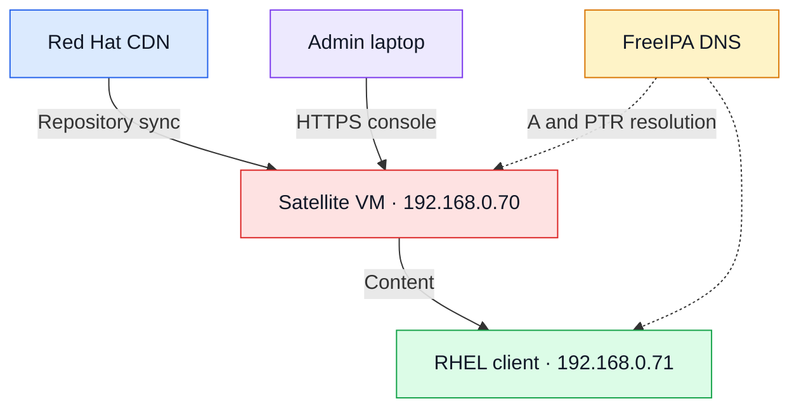

# Red Hat Satellite 6.19 — Evaluation VM Lab Guide

Checked against Red Hat documentation on 19 October 2026.

This walkthrough installs Satellite 6.19 on a fresh RHEL 9 x86_64 VM, opens the web console, imports a subscription manifest, synchronizes RHEL content, and registers one learning client. Commands are manual steps; execute each block on the host named above it. The commands have not been run against your VM.

## 1. Choose the evaluation

Red Hat offers a no-cost, self-supported 60-day RHEL trial that includes access to Satellite. It is a time-limited evaluation, rather than a permanently free Satellite edition. [1][2]

1. Open [Try Red Hat Enterprise Linux](https://www.redhat.com/en/technologies/linux-platforms/enterprise-linux/try).
2. Choose **Get the 60-day trial** and sign in or create a Red Hat account.
3. Complete the evaluation form and accept its terms. The trial starts when activated.
4. Check the trial/subscription details in your account and confirm Satellite access.
5. Download the latest available **RHEL 9 x86_64 Binary DVD ISO** from [Red Hat downloads](https://access.redhat.com/downloads/).

Use Satellite **6.19** with **RHEL 9** for this procedure. These RPM repository commands are specific to that combination. The documented Satellite 6.20 limited-availability program uses a different installation approach. [3][4]

An ordinary RHEL developer subscription should not be assumed to provide Satellite repository access. Confirm the evaluation entitlement. Any additional RHEL client VM must also be covered by an appropriate subscription for your lab use.

If you previously used this evaluation, Red Hat documents a waiting period of 90 days after its expiry before another evaluation of that product can be requested. [2]

## 2. Plan the VMs

Use a dedicated VM for Satellite. Keep your existing helper, DNS, DHCP, and cluster roles on their current hosts.

| Setting | Satellite VM | Test client VM |
|---|---|---|
| Example name | satellite.openhelp.net | rhelclient01.openhelp.net |
| Guest OS | Latest available RHEL 9 x86_64 | RHEL 9 x86_64 |
| vCPU | 4 | 2 |
| RAM | 24 GB | 4 GB |
| Virtual disk | 500 GB, preferably on SSD/NVMe | 30 GB |
| Swap | At least 4 GB | Installer default |
| Network | One adapter on the lab LAN | Same LAN |

Red Hat specifies at least **4 CPU cores, 20 GB RAM, and 4 GB swap** for Satellite 6.19. The 24 GB allocation above leaves a little margin. Its storage table budgets 300 GB for `/var/lib/pulp` for its reference workload; actual content growth depends on what you synchronize. [4]

A laptop with 32 GB total RAM can be tight once the host OS and other labs are running. Allocate resources that are actually available.

Suggested partitions on the Satellite virtual disk:

| Mount point | Suggested size | Type |
|---|---|---|
| `/boot` | 1 GiB | XFS |
| `/boot/efi` | 600 MiB, when using UEFI | EFI System Partition |
| `swap` | 4 GiB or more | Swap |
| `/` | 80 GiB | XFS on LVM |
| `/var/lib/pulp` | Remaining capacity, at least 300 GiB | XFS on LVM |

Keeping `/var/lib/pulp` on its own filesystem makes repository growth easier to manage. Avoid an automatic layout that puts most capacity into `/home`. An expanding virtual disk still needs real space on the laptop as repositories and snapshots grow.

## 3. Choose addresses and VM networking

The following are **example addresses**. Confirm they are unused and reserve/exclude them from your DHCP pool before assigning them. Replace the DNS server address with the current address of your FreeIPA/DNS server.

| Purpose | Example value |
|---|---|
| LAN | `192.168.0.0/24` |
| Gateway | `192.168.0.1` |
| FreeIPA/DNS server | `192.168.0.10` — verify your actual address |
| Satellite | `192.168.0.70/24` |
| Test client | `192.168.0.71/24` |
| Satellite URL | `https://satellite.openhelp.net` |
| Organization | `OPENHELP` |
| Location | `Warsaw-Lab` |

For this layout, select the physical network interface connected to the `192.168.0.0/24` LAN:

| Hypervisor | Adapter selection |
|---|---|
| VirtualBox | Settings → Network → Adapter 1 → **Bridged Adapter** → correct physical NIC → Cable Connected |
| VMware Workstation | VM Settings → Network Adapter → **Bridged** → map bridging to the correct physical NIC |

The Satellite VM must reach Red Hat over outbound HTTPS. The browser laptop and client VM must resolve and reach Satellite's FQDN. Do not put the example `192.168.0.x` address on an isolated network that has no path to that LAN.



## 4. Create the Satellite VM and install RHEL

On the laptop/hypervisor:

1. Create a new VM using the resources in section 2.
2. Attach the RHEL 9 DVD ISO. In VirtualBox, skip unattended installation so you can configure RHEL directly.
3. Boot the ISO and start the RHEL installer.
4. Choose **Minimal Install** without a graphical desktop or extra application roles.
5. Use custom storage and create the partitions listed above.
6. Configure the LAN adapter, static address, gateway, and DNS. Set the hostname to `satellite.openhelp.net`.
7. Set a root password and create an administrative user, for example `labadmin`, with administrator/sudo privileges.
8. Finish installation, detach the ISO, and reboot into the installed OS.
9. Log in and enter a root shell:

```bash
sudo -i
```

Satellite requires a fresh RHEL base installation dedicated to its services. [4]

## 5. Configure or verify the static network

**Run on Satellite.** If you already configured these values in the RHEL installer, verify them and skip the modification commands.

```bash
hostnamectl set-hostname satellite.openhelp.net
nmcli -f NAME,DEVICE connection show --active
ip -br address
ip route
```

Use the VM console for a network change. Replace the connection name below with the actual **NAME** shown by `nmcli`; it is not necessarily the interface name.

```bash
SAT_CONN='Wired connection 1'

nmcli connection modify "$SAT_CONN" \
  ipv4.method manual \
  ipv4.addresses 192.168.0.70/24 \
  ipv4.gateway 192.168.0.1 \
  ipv4.dns '192.168.0.10' \
  ipv4.ignore-auto-dns yes

nmcli connection up "$SAT_CONN"
```

Replace `192.168.0.10` with the DNS server that hosts or resolves your lab zone. Leave IPv6 defaults intact, including loopback `::1`.

## 6. Add forward and reverse DNS

**Run on your FreeIPA DNS server**, if you manage `openhelp.net` with FreeIPA. Otherwise create equivalent A and PTR records on your DNS service.

```bash
kinit admin

ipa dnsrecord-add openhelp.net satellite \
  --a-rec=192.168.0.70

ipa dnsrecord-add openhelp.net rhelclient01 \
  --a-rec=192.168.0.71
```

Check for the reverse zone:

```bash
ipa dnszone-show 0.168.192.in-addr.arpa.
```

Only if that reverse zone does not already exist, create it:

```bash
ipa dnszone-add 0.168.192.in-addr.arpa.
```

Then add the PTR records:

```bash
ipa dnsrecord-add 0.168.192.in-addr.arpa. 70 \
  --ptr-rec=satellite.openhelp.net.

ipa dnsrecord-add 0.168.192.in-addr.arpa. 71 \
  --ptr-rec=rhelclient01.openhelp.net.
```

If records already exist, inspect them and correct the existing record rather than adding conflicting addresses. The commands follow Red Hat's IdM DNS record syntax. [5]

**Back on Satellite**, verify basic resolution before registration:

```bash
hostname -f
getent ahostsv4 satellite.openhelp.net
getent hosts cdn.redhat.com
getent hosts subscription.rhsm.redhat.com
```

Expected Satellite hostname: `satellite.openhelp.net`; expected IPv4 address: `192.168.0.70`.

## 7. Register Satellite's RHEL OS with Red Hat

**Run on Satellite as root.**

Check whether the system is already registered:

```bash
subscription-manager identity
```

If it is not registered, register interactively using the account with the active evaluation:

```bash
subscription-manager register
```

Then refresh account content access:

```bash
subscription-manager refresh
subscription-manager identity
```

Keep the Satellite server registered to Red Hat's CDN. The later client-registration procedure is for the separate client VM; Satellite cannot register to itself. [6]

## 8. Enable exactly the repositories for Satellite 6.19 on RHEL 9

**Run on Satellite as root.**

```bash
subscription-manager repos --disable='*'

subscription-manager repos \
  --enable=rhel-9-for-x86_64-baseos-rpms \
  --enable=rhel-9-for-x86_64-appstream-rpms \
  --enable=satellite-6.19-for-rhel-9-x86_64-rpms \
  --enable=satellite-maintenance-6.19-for-rhel-9-x86_64-rpms

dnf clean all
dnf makecache
dnf repolist --enabled
```

All four repository IDs should appear. These are the repository IDs in the 6.19 connected-installation guide. [6]

If either Satellite repository is unavailable, stop here and check the active trial/account access:

```bash
subscription-manager refresh
subscription-manager repos --list
```

Confirm the account, evaluation status, RHEL major version, and architecture. Do not substitute community Foreman/Katello or another Satellite release's repositories into this installation.

With Simple Content Access, a subscription status label alone can be misleading. Successful identity, repository access, and metadata download are the useful checks; do not add an old `attach --auto` step as a generic fix.

## 9. Update RHEL and install preparation tools

**Run on Satellite as root.** This OS upgrade occurs before Satellite is installed.

```bash
dnf upgrade -y
reboot
```

Log back in, become root, and continue:

```bash
sudo -i
dnf install -y chrony firewalld bind-utils tmux
systemctl enable --now chronyd firewalld
localectl set-locale LANG=en_US.UTF-8
```

## 10. Complete the pre-installation checks

**Run on Satellite as root.**

```bash
cat /etc/redhat-release
uname -m
hostname -f
dig +short satellite.openhelp.net A
dig +short -x 192.168.0.70
getenforce
ip -6 address show dev lo
timedatectl
chronyc tracking
free -h
swapon --show
df -hT / /var/lib/pulp
```

Confirm:

- The OS is RHEL 9, architecture `x86_64`.
- Forward DNS returns `192.168.0.70`; reverse DNS returns `satellite.openhelp.net.`.
- SELinux is `Enforcing`.
- IPv6 loopback includes `::1`.
- NTP is synchronized; `chronyc tracking` has normal leap status.
- VM resources and filesystem capacity match the plan.

Fix time synchronization before installation if it is not working. If NTP is filtered, allow access to your chosen NTP source. Correct forward/reverse DNS is part of Red Hat's preparation procedure. [7]

## 11. Open the firewall for this lab's functions

**Run on Satellite as root.** This example uses external DNS and registers already installed RHEL clients. Additional provisioning features have their own port requirements.

Identify the zone assigned to the VM interface:

```bash
firewall-cmd --get-active-zones
```

Replace `public` below if the active interface uses another zone:

```bash
SAT_ZONE=public

firewall-cmd --permanent --zone="$SAT_ZONE" \
  --add-service=ssh \
  --add-service=http \
  --add-service=https \
  --add-port=8000/tcp \
  --add-port=9090/tcp

firewall-cmd --reload
firewall-cmd --zone="$SAT_ZONE" --list-all
```

Basic traffic paths:

| Source | Destination | Access |
|---|---|---|
| Browser laptop / client | Satellite | TCP 443; TCP 80 where needed for published/bootstrap content |
| Lab clients / components | Satellite | TCP 8000 and 9090 for applicable Satellite services |
| Satellite | Red Hat CDN and subscription service | TCP 443 |
| Satellite / client | DNS server | UDP/TCP 53 |
| Satellite / client | NTP source | UDP 123 |
| Admin laptop | Satellite / client | TCP 22 |

If you later enable provisioning, consult the full port matrix before adding DHCP, DNS, TFTP, or Puppet access. Opening a firewall port does not itself enable that server role. [7]

## 12. Install and configure Satellite

**Run on Satellite as root.**

```bash
dnf install -y satellite
tmux new -s satellite-install
```

Inside the `tmux` session, choose an admin password at the prompt:

```bash
read -rsp 'Choose the Satellite admin password: ' SAT_ADMIN_PASSWORD
echo

satellite-installer --scenario satellite \
  --foreman-initial-organization 'OPENHELP' \
  --foreman-initial-location 'Warsaw-Lab' \
  --foreman-initial-admin-username admin \
  --foreman-initial-admin-password "$SAT_ADMIN_PASSWORD"

SAT_INSTALL_RC=$?
unset SAT_ADMIN_PASSWORD
echo "Installer exit code: $SAT_INSTALL_RC"
```

Wait until the installer completes with exit code `0`. The password you entered is the Satellite web administrator password; it is separate from your RHEL and Red Hat account passwords. This installation uses local databases and the integrated Capsule. [6]

To detach from `tmux`, press **Ctrl+B**, release, then **D**. To reconnect:

```bash
tmux attach -t satellite-install
```

From a second terminal, monitor the installation:

```bash
tail -f /var/log/foreman-installer/satellite.log
```

Use `Ctrl+C` to leave the log viewer. If installation fails, inspect the first meaningful error before retrying. After fixing its cause, rerun the same installer configuration; do not delete databases or repeatedly rebuild without diagnosing the failure.

## 13. Verify services and open the web console

**Run on Satellite as root.**

```bash
satellite-maintain service status
hammer auth login
hammer ping
rpm -q satellite
```

For `hammer auth login`, supply username `admin` and the password chosen during installation. The session avoids having to place credentials into each command. [8]

`hammer ping` should show successful checks for the core services. Investigate any failed service before importing content. [9]

On the browser laptop, ensure `satellite.openhelp.net` resolves to `192.168.0.70`, then open:

[https://satellite.openhelp.net](https://satellite.openhelp.net)

Satellite initially uses its generated CA. To trust it in your browser, copy this **public CA certificate** from Satellite using your administrative account:

```bash
scp labadmin@satellite.openhelp.net:/var/www/html/pub/katello-server-ca.crt .
```

Import that certificate into the browser/OS certificate-authority trust store. Sign in as `admin` and select organization **OPENHELP** and location **Warsaw-Lab**. [10]

## 14. Create and import a subscription manifest

Registering Satellite's own OS enabled installation packages. A **manifest in the Satellite organization** enables its Red Hat content workflow.

In the [Red Hat Hybrid Cloud Console](https://console.redhat.com/):

1. Open **Services → Subscriptions and Spend → Manifests**.
2. Create a manifest, for example `OPENHELP-SATELLITE-LAB`.
3. Select the Satellite application type/version matching your installation.
4. Confirm that the relevant trial/RHEL subscriptions are available to that manifest. Follow any subscription-allocation step displayed for your account.
5. Export the manifest and download its ZIP file. [11]

In Satellite:

1. Set organization context to **OPENHELP**.
2. Open **Content → Subscriptions → Manage Manifest**.
3. Upload the exported ZIP file without unpacking it.
4. Confirm that the imported subscription/content information is present. [6]

If manifest creation is disabled, check your Hybrid Cloud Console subscription-administrator permissions and whether the Satellite evaluation is active. Repository access for the server and the ability to create a manifest are separate checks.

## 15. Enable and synchronize RHEL 9 repositories

In Satellite, under organization **OPENHELP**:

1. Open **Content → Red Hat Repositories**.
2. Enable **Red Hat Enterprise Linux 9 for x86_64 – BaseOS (RPMs)**, release **9**.
3. Enable **Red Hat Enterprise Linux 9 for x86_64 – AppStream (RPMs)**, release **9**.
4. Optionally enable **Red Hat Satellite Client 6 for RHEL 9 x86_64 (RPMs)** for later host integration tools.
5. Open **Content → Products**, select the relevant products/repositories, and synchronize them.
6. Check **Content → Sync Status** and wait for successful completion. [12][13]

Start with this small repository set. Do not synchronize every available RHEL release, architecture, source repository, and debug repository for an introductory lab.

If you choose an **On Demand** repository download policy, initial sync mostly downloads metadata; Satellite will still need upstream connectivity when an uncached package is requested. With an Immediate policy, packages are downloaded during synchronization.

## 16. Create a DEV environment, content view, and activation key

First create the lifecycle environment:

1. Open **Content → Lifecycle → Lifecycle Environments**.
2. Add a new environment path with an environment called **DEV**, following the built-in **Library** environment. [14]

Then create the content view:

1. Open **Content → Lifecycle → Content Views**.
2. Create **CV-RHEL9** using the standard content-view type.
3. Add the synchronized BaseOS and AppStream repositories, plus Satellite Client if you enabled it.
4. Publish the first version with a description such as `Initial RHEL 9 lab content`.
5. Promote that version to **DEV**. [15]

Finally create the activation key:

1. Open **Content → Lifecycle → Activation Keys**.
2. Create **AK-RHEL9-DEV**.
3. Assign content-view environment **DEV / CV-RHEL9**. If the create form does not offer the assignment, save the key, open its **Content view environments** card, and assign it there.
4. In **Repository Sets**, ensure BaseOS and AppStream are enabled for registering clients. Enable Satellite Client as well if you included it. [16]

The content view defines the published content snapshot. DEV is the environment receiving it. The activation key applies that content setup during client registration.

## 17. Install and register the test client

Create a separate small RHEL 9 VM from the ISO, using `192.168.0.71/24`, the same gateway/DNS, and hostname `rhelclient01.openhelp.net`. Create the `labadmin` user as on Satellite.

**Run on the client as root.**

```bash
sudo -i
hostnamectl set-hostname rhelclient01.openhelp.net
getent ahostsv4 satellite.openhelp.net
```

Trust Satellite's generated public CA by transferring it over SSH:

```bash
scp labadmin@satellite.openhelp.net:/var/www/html/pub/katello-server-ca.crt \
  /etc/pki/ca-trust/source/anchors/satellite-ca.crt

update-ca-trust
curl --head https://satellite.openhelp.net/users/login
```

The HTTPS check should succeed without a certificate-verification error. If your RHEL minimal image lacks `scp`, install `openssh-clients` from your RHEL media or authorized RHEL repositories first.

Use a freshly installed client that is not already registered elsewhere. If you intentionally migrate an existing disposable client, unregister that client from its previous service before registration; do not run that cleanup on Satellite.

In Satellite, generate the client registration command:

1. Open **Hosts → Register Host**.
2. Select organization **OPENHELP**, location **Warsaw-Lab**, and activation key **AK-RHEL9-DEV**.
3. Choose Satellite/the integrated Capsule as the content/registration source where prompted.
4. Leave optional Insights, remote-execution, and extra package setup disabled for this first registration unless you have configured their prerequisites.
5. Keep **Insecure** unchecked after installing the CA.
6. Generate the registration command.
7. Copy and run the generated command **as root on the client VM**. It contains an expiring registration token, so generate a fresh one if it expires. [17]

Use the command generated by your Satellite rather than copying a token or organization ID from somebody else's example.

## 18. Confirm that the client receives content from Satellite

**Run on the client as root.**

```bash
subscription-manager identity
subscription-manager refresh
subscription-manager repos --list-enabled
dnf repolist --enabled
dnf makecache
dnf install -y httpd
dnf updateinfo list security
```

Expected results:

- The client identity belongs to organization `OPENHELP`.
- BaseOS and AppStream are enabled.
- Repository metadata and the test package download successfully.
- The client appears under **Hosts → All Hosts** in Satellite with its assigned content-view environment.

To inspect repository origins:

```bash
dnf repoinfo
```

The managed Red Hat repository base URLs should point to your Satellite FQDN. The test installs Apache but does not start or expose a web service.

## 19. Useful CLI commands and lab shutdown

**Run on Satellite as root** after authenticating Hammer:

```bash
hammer auth login
hammer organization list
hammer location list
hammer host list --organization OPENHELP
hammer product list --organization OPENHELP
hammer repository list --organization OPENHELP
hammer content-view list --organization OPENHELP
hammer lifecycle-environment list --organization OPENHELP
hammer activation-key list --organization OPENHELP
satellite-maintain service status
```

Before a planned lab shutdown, allow active synchronization/publication tasks to finish. Stop the services, then power off the VM:

```bash
satellite-maintain service stop
systemctl poweroff
```

After starting the VM again:

```bash
satellite-maintain service start
satellite-maintain service status
hammer ping
```

For a simple lab checkpoint, take the VM snapshot while the guest is powered off. For ongoing maintenance and real backups, follow the Satellite administration guide. [9]

## 20. Troubleshooting reference

| Symptom | First checks |
|---|---|
| Satellite repository ID is unavailable | Correct Red Hat account, active Satellite evaluation, RHEL 9 x86_64, `subscription-manager refresh` |
| Installer rejects the hostname | `hostname -f`, forward A record, PTR record, configured resolver |
| SSL says expired or not yet valid | Guest time, timezone, NTP synchronization, host clock |
| Installer is killed or services repeatedly restart | RAM allocation, `free -h`, `swapon --show`, `journalctl -k` for out-of-memory messages |
| Web console cannot be reached | FQDN resolution on the laptop, bridge NIC selection, VM IP, firewalld zone and TCP 443 |
| Manifest creation is disabled | Evaluation status and Hybrid Cloud Console subscription-administrator role |
| Repositories are empty in Satellite | Correct organization and a valid imported manifest |
| Repository sync is denied | Manifest/content access, outbound CDN access, proxy configuration, clock |
| Client has no repositories | Activation-key repository overrides, completed sync, published/promoted content view, client environment assignment |
| Client rejects Satellite's certificate | Trust the public CA; confirm hostname and time |
| `/var/lib/pulp` fills up | Review repository scope and content-retention settings; add capacity rather than manually deleting Pulp data |

Satellite diagnostics:

```bash
satellite-maintain service status
hammer ping
systemctl --failed
tail -n 100 /var/log/foreman-installer/satellite.log
journalctl -b -p err --no-pager
df -h
free -h
```

## 21. Suggested learning exercises

Once installation and the first client are working:

1. Create TEST and PROD after DEV in the same lifecycle path.
2. Publish a second content-view version and promote it through those environments.
3. Compare available packages and errata before and after promotion.
4. Add a second authorized RHEL client with a different activation key.
5. Configure and test remote execution.
6. Explore host groups and provisioning on a dedicated lab subnet.
7. Practice backup and recovery using the administration guide.

For a community option without the Satellite evaluation period, explore **Foreman with Katello**. It is a separate upstream software installation; the Satellite package/repository procedure above does not apply to it. Red Hat content still requires appropriate access. [18]

## Official references

1. [Red Hat RHEL trial, including Satellite access](https://www.redhat.com/en/technologies/linux-platforms/enterprise-linux/try)
2. [Red Hat: obtaining an evaluation Satellite subscription](https://access.redhat.com/solutions/449923)
3. [Satellite 6.19 release information](https://access.redhat.com/articles/1365633) and [Satellite product/program information](https://www.redhat.com/en/technologies/management/satellite)
4. [Satellite 6.19 operating system, hardware, and storage requirements](https://docs.redhat.com/en/documentation/red_hat_satellite/6.19/html/installing_satellite_server_in_a_connected_network_environment/planning-satellite-server-installation_satellite)
5. [RHEL 9: working with DNS in Identity Management](https://docs.redhat.com/en/documentation/red_hat_enterprise_linux/9/html-single/working_with_dns_in_identity_management/index)
6. [Satellite 6.19 repositories, installation, and manifest import](https://docs.redhat.com/en/documentation/red_hat_satellite/6.19/html/installing_satellite_server_in_a_connected_network_environment/installing-satellite-server)
7. [Satellite 6.19 firewall and DNS preparation](https://docs.redhat.com/en/documentation/red_hat_satellite/6.19/html/installing_satellite_server_in_a_connected_network_environment/preparing-your-environment-for-satellite-server-installation)
8. [Hammer authentication](https://docs.redhat.com/en/documentation/red_hat_satellite/6.19/html/using_the_hammer_cli_tool/hammer-authentication)
9. [Satellite 6.19 administration](https://docs.redhat.com/en/documentation/red_hat_satellite/6.19/html-single/administering_red_hat_satellite/index)
10. [Web console access and CA certificate](https://docs.redhat.com/en/documentation/red_hat_satellite/6.19/html/configuring_authentication_for_red_hat_satellite_users/accessing-satellite-from-web-ui)
11. [Creating and managing connected Satellite manifests](https://docs.redhat.com/en/documentation/subscription_central/1-latest/html-single/creating_and_managing_manifests_for_a_connected_satellite_server/index)
12. [Adding Red Hat content](https://docs.redhat.com/en/documentation/red_hat_satellite/6.19/html/managing_content/adding-content-to-satellite)
13. [Synchronizing repositories](https://docs.redhat.com/en/documentation/red_hat_satellite/6.19/html/managing_content/synchronizing-content-to-satellite)
14. [Lifecycle environments](https://docs.redhat.com/en/documentation/red_hat_satellite/6.19/html/managing_content/managing_application_lifecycles_content-management)
15. [Content views](https://docs.redhat.com/en/documentation/red_hat_satellite/6.19/html/managing_content/managing-content-views-and-content-view-environments)
16. [Activation keys](https://docs.redhat.com/en/documentation/red_hat_satellite/6.19/html/managing_content/managing_activation_keys_content-management)
17. [Global host registration](https://docs.redhat.com/en/documentation/red_hat_satellite/6.19/html/managing_hosts/registering-hosts-to-satellite)
18. [Foreman community project](https://www.theforeman.org/)
