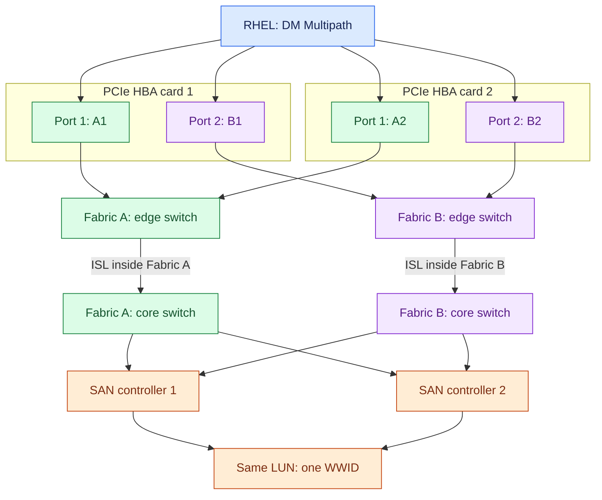
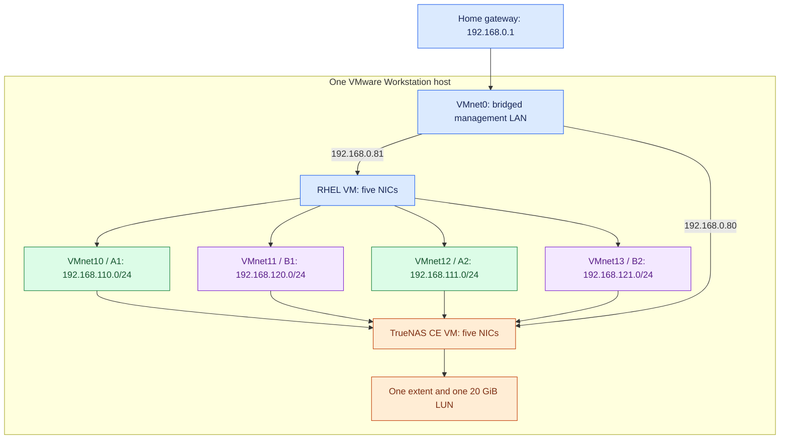
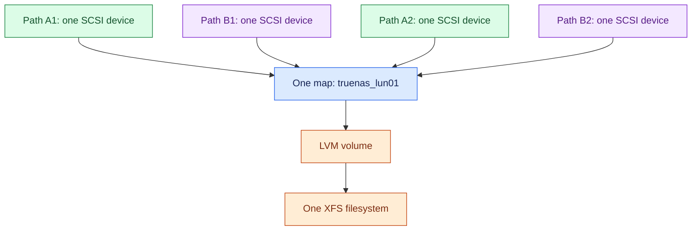

# VMware Workstation: TrueNAS and RHEL 9 four-path SAN lab — version 2.0

**Prepared:** 22 October 2026  
**Edition:** 2.0 — VMware Workstation Pro; two VMs on one physical Workstation host.  
**Addressing revision:** your LAN gateway is `192.168.0.1`; management uses `192.168.0.0/24`, and the four isolated storage paths use separate `192.168.x.0/24` subnets.  
**Lab software:** VMware Workstation Pro on a Windows or Linux host, TrueNAS Community Edition 25.10.7, and RHEL 9.x; x86_64 guests  
**Style:** manual commands, GUI steps, expected results, colour Mermaid diagrams  
**Validation:** vendor documentation reviewed; 63 shell examples syntax-checked; IP/NIC/portal mappings, image links and bundle contents checked. The VMs and physical SAN have not been deployed or exercised by the author.

The ZIP includes this Markdown and **three JPGs**: the Workstation lab topology, the Workstation network-settings reference, and the production FC reference. Extract the entire ZIP, keeping `images/` next to this document. The original image filenames are retained so existing GitHub image references can continue to work after you upload the updated files. Self-contained colour Mermaid source is also included.

## 0. Workstation scope and checks before you start

This edition provides one practical procedure for **VMware Workstation Pro**. Sections **5–19** build and test the two-VM iSCSI lab. Sections **2 and 20–23** retain the separate physical FC production reference; they are not additional Workstation configuration steps.

An issue-free result cannot be guaranteed for an unseen laptop, Workstation release or guest installation. The procedure instead gives explicit checks at each stage. Continue only when the preceding check passes, and record the installed versions and observed results in Section 25.

1. Run both VMs on **the same Workstation host**. Four local host-only VMnets do not connect automatically to VMs on another laptop.
2. Record **Help → About VMware Workstation**. Use an installation with **Virtual Network Editor**, custom VMnets and support for the five adapters required per VM [S12, S18].
3. Allocate 8 GiB RAM to TrueNAS and 4 GiB to RHEL, while retaining enough memory for the host OS and other running VMs. Those guests alone need 12 GiB. A 16 GiB host needs other large VMs stopped; 24–32 GiB is more comfortable.
4. Enable normal CPU virtualization in the host firmware as required to run 64-bit VMs. **Nested virtualization is not needed** for this storage lab.
5. Confirm the host's active LAN really is `192.168.0.0/24`, with gateway `192.168.0.1`. Reserve unused addresses `.80` and `.81` before assigning them to the VMs.
6. Confirm VMnet10–13 and the four storage subnets in Section 4 are unused. Preserve networks belonging to your existing OpenShift/OpenStack labs. Do not use **Restore Defaults** in Virtual Network Editor.
7. Use fresh, empty lab disks. If the earlier lab already contains data, keep its pool, zvol, extent, IQN, disk WWID and filesystem. This document revision does not require recreating or formatting them; apply the Workstation network checks and then verify the existing storage.

| Where an action runs | Actions in this guide |
|---|---|
| Workstation host GUI | Virtual Network Editor; create VMs/VMDKs; attach five adapters; disconnect a selected virtual cable |
| TrueNAS VM console / web UI | Install TrueNAS, assign NIC addresses, create pool/zvol/target/extent and enable iSCSI |
| RHEL VM console / root shell | Install packages, configure NetworkManager/iSCSI/multipath/LVM/XFS and run checks |
| Physical SAN equipment only | FC HBA inventory, Cisco MDS switch CLI, Enterprise FC setup in Sections 20–23 |

Linux guest commands are not commands for the Workstation host's Windows PowerShell. Use the RHEL console or an SSH login to RHEL, and obtain a root shell with `sudo -i` where required.

## 1. Read this distinction first

Your requested physical server design is valid:

**Two separate dual-port FC HBA cards = four FC initiator ports = four host WWPNs.**

However, a normal TrueNAS Community Edition VM and four virtual Ethernet adapters cannot reproduce those physical FC ports. The official TrueNAS documentation makes FC target functionality an Enterprise-licensed feature requiring suitable FC hardware. The version-specific UI and appliance support also matter. See [S1], [S2] and [S3].

This guide therefore supplies two clearly labelled routes:

| Route | What you actually build | Identifiers on the RHEL host | Result |
|---|---|---|---|
| **A: VMware Workstation lab — start here** | TrueNAS CE exports one iSCSI LUN over four host-only VMnets to a second RHEL VM on the same Workstation host | One initiator IQN, four interface bindings, four sessions, one disk WWID | A working four-path DM Multipath exercise |
| **B: actual FC hardware** | Two physical dual-port FC HBA cards, two independent fabrics, FC switches, and a supported FC target such as licensed TrueNAS Enterprise | Four host WWPNs; one LUN WWID | Real FC multipathing; eight paths in the illustrated target-port layout |

**Route A teaches storage multipathing. It does not create four FC WWPNs or test FC zoning.** Renaming four virtual NICs to “HBA1/HBA2” would not change their protocol.

The free VM lab has one TrueNAS VM. Its four paths do not provide storage-controller HA, hypervisor HA or disaster recovery. Route B shows the separate production architecture.

### 1.1 What bonding does here

| Technology | Joins or manages | Linux result |
|---|---|---|
| Ethernet bonding | Ethernet NIC links | A network interface such as `bond0` |
| DM Multipath | Paths to the same block-storage LUN | A block device such as `/dev/mapper/truenas_lun01` |

Keep the four dedicated storage NICs separate in Route A. TrueNAS recommends multipath rather than LACP/LAGG for iSCSI [S4]. Ethernet bonds used for application or management traffic are a separate part of a production server.

### 1.2 Contents and order

1. Sections 0 and 3–4: check the Workstation scope, lab topology and address plan. Section 2 is the physical FC comparison.
2. Sections 5–7: create the virtual networks and install the two VMs.
3. Sections 8–10: configure RHEL networking and the TrueNAS block share.
4. Sections 11–15: bind four iSCSI paths, configure multipathing, and create a filesystem.
5. Sections 16–19: test failover, reboot persistence, troubleshooting, and shutdown.
6. Sections 20–23: optional reference for a separate physical RHEL/FC SAN; do not execute these as Workstation lab steps.
7. Sections 24–26: interview reference, completion record, and sources.

## 2. Production reference: four FC ports and multiple FC switches

This is a storage-only view of a critical Linux server. Ethernet ToR switches, application bonds, client networks and management networks are omitted so they cannot be confused with FC switches.


### 2.1 Physical inventory

| Item | Example quantity | Purpose |
|---|---:|---|
| Linux server | 1 shown | Runs the application and DM Multipath |
| Dual-port FC HBA card | 2 | Four host FC ports; card failure does not remove every path |
| FC fabric | 2 | Independent failure domains, called A and B |
| FC switch | 4 | Edge and core switch in each fabric |
| HA SAN controller | 2 | Each presents the same LUN through a port in each fabric |
| LUN | 1 shown | One logical disk with one persistent WWID |

For a small SAN, one switch per fabric is sufficient to illustrate dual-fabric redundancy. The expanded reference below uses two switches per fabric to show a genuine multi-switch layout. Additional switches do not, by themselves, create additional Linux SCSI paths.



**An ISL is an inter-switch link inside one fabric. Fabric A and Fabric B are not joined in this reference.** FC switch meshing, when used, is designed within a fabric; it is not a replacement for keeping the two fabrics independent [S5, S15, S16].

### 2.2 Host cabling and host WWPN count

| Host card and port | Name in this guide | Fabric | Unique host WWPN |
|---|---|---|---|
| HBA card 1, port 1 | A1 | A | WWPN-A1 |
| HBA card 1, port 2 | B1 | B | WWPN-B1 |
| HBA card 2, port 1 | A2 | A | WWPN-A2 |
| HBA card 2, port 2 | B2 | B | WWPN-B2 |

The target has four target ports: controller 1/A, controller 1/B, controller 2/A and controller 2/B. These have their own target WWPNs; they are not extra host WWPNs.

### 2.3 Why this reference has eight paths, not four

Each of the four host ports can reach one target port on each controller in its fabric:

| Path | Host port | Switch route | Target port | Disk |
|---|---|---|---|---|
| 1 | A1 | A-edge → A-core | Controller 1/A | Same LUN |
| 2 | A1 | A-edge → A-core | Controller 2/A | Same LUN |
| 3 | A2 | A-edge → A-core | Controller 1/A | Same LUN |
| 4 | A2 | A-edge → A-core | Controller 2/A | Same LUN |
| 5 | B1 | B-edge → B-core | Controller 1/B | Same LUN |
| 6 | B1 | B-edge → B-core | Controller 2/B | Same LUN |
| 7 | B2 | B-edge → B-core | Controller 1/B | Same LUN |
| 8 | B2 | B-edge → B-core | Controller 2/B | Same LUN |

**Four host WWPNs and eight paths are consistent.** Path count depends on initiator ports, visible target ports and LUN mapping. A different zoning or target-port design can give a different count. The host OS and array must support the selected count.

### 2.4 Failure behaviour in this reference

| Failure | Remaining connectivity |
|---|---|
| HBA card 1 | HBA card 2 retains A2 and B2: four of eight paths |
| One FC edge/core switch or its only ISL in Fabric A | Fabric B retains four paths |
| One SAN controller | The other controller retains four paths |
| One host FC cable | Three initiator ports retain six paths |
| Entire server | Requires an application/OS cluster peer; multipathing cannot replace the server |
| Entire SAN array/site | Requires a separate replication/DR design |

These are topology counts, not promises of zero interruption. ALUA state, controller takeover and vendor timeout settings determine actual recovery behaviour. An HA server pair also needs quorum/fencing and controlled shared-disk access [S17].

## 3. Free VM lab: the four independent iSCSI paths you can build now

Run `TrueNAS-SAN` and `RHEL-SAN01` on **one VMware Workstation host**. Adapter 1 of each VM uses **Custom: VMnet0**, bridged to your home LAN. Adapters 2–5 use **Custom: VMnet10, VMnet11, VMnet12 and VMnet13**, respectively. The four storage networks are local host-only Ethernet switches implemented by Workstation.




The A/B labels are learning labels. These are four Ethernet virtual networks, not four FC switches. Four separate subnets avoid ambiguous routing and the TrueNAS restriction against separate interfaces on the same subnet [S4]. VMnet0 carries management/internet traffic; iSCSI binds only to the four storage addresses. Workstation supplies the virtual switches, so no managed physical switch, VLAN trunk, LACP or physical FC HBA is required for Route A.

### 3.1 What corresponds and what does not

| Production FC concept | VM-lab counterpart | Difference |
|---|---|---|
| Four physical FC initiator ports | Four RHEL Ethernet vNICs | vNICs have MAC/IP addresses, not FC WWPNs |
| Two physical HBA cards | No equivalent physical card separation | All virtual NICs may depend on one host |
| A/B fabric connectivity | A1/A2 and B1/B2 logical path groups | Group outage is simulated by disabling two NICs |
| FC zoning | IQN ACL, CHAP and isolated networks | Different access-control mechanisms |
| FC initiator login | iSCSI session login | Different transport protocol |
| One LUN reached by several paths | One iSCSI LUN reached by four sessions | Same DM Multipath learning objective |
| Two HA SAN controllers | One TrueNAS VM | No controller failover exercise |
| Eight paths in Section 2 | Four paths in this lab | Each initiator connects to one target portal |

Do not create four separate zvols or four independent extents. Four different disks will have different WWIDs and must not be combined as if they were paths to one disk.

## 4. Addressing, names and VM sizing

**Your home LAN:** this revision uses your gateway `192.168.0.1` and assumes a LAN mask of `255.255.255.0` (`/24`). Check the router's actual mask before applying the examples. Both VMs use Adapter 1 for management and internet access on that LAN.

All lab addresses now begin with `192.168`. With a `/24` mask, the third number identifies the subnet: `192.168.0.x` is your home LAN, while `192.168.110.x`, `192.168.120.x`, `192.168.111.x` and `192.168.121.x` are four different storage subnets. Keep the storage subnets on their own **Workstation host-only VMnets**. TrueNAS requires separate subnets for these separate interfaces [S4].

You do not need extra routers or gateways such as `192.168.110.1` for this lab. RHEL and TrueNAS talk directly on each storage network. Set `192.168.0.1` as the management default gateway on both VMs; leave the gateway blank on every storage interface. The physical FC reference uses WWPNs for storage paths, so these IP changes apply to the Ethernet/iSCSI lab.

### 4.1 Host and service names

| Item | Value |
|---|---|
| TrueNAS VM name | `TrueNAS-SAN` |
| TrueNAS hostname | `truenas01.openhelp.net` |
| RHEL VM name | `RHEL-SAN01` |
| RHEL hostname | `rhel-san01.openhelp.net` |
| TrueNAS management IP | `192.168.0.80/24` |
| RHEL management IP | `192.168.0.81/24` |
| Management subnet / mask | `192.168.0.0/24` / `255.255.255.0` — assumed; verify on your router |
| Management gateway | `192.168.0.1` — your LAN router, used by Adapter 1 on both VMs |
| Management DNS | Your working LAN DNS; `192.168.0.10` only if your FreeIPA DNS actually uses it. Use `192.168.0.1` only if your router provides DNS forwarding. |
| RHEL initiator IQN | `iqn.2026-10.net.openhelp:rhel-san01` |
| TrueNAS target basename | `iqn.2026-10.net.openhelp:truenas01` |
| Target short name | `rhel-lun01` |
| Full target IQN | `iqn.2026-10.net.openhelp:truenas01:rhel-lun01` |
| Portal group description | `rhel-four-path-portals` |
| Extent | `rhel-lun01-extent` |
| Pool / zvol | `sanpool/rhel_lun01` |
| iSCSI LUN ID | `0` |
| Linux multipath alias | `truenas_lun01` |

The VM management addresses `192.168.0.80` and `192.168.0.81` are suggested static addresses, not addresses assigned automatically by this document. Confirm both are unused and reserve them or exclude them from your router's DHCP pool. Confirm that the four storage subnets do not overlap your LAN, VPN or existing virtual networks. IQN strings are identifiers; DNS resolution does not establish an iSCSI session. Copy the actual target IQN displayed by your TrueNAS system if it differs.

### 4.2 Four storage paths

| Workstation hardware label | Role | Select Custom network in BOTH VMs | TrueNAS IP | RHEL IP | Mask / gateway |
|---|---|---|---|---|---|
| Network Adapter | Management | VMnet0 — bridged | `192.168.0.80` | `192.168.0.81` | `/24`; gateway `192.168.0.1` |
| Network Adapter 2 | A1 | VMnet10 — host-only | `192.168.110.10` | `192.168.110.20` | `/24`; no gateway |
| Network Adapter 3 | B1 | VMnet11 — host-only | `192.168.120.10` | `192.168.120.20` | `/24`; no gateway |
| Network Adapter 4 | A2 | VMnet12 — host-only | `192.168.111.10` | `192.168.111.20` | `/24`; no gateway |
| Network Adapter 5 | B2 | VMnet13 — host-only | `192.168.121.10` | `192.168.121.20` | `/24`; no gateway |

Adapter 1 is management: TrueNAS `192.168.0.80/24`, RHEL `192.168.0.81/24`, and gateway `192.168.0.1` on both. Give storage NICs **no default gateway and no DNS settings**. They use directly connected routes. Keep MTU 1500 throughout this first exercise.

| Network | Subnet | Gateway | Connection type |
|---|---|---|---|
| Management / internet | `192.168.0.0/24` | `192.168.0.1` | Adapter 1, bridged to your home LAN |
| Storage A1 | `192.168.110.0/24` | None | Adapter 2, isolated VMnet10 |
| Storage B1 | `192.168.120.0/24` | None | Adapter 3, isolated VMnet11 |
| Storage A2 | `192.168.111.0/24` | None | Adapter 4, isolated VMnet12 |
| Storage B2 | `192.168.121.0/24` | None | Adapter 5, isolated VMnet13 |

### 4.3 VM resources

| Resource | TrueNAS-SAN | RHEL-SAN01 |
|---|---|---|
| vCPU | 2 | 2 |
| RAM | 8 GiB minimum; 16 GiB useful if available | 4 GiB |
| OS disk | 32 GiB SATA VMDK | 40 GiB SATA VMDK |
| Data virtual disks attached directly | Two empty 60 GiB SATA VMDKs | None: data arrives through iSCSI |
| Network adapters | 5 | 5 |
| ISO | TrueNAS CE 25.10.7, matching this guide's stable documentation | RHEL 9.x installation ISO |
| Workstation guest type | Linux → Debian 64-bit option, following [S3] | Linux → Red Hat Enterprise Linux 9 64-bit |
| Firmware for this fresh lab | BIOS before OS installation, following [S3] | BIOS for this example; keep the installed firmware unchanged |

Create a mirror from the two TrueNAS data disks and a 20 GiB zvol. A mirror of two virtual disks on one physical laptop disk teaches pool configuration, but it does not survive loss of that laptop disk.

The TrueNAS software-status page listed 25.10.7 for General use when checked for this guide [S2]. Recheck it before downloading a later release. The official installation guide supports VM installation with a separate boot disk and data disk [S3].

## 5. VMware Workstation: create the networks and both VMs

**Location: VMware Workstation host GUI.** Complete these steps with the lab VMs powered off, not suspended. Workstation's **Custom: Specific virtual network** option attaches a VM NIC to the exact VMnet you select [S12].


### 5.1 Record existing settings

1. Open **Edit → Virtual Network Editor**.
2. On Windows, use **Change Settings** when shown to obtain administrative rights. On Linux, use the editor's required administrator authentication.
3. Record existing VMnet names, subnets and bridge assignments. Preserve VMnet1, VMnet8 and networks used by other labs.
4. Confirm VMnet10, VMnet11, VMnet12 and VMnet13 are free. If a number is already in use, choose an unused custom VMnet and change that path's attachment consistently in **both VMs** and your worksheet. The IP subnets below can remain the same only if they too are unused.
5. Do not click **Restore Defaults**: it can replace networks used by your existing VMs.

### 5.2 Configure VMnet0 for your LAN

1. Select **VMnet0**.
2. Set its type to **Bridged**.
3. In **Bridged to**, select the actual host Ethernet or Wi-Fi uplink that reaches `192.168.0.1`; avoid Automatic selection for this lab.
4. Keep the home LAN mask `255.255.255.0` as assumed in this guide. A bridged VMnet gets its LAN addressing from your guest/router configuration; do not create a new NAT subnet called `192.168.0.0/24`.
5. Apply the setting. If VMnet0 was already bridged correctly, retain that working assignment.

The `.80`/`.81` guest management addresses belong directly to your LAN. The default Workstation NAT VMnet8 has a different gateway/address plan and is not used here [S12]. If wireless bridging fails on your host/AP, diagnose VMnet0 or use a working wired LAN bridge before continuing.

### 5.3 Add four isolated host-only VMnets

For each row below, click **Add Network**, choose its VMnet number, and set the row's values:

| VMnet | Type in Virtual Network Editor | Subnet IP | Subnet mask | Local DHCP | Connect a host virtual adapter |
|---|---|---|---|---|---|
| VMnet10 | Host-only | `192.168.110.0` | `255.255.255.0` | Unchecked / off | Unchecked / off |
| VMnet11 | Host-only | `192.168.120.0` | `255.255.255.0` | Unchecked / off | Unchecked / off |
| VMnet12 | Host-only | `192.168.111.0` | `255.255.255.0` | Unchecked / off | Unchecked / off |
| VMnet13 | Host-only | `192.168.121.0` | `255.255.255.0` | Unchecked / off | Unchecked / off |

1. Select **Host-only** for VMnet10.
2. Enter its subnet and mask from the table.
3. Clear **Use local DHCP service to distribute IP addresses to VMs**.
4. Clear **Connect a host virtual adapter to this network**. Guest-to-guest traffic still uses this VMnet; the laptop does not need an IP on it.
5. Repeat for VMnet11–13, then **Apply → OK**.

No gateway/NAT is configured for these storage VMnets. No physical NIC is bridged to them. No physical VLAN configuration is needed for two VMs on this one Workstation host. The storage traffic stays within Workstation.

**Check 1:** Virtual Network Editor shows one bridged VMnet0 plus four distinct host-only subnets; DHCP is off on all four storage VMnets.

### 5.4 Create TrueNAS-SAN

1. Choose **File → New Virtual Machine** and use the Custom wizard or the equivalent configuration screens in your installed Workstation release.
2. Select **I will install the operating system later**. This avoids an unattended installation path that does not match the TrueNAS installer.
3. Choose **Linux** and an available **Debian 64-bit** guest profile. The TrueNAS 25.10 VM guide gives Debian 11 64-bit as its example [S3]. The OS actually installed comes from the TrueNAS CE ISO.
4. Name the VM **TrueNAS-SAN** and choose a host directory with enough free space for its VMDKs.
5. Assign **2 vCPUs** and **8192 MiB RAM** minimum. Leave nested CPU virtualization options off; this VM exports storage rather than running nested VMs.
6. At the virtual disk type screen, select **SATA**, then create a **new 32 GiB OS VMDK**. This lab uses SATA VMDKs with BIOS firmware. Finish without starting the VM.
7. Open **VM → Settings → Options → Advanced** and select **BIOS** firmware for this fresh TrueNAS installation, as documented in [S3]. Do this before installing the OS; do not flip firmware mode on an installed guest.
8. Under **Hardware → Add → Hard Disk**, select **SATA** and add **two new, separate 60 GiB VMDKs** for the future ZFS mirror. Keep the boot disk separate. Growable VMDKs are acceptable for learning; monitor the host filesystem's free space as they grow.
9. Under **CD/DVD**, select the TrueNAS CE 25.10.7 ISO and enable **Connect at power on**.
10. Select the existing **Network Adapter**. Choose **Custom: Specific virtual network → VMnet0**.
11. Use **Hardware → Add → Network Adapter** four times. Select VMnet10 for **Network Adapter 2**, VMnet11 for **3**, VMnet12 for **4**, and VMnet13 for **5**.
12. For all five adapters, enable **Connect at power on**. After powering on, verify **Connected** is selected too. Some Workstation releases make Connected meaningful only while the VM is running.
13. On each adapter, open **Advanced** and record its generated MAC address. Keep each MAC unique. If the field is generated at first boot, record it then; do not guess the MAC or the Linux interface name.

Expected TrueNAS inventory: **32 GiB + 60 GiB + 60 GiB VMDKs; 5 network adapters**. A Workstation virtual SCSI disk controller is not an FC HBA and does not create FC WWPNs.

### 5.5 Create RHEL-SAN01

1. Create a second VM with **I will install the operating system later**.
2. Choose **Linux → Red Hat Enterprise Linux 9 64-bit**, name **RHEL-SAN01**, and allocate **2 vCPUs / 4096 MiB RAM**.
3. At the disk type screen, select **SATA** and create one **new 40 GiB OS VMDK**. Do not add data VMDKs; the practice data disk will arrive through iSCSI.
4. Use **BIOS** firmware for this example before installation. Attach the RHEL 9 ISO to CD/DVD and enable **Connect at power on**.
5. Attach **Network Adapter → Custom: VMnet0**.
6. Add Network Adapter 2–5 and map them to **VMnet10, VMnet11, VMnet12, VMnet13 in that exact order**, matching TrueNAS.
7. Enable **Connect at power on** on all five adapters, verify Connected after boot, and record each MAC in Advanced.

**Check 2:** Each VM has five NICs. The same numbered adapter in the two VMs reaches the same VMnet, but the two NICs have different MAC addresses. You have not selected the generic Host-only radio option for every storage NIC: that often attaches all of them to the default VMnet1 instead of four separate networks.

### 5.6 Fill the MAC-to-interface worksheet

| VM | Workstation adapter | VMnet | Role | MAC from Workstation | Actual guest interface |
|---|---|---|---|---|---|
| TrueNAS-SAN | Network Adapter | VMnet0 | Management | Fill in | Fill in |
| TrueNAS-SAN | Network Adapter 2 | VMnet10 | A1 | Fill in | Fill in |
| TrueNAS-SAN | Network Adapter 3 | VMnet11 | B1 | Fill in | Fill in |
| TrueNAS-SAN | Network Adapter 4 | VMnet12 | A2 | Fill in | Fill in |
| TrueNAS-SAN | Network Adapter 5 | VMnet13 | B2 | Fill in | Fill in |
| RHEL-SAN01 | Network Adapter | VMnet0 | Management | Fill in | Fill in |
| RHEL-SAN01 | Network Adapter 2 | VMnet10 | A1 | Fill in | Fill in |
| RHEL-SAN01 | Network Adapter 3 | VMnet11 | B1 | Fill in | Fill in |
| RHEL-SAN01 | Network Adapter 4 | VMnet12 | A2 | Fill in | Fill in |
| RHEL-SAN01 | Network Adapter 5 | VMnet13 | B2 | Fill in | Fill in |

After installing each guest, compare `ip -br link` with these MACs. Workstation guest interfaces can be called `ens33`, `ens37`, `ens38`, `ens39`, `ens40` or something else. Names and numbering depend on the VM hardware layout; **only the MAC match identifies the intended adapter**.

Do not hot-remove or reorder adapters after binding iSCSI sessions to them. If you change VM hardware or clone a VM, repeat this worksheet and check both network profiles and initiator identity.

### 5.7 Host preparation for the failover exercise

Keep the Workstation host awake during installation and tests. Sleep/suspend stops both guests together, which is not a single-path failure. Maintain enough host disk space for the growable VMDKs and avoid pausing or taking/reverting independent storage/client VM snapshots while the shared LUN is mounted. The normal lab shutdown/startup order is in Section 19.

### 5.8 Expose TrueNAS virtual disk identifiers

Set this before creating the data pool. VMware virtual disks can otherwise have missing/duplicate serial numbers in the guest. TrueNAS recommends exposing unique virtual disk identifiers where possible [S20].

1. Ensure **TrueNAS-SAN is Powered Off**, not suspended. Close its settings window and tab.
2. In the host's file manager, open the VM directory you selected in Section 5.4. Locate the actual **`.vmx` configuration file**, normally `TrueNAS-SAN.vmx`. Enable filename extensions on Windows so it is not confused with a VMDK or `.vmx.txt`.
3. Make a backup copy of this `.vmx` file. Open the original in a plain-text editor on the Workstation host.
4. Find an existing `disk.EnableUUID` entry and change it to the value below; if absent, add it once. Keep straight quotation marks and do not leave conflicting duplicate entries:

```ini
disk.EnableUUID = "TRUE"
```

5. Save the file. Reload this VM configuration in Workstation before powering it on. Broadcom documents reopening Workstation or opening the edited `.vmx` to load its changes [S21]. This does not create an FC HBA or change an existing TrueNAS iSCSI extent's NAA identifier.
6. After installing TrueNAS, verify disk identities in **Storage → Disks** before building the mirror. Prefer two data disks with distinct, non-empty serials. Section 9.2 covers the documented lab-only UI option if the virtual disks still lack unique serials.

Do not edit a running VM's `.vmx` file, invent new serials for an established pool, or modify TrueNAS middleware code to bypass validation.

## 6. Install TrueNAS in VMware Workstation and set management access

**Location: TrueNAS-SAN Workstation console, then its web UI.**

1. Obtain the TrueNAS CE 25.10.7 installer from the official [TrueNAS download page](https://www.truenas.com/download-truenas-community-edition/); verify its published checksum. Confirm this is the Linux-based CE release used by this guide.
2. Power on `TrueNAS-SAN`. If it does not boot the ISO, check CD/DVD → Use ISO image / Connected and use Workstation's **Power On to Firmware** or its boot menu to choose the virtual CD/DVD.
3. Select **Install/Upgrade**, then choose **only the 32 GiB OS disk**. The two 60 GiB data disks must remain unselected.
4. Complete the administrator and password prompts shown by that release. Record the actual administrator username rather than assuming it is `root` or `admin`.
5. Use the **BIOS** boot/install choice if the installer asks, matching the Workstation VM firmware configured in Section 5.
6. Finish installation, shut the VM down as directed by the installer, disconnect the ISO in Workstation's CD/DVD settings and start the VM from its OS VMDK.
7. In the TrueNAS console, match the management NIC to **Network Adapter / VMnet0 by MAC**. Use the console's **Open Linux Shell** action if necessary to inspect NICs with the read-only command below; console menu numbers can vary:

```bash
ip -br link
```

8. Return to the console network setup and set only that management interface to static **`192.168.0.80/24`**. Leave DHCP off on the four storage NICs. Their static addresses will be configured in Section 9.
9. In global network settings, set **IPv4 default gateway `192.168.0.1`** and a reachable LAN DNS server. Use `192.168.0.10` only if that is your working FreeIPA DNS; use the router as DNS only if it forwards DNS requests.
10. Open **`https://192.168.0.80`** from the Workstation host. Complete the first-login flow and the initial self-signed-certificate exception if presented.
11. Set hostname `truenas01`, domain `openhelp.net`, your time zone and working time synchronisation. Record the installed release.

**Check 3:** The browser reaches TrueNAS over VMnet0 at `.80`. Workstation's four storage adapters are present and mapped by MAC. No iSCSI service or LUN is required yet. If management fails, troubleshoot VMnet0/bridge/IP/DNS first; changing storage subnets will not repair a management bridge.

## 7. Install RHEL 9 in VMware Workstation and confirm management

**Location: RHEL-SAN01 Workstation console; root shell after installation.**

1. Boot the RHEL 9 ISO and install onto the **40 GiB local OS VMDK**.
2. In the installer's network screen, identify **Network Adapter / VMnet0 by MAC**. Configure address `192.168.0.81`, prefix `24`, gateway `192.168.0.1`, a working LAN DNS server and hostname `rhel-san01.openhelp.net`.
3. Keep the other four NICs disconnected in the guest's installer network screen or without automatic DHCP profiles. They will receive static storage addresses later; keep all five virtual cables connected in Workstation.
4. Create your normal administrative user/root access, finish installation, disconnect the ISO and boot from the OS VMDK.
5. Open a root shell and inspect the actual NICs:

```bash
hostnamectl set-hostname rhel-san01.openhelp.net
cat /etc/redhat-release
ip -br link
ip -br address
nmcli -f DEVICE,TYPE,STATE,CONNECTION device status
nmcli -f GENERAL.DEVICE,GENERAL.HWADDR device show
ip -4 route
timedatectl
```

6. Fill the RHEL half of Section 5.6 by matching guest MACs to Workstation **Advanced → MAC Address**. `lo` is the loopback device and is not one of the five Ethernet NICs.

### 7.1 Correct management settings only if required

If management already has `.81/24` and the correct default gateway/DNS, skip this subsection. Otherwise run these commands **in the Workstation guest console**, because reactivating management can interrupt an SSH connection.

List connection profiles and enter the existing management profile's exact name and your real DNS server:

```bash
nmcli -f NAME,UUID,TYPE,DEVICE connection show
read -r -p 'Existing RHEL management connection profile name: ' MGMT_PROFILE
read -r -p 'Working LAN DNS server IP, for example 192.168.0.10: ' LAN_DNS
nmcli connection modify "$MGMT_PROFILE" ipv4.method manual ipv4.addresses 192.168.0.81/24 ipv4.gateway 192.168.0.1 ipv4.dns "$LAN_DNS" ipv4.ignore-auto-dns yes ipv4.never-default no connection.autoconnect yes
nmcli connection up "$MGMT_PROFILE"
```

Do not select a storage profile here. Use the existing management profile associated with the MAC you matched in Section 5.6.

### 7.2 Check LAN access and install the tools

```bash
ip -4 route show default
ping -c 3 192.168.0.1
ping -c 3 192.168.0.80
getent ahostsv4 cdn.redhat.com
```

Expected default route: `default via 192.168.0.1 dev <your-management-interface>`. The gateway may block ICMP; if so, verify the route and actual DNS/HTTPS/repository access rather than treating ping alone as conclusive.

Inspect registration and repositories:

```bash
subscription-manager identity
dnf repolist
```

If this new VM is not registered, register interactively using your available Red Hat account/entitlement [S19], then refresh and inspect repositories again. Skip registration if `subscription-manager identity` already confirms a registered system:

```bash
subscription-manager register
subscription-manager refresh
dnf repolist
```

If registered but the standard RHEL 9 x86_64 repositories are disabled:

```bash
subscription-manager repos --enable=rhel-9-for-x86_64-baseos-rpms --enable=rhel-9-for-x86_64-appstream-rpms
```

Install the lab tools:

```bash
dnf install -y iscsi-initiator-utils device-mapper-multipath lvm2 xfsprogs lsscsi nmap-ncat fio
```

**Check 4:** RHEL management is `.81/24` through VMnet0; TrueNAS is reachable at `.80`; `dnf` installs the tools successfully. If the host has internet but the guest cannot reach repositories, fix bridging, DNS, time or entitlement before continuing.

## 8. Configure RHEL's four dedicated Workstation storage NICs

**Location: RHEL root shell.** Each storage NIC is a separate Ethernet interface; no storage bond is created.

### 8.1 Enter names from the MAC worksheet

Use the **actual five interface names** recorded in Section 5.6. The prompts keep the example from silently configuring a different NIC on your VM:

```bash
read -r -p 'Management NIC matched to VMnet0 MAC: ' MGMT_NIC
read -r -p 'A1 NIC matched to Network Adapter 2 / VMnet10 MAC: ' SAN_A1_NIC
read -r -p 'B1 NIC matched to Network Adapter 3 / VMnet11 MAC: ' SAN_B1_NIC
read -r -p 'A2 NIC matched to Network Adapter 4 / VMnet12 MAC: ' SAN_A2_NIC
read -r -p 'B2 NIC matched to Network Adapter 5 / VMnet13 MAC: ' SAN_B2_NIC

ip link show "$MGMT_NIC"
ip link show "$SAN_A1_NIC"
ip link show "$SAN_B1_NIC"
ip link show "$SAN_A2_NIC"
ip link show "$SAN_B2_NIC"
printf '%s\n' "$MGMT_NIC" "$SAN_A1_NIC" "$SAN_B1_NIC" "$SAN_A2_NIC" "$SAN_B2_NIC" | sort | uniq -c
```

Expected: every `ip link show` succeeds and the last command shows **five different names, each with count 1**. Stop if any name is empty, duplicated or mismatched. Re-enter these variables after opening a new shell before the iface-binding commands in Section 12.

### 8.2 Inspect existing storage profiles

```bash
nmcli -f NAME,UUID,TYPE,DEVICE connection show
```

These instructions create profiles on **fresh dedicated storage NICs**. If an automatic profile already exists for one of these storage NICs, disable autoconnect on that specific old profile before replacing it:

```bash
nmcli connection modify "OLD_STORAGE_PROFILE_NAME" connection.autoconnect no
```

Substitute its exact name. Do not alter the management profile. If the intended `san-a1`/`san-b1`/`san-a2`/`san-b2` profiles already exist from an earlier run, inspect and correct those existing profiles instead of adding duplicate names. Do not recreate the LUN/filesystem when rechecking an existing lab.

### 8.3 Create and activate the four new static profiles

```bash
nmcli connection add type ethernet ifname "$SAN_A1_NIC" con-name san-a1 ipv4.method manual ipv4.addresses 192.168.110.20/24 ipv4.never-default yes ipv6.method disabled connection.autoconnect yes
nmcli connection add type ethernet ifname "$SAN_B1_NIC" con-name san-b1 ipv4.method manual ipv4.addresses 192.168.120.20/24 ipv4.never-default yes ipv6.method disabled connection.autoconnect yes
nmcli connection add type ethernet ifname "$SAN_A2_NIC" con-name san-a2 ipv4.method manual ipv4.addresses 192.168.111.20/24 ipv4.never-default yes ipv6.method disabled connection.autoconnect yes
nmcli connection add type ethernet ifname "$SAN_B2_NIC" con-name san-b2 ipv4.method manual ipv4.addresses 192.168.121.20/24 ipv4.never-default yes ipv6.method disabled connection.autoconnect yes

nmcli connection up san-a1
nmcli connection up san-b1
nmcli connection up san-a2
nmcli connection up san-b2

ip -br address
ip -4 route
ip -4 route show default
```

**Check 5:** Four storage NICs have their assigned `/24` addresses. There is exactly one IPv4 default route, via `192.168.0.1` on management. Each storage subnet has a directly connected route through its own NIC. The following is a schematic of required values, not output with guaranteed interface names:

| Route / destination | Required interface | Source on RHEL | Gateway |
|---|---|---|---|
| Default | The actual `$MGMT_NIC` | `192.168.0.81` | `192.168.0.1` |
| `192.168.110.0/24` | The actual `$SAN_A1_NIC` | `192.168.110.20` | None |
| `192.168.120.0/24` | The actual `$SAN_B1_NIC` | `192.168.120.20` | None |
| `192.168.111.0/24` | The actual `$SAN_A2_NIC` | `192.168.111.20` | None |
| `192.168.121.0/24` | The actual `$SAN_B2_NIC` | `192.168.121.20` | None |

No storage route should use `via 192.168.0.1`. Neither DNS nor a default gateway belongs on `san-a1`/`san-b1`/`san-a2`/`san-b2`.

## 9. Configure TrueNAS storage networking and pool

**Location: TrueNAS web UI.**

### 9.1 Set the four storage addresses

1. Open **Network → Interfaces** in TrueNAS 25.10. Match every interface to the Workstation MAC worksheet in Section 5.6; do not infer the guest name from the adapter number.
2. Match Adapter 2 to its guest interface by MAC address; choose **Edit**.
3. Turn off DHCP for that storage NIC.
4. Under aliases/IP addresses, add `192.168.110.10` with prefix length `24`.
5. Repeat for Adapter 3/B1 = `192.168.120.10/24`, Adapter 4/A2 = `192.168.111.10/24`, and Adapter 5/B2 = `192.168.121.10/24`.
6. Keep MTU 1500. Set no storage default gateway.
7. Apply the pending network changes, test connectivity, and save them permanently before the rollback timer expires.
8. **Check 6:** The interface list shows management `.0.80/24` plus the four storage IPs in Section 4.2, each on a different NIC. Global default gateway remains `192.168.0.1`.

### 9.2 Create the mirror pool

First open **Storage → Disks** and identify the 32 GiB boot disk and the **two empty 60 GiB data VMDKs** by size and identity. Show the **Serial** column [S22]. For a read-only guest view, use the TrueNAS console's Linux shell:

```bash
lsblk -d -o NAME,SIZE,MODEL,SERIAL,WWN
```

Prefer distinct non-empty serials for the two data disks. If they are missing or duplicated, verify that Section 5.8 was applied and the VM configuration was reloaded. Check the TrueNAS UI as well as `lsblk`; one does not prove what the other reports.

TrueNAS 25.10's pool wizard can show **Allow non-unique serialed disks → Allow / Don't Allow** [S22]. If unique serials are still unavailable, **this disposable VMDK practice lab only** can use **Allow**, after verifying that the selected disks are exactly its two empty 60 GiB data VMDKs. This documented UI option permits the exercise; it does not prove production-safe disk identification or pool import. Keep the UUID setting, and do not fabricate serials or force-create a pool from the shell. If this option is unavailable or the wizard still rejects the disks, stop at that check and resolve the disk/controller/guest-version issue before adding data.

1. Open **Storage → Create Pool** or **Storage → Pools → Add**, according to the release's screen layout.
2. Pool name: `sanpool`.
3. Choose only the two empty 60 GiB data disks.
4. Create one **Mirror** data vdev with those disks.
5. Confirm the disk erasure for those two lab disks and create the pool.
6. Confirm that the pool is healthy. The OS boot disk must not be selected for this pool.

### 9.3 Create one zvol

1. Open **Datasets**, select `sanpool`, and choose **Add Zvol**.
2. Name: `rhel_lun01`.
3. Size: `20 GiB`.
4. For this small exercise, use a non-sparse/reserved zvol if the GUI offers the choice. Leave other storage properties at their normal defaults.
5. Save. Confirm the object is a **zvol**, not a regular dataset or SMB share.

The following screen labels can move between stable releases. The required objects are one pool, one zvol, one extent, one target, one portal group and one LUN association [S6, S7].

## 10. Configure one TrueNAS iSCSI target through four portals

**Location: TrueNAS web UI.** Set up the target before logging in from RHEL.

### 10.1 Global target basename

1. Open **Shares → Block Shares (iSCSI)** and its configuration screen.
2. Open **Global Target Configuration**, or the iSCSI service's edit/settings screen if that release puts the field there.
3. On this fresh lab installation, set basename to `iqn.2026-10.net.openhelp:truenas01`.
4. Save. This guide's target IQN will then be `iqn.2026-10.net.openhelp:truenas01:rhel-lun01`.

If you retain the default basename, record the resulting full IQN and use it in every RHEL target command. Do not change an existing production system's basename just to match an example.

### 10.2 Authorized Access / CHAP

1. Open **Authorized Access → Add**.
2. Group ID: `1`.
3. User: `rhel-san01`.
4. Secret: choose your own 12–16-character CHAP secret and enter the same value in confirmation, following the TrueNAS 25.10 UI requirements [S7]. Use the same secret later in RHEL.
5. For one-way CHAP, leave peer user/secret empty.
6. Save. Do not put your real secret in this Markdown file or a Git repository.

CHAP authenticates the initiator; it does not encrypt the iSCSI data stream.

### 10.3 Initiator group

1. Open **Initiators → Add**.
2. Description: `rhel-san01-only`.
3. Disable **Allow All Initiators**, if selected.
4. Add initiator IQN `iqn.2026-10.net.openhelp:rhel-san01`.
5. Save and record the group ID.

### 10.4 One portal group with four listen addresses

1. Open **Portals → Add**.
2. Description: `rhel-four-path-portals`.
3. Add all four listen addresses, TCP port `3260`:

| Listen IP | Purpose |
|---|---|
| `192.168.110.10` | A1 |
| `192.168.120.10` | B1 |
| `192.168.111.10` | A2 |
| `192.168.121.10` | B2 |

4. Do not use `0.0.0.0` for this lab; the explicit addresses avoid listening on management.
5. If the release offers a separate **Discovery Authentication Method**, leave discovery authentication at **None** for this isolated lab. Session authentication on the target group will still be CHAP.
6. Save and record the portal group ID.

### 10.5 Device extent

1. Open **Extents → Add**.
2. Name: `rhel-lun01-extent`.
3. Type: **Device**.
4. Device: the zvol `sanpool/rhel_lun01`.
5. Keep the generated serial/NAA and the default logical block-size setting. Read-only should be off.
6. Save. Keep that serial/NAA stable; it contributes to the disk identity seen by clients.

### 10.6 Target and access group

1. Open **Targets → Add**.
2. Short name: `rhel-lun01`.
3. Mode: **iSCSI** where a mode selector is present.
4. Authorized networks: add `192.168.110.0/24`, `192.168.120.0/24`, `192.168.111.0/24` and `192.168.121.0/24`.
5. Add a target group using the portal group from 10.4 and initiator group from 10.3.
6. Authentication method: **CHAP**. Authentication/Authorized Access group: `1`.
7. Save and verify the full target IQN.

Discovery authentication and session authentication are different settings. A discovery listing can be visible while access to the actual LUN still requires CHAP and the correct initiator IQN.

### 10.7 Associate the target and extent

1. Open **Associated Targets → Add** or the target-to-extent association screen.
2. Target: `rhel-lun01`.
3. LUN ID: `0`.
4. Extent: `rhel-lun01-extent`.
5. Save.
6. Start the **iSCSI** service and enable its **Start Automatically** option.

Expected final inventory:

| Object | Count |
|---|---:|
| Target IQN | 1 |
| Portal group | 1 |
| Listen addresses in that group | 4 |
| Zvol / extent / LUN | 1 / 1 / 1 |
| RHEL initiator IQN allowed | 1 |

## 11. Verify the four IP paths before iSCSI login

**Location: RHEL root shell.**

```bash
ping -c 3 -I 192.168.110.20 192.168.110.10
ping -c 3 -I 192.168.120.20 192.168.120.10
ping -c 3 -I 192.168.111.20 192.168.111.10
ping -c 3 -I 192.168.121.20 192.168.121.10

ip route get 192.168.110.10
ip route get 192.168.120.10
ip route get 192.168.111.10
ip route get 192.168.121.10

nc -zv -w 3 192.168.110.10 3260
nc -zv -w 3 192.168.120.10 3260
nc -zv -w 3 192.168.111.10 3260
nc -zv -w 3 192.168.121.10 3260
```

**Check 7:** Each route uses its matching storage NIC and source IP; every TCP 3260 probe succeeds. A Workstation storage VMnet is directly connected, so no gateway or physical router is required. Do not proceed to login until all four paths pass.

If one path fails, compare BOTH VMs' numbered adapter → Custom VMnet selection, guest MAC/IP/mask, Workstation Connected state, and TrueNAS iSCSI listener. First verify matching VMnet attachments; ICMP success through management does not prove that storage path is configured.

Keep SELinux enforcing and keep the RHEL firewall enabled. RHEL is the initiator: it does not require a new inbound TCP 3260 listener rule. Target-side ACLs and any intermediate firewall must permit the actual sessions. Do not disable the firewall globally to hide a routing or portal problem.

## 12. Configure RHEL iSCSI identity, CHAP and interface bindings

**Location: RHEL root shell; fresh lab VM with no existing iSCSI workloads.**

### 12.1 Set the initiator identity

```bash
install -d -m 700 /root/san-lab-backup
cp -a /etc/iscsi/initiatorname.iscsi /root/san-lab-backup/initiatorname.iscsi.before-lab
cp -a /etc/iscsi/iscsid.conf /root/san-lab-backup/iscsid.conf.before-lab

printf '%s\n' 'InitiatorName=iqn.2026-10.net.openhelp:rhel-san01' > /etc/iscsi/initiatorname.iscsi
cat /etc/iscsi/initiatorname.iscsi
```

This IQN must exactly match the TrueNAS initiator ACL. Keep it unique if you clone the VM.

### 12.2 Set default session authentication for new node records

```bash
vi /etc/iscsi/iscsid.conf
```

Find and edit/uncomment the corresponding existing lines. Do not leave conflicting duplicate settings:

```ini
node.session.auth.authmethod = CHAP
node.session.auth.username = rhel-san01
node.session.auth.password = REPLACE_WITH_YOUR_TRUENAS_CHAP_SECRET
node.startup = manual
```

The password placeholder must be replaced in the local configuration file with the secret you chose in TrueNAS. The guide does not supply a reusable password. Leave discovery CHAP settings unset because discovery authentication was not enabled on the target.

```bash
chmod 600 /etc/iscsi/iscsid.conf
systemctl enable --now iscsid
systemctl enable iscsi
systemctl restart iscsid
```

`iscsid` runs the initiator daemon. Enabling `iscsi` supplies the automatic-session restore service for later reboots [S8].

### 12.3 Create four software-iSCSI iface records

Re-enter the four actual NIC names from Section 8 if you opened a new shell.

```bash
iscsiadm -m iface -I path-a1 --op=new
iscsiadm -m iface -I path-a1 --op=update -n iface.transport_name -v tcp
iscsiadm -m iface -I path-a1 --op=update -n iface.net_ifacename -v "$SAN_A1_NIC"

iscsiadm -m iface -I path-b1 --op=new
iscsiadm -m iface -I path-b1 --op=update -n iface.transport_name -v tcp
iscsiadm -m iface -I path-b1 --op=update -n iface.net_ifacename -v "$SAN_B1_NIC"

iscsiadm -m iface -I path-a2 --op=new
iscsiadm -m iface -I path-a2 --op=update -n iface.transport_name -v tcp
iscsiadm -m iface -I path-a2 --op=update -n iface.net_ifacename -v "$SAN_A2_NIC"

iscsiadm -m iface -I path-b2 --op=new
iscsiadm -m iface -I path-b2 --op=update -n iface.transport_name -v tcp
iscsiadm -m iface -I path-b2 --op=update -n iface.net_ifacename -v "$SAN_B2_NIC"

iscsiadm -m iface
```

Expected: four named iface records using transport `tcp` and four different `net_ifacename` values. If a `path-*` record already exists, inspect and update it instead of repeatedly creating it.

An iSCSI **iface** is an initiator binding record. It is not a Linux bond, an FC HBA or a new network interface. Software-iSCSI binding is documented by the upstream Open-iSCSI project [S9].

## 13. Create exactly four node records and log in

### 13.1 Set the target IQN

**Location: RHEL root shell.** Use the actual full IQN from TrueNAS:

```bash
TARGET_IQN='iqn.2026-10.net.openhelp:truenas01:rhel-lun01'
```

Optional read-only discovery, without creating extra node records:

```bash
iscsiadm -m discoverydb -t sendtargets -p 192.168.110.10:3260 -I path-a1 --op=nonpersistent --discover
```

Expected: the target IQN and possibly all four advertised portals. This command does not populate the node database. Discovery behaviour and static node creation are described in Open-iSCSI's documentation [S9].

### 13.2 Create the four selected portal/interface combinations

Static node records are used deliberately. Repeating ordinary discovery through four interfaces can create unwanted cross-interface records, while this lab needs exactly four selected sessions.

```bash
iscsiadm -m node --op=new -T "$TARGET_IQN" -p 192.168.110.10:3260 -I path-a1
iscsiadm -m node --op=new -T "$TARGET_IQN" -p 192.168.120.10:3260 -I path-b1
iscsiadm -m node --op=new -T "$TARGET_IQN" -p 192.168.111.10:3260 -I path-a2
iscsiadm -m node --op=new -T "$TARGET_IQN" -p 192.168.121.10:3260 -I path-b2
```

These new records inherit the CHAP settings you edited before creating them. Editing `iscsid.conf` later does not reliably update already-created node records; update those records explicitly if correcting credentials.

### 13.3 Prepare multipathing without claiming the OS disk

This starter configuration is **only for this new lab VM with a local OS disk**. It temporarily excludes every disk until the intended LUN's WWID is identified.

```bash
mpathconf --enable
cp -a /etc/multipath.conf /root/san-lab-backup/multipath.conf.before-lab

cat > /etc/multipath.conf <<'EOF'
defaults {
    find_multipaths strict
    user_friendly_names no
}
blacklist {
    wwid ".*"
}
EOF

multipath -t > /dev/null
systemctl enable --now multipathd
multipathd reconfigure
```

Do not replace the configuration of a running production host with this lab-only starting file.

### 13.4 Log in through the four paths

```bash
iscsiadm -m node -T "$TARGET_IQN" -p 192.168.110.10:3260 -I path-a1 --login
iscsiadm -m node -T "$TARGET_IQN" -p 192.168.120.10:3260 -I path-b1 --login
iscsiadm -m node -T "$TARGET_IQN" -p 192.168.111.10:3260 -I path-a2 --login
iscsiadm -m node -T "$TARGET_IQN" -p 192.168.121.10:3260 -I path-b2 --login

iscsiadm -m session
iscsiadm -m session -P 3
lsscsi -t
lsblk -o NAME,SIZE,TYPE,MODEL,SERIAL,WWN,MOUNTPOINTS
```

**Check 8:** Four sessions reach the same target IQN, one per portal/interface pair. `iscsiadm -m session -P 3` should show the intended iface and portal for each. Each session exposes LUN 0. The kernel may show four new `/dev/sdX` path devices of 20 GiB each.

**Those four devices are four views of the same 20 GiB disk. They do not provide 80 GiB. Do not format any of them individually.**

## 14. Admit only the intended LUN into DM Multipath

### 14.1 Identify its four SCSI paths and their WWID

**Location: RHEL root shell.** Read `iscsiadm -m session -P 3` and record the four attached SCSI disk names for the target and LUN 0.

The following names are an example only. Replace them with the four actual new iSCSI path devices. These commands are read-only:

```bash
/usr/lib/udev/scsi_id --whitelisted --device=/dev/sdb
/usr/lib/udev/scsi_id --whitelisted --device=/dev/sdc
/usr/lib/udev/scsi_id --whitelisted --device=/dev/sdd
/usr/lib/udev/scsi_id --whitelisted --device=/dev/sde
```

**All four outputs must be the same non-empty WWID.** If they differ, stop here and correct the TrueNAS target/extent/LUN associations. Never force unrelated disks into one map by changing their identities.

Record the actual LUN identity, substituting a verified path device:

```bash
SAN_WWID=$(/usr/lib/udev/scsi_id --whitelisted --device=/dev/sdb)
printf 'Intended SAN LUN WWID: %s\n' "$SAN_WWID"
```

Continue only after visually verifying that it is non-empty and is the identity returned by all four target-LUN paths.

### 14.2 Create a LUN-specific configuration

The heredoc below intentionally expands the **verified** `SAN_WWID` variable into the configuration. It is not an example WWID to paste blindly.

```bash
cat > /etc/multipath.conf <<EOF
defaults {
    find_multipaths strict
    user_friendly_names no
}

blacklist {
    wwid ".*"
}

blacklist_exceptions {
    wwid "$SAN_WWID"
}

multipaths {
    multipath {
        wwid "$SAN_WWID"
        alias truenas_lun01
        path_grouping_policy failover
        path_selector "service-time 0"
        failback manual
        no_path_retry fail
    }
}
EOF

multipath -a "$SAN_WWID"
multipath -t > /dev/null
multipathd reconfigure
udevadm settle
multipath -ll truenas_lun01
multipathd show paths
```

Why these settings are used:

| Setting | Purpose in this lab |
|---|---|
| `find_multipaths strict` | Only accept a LUN registered in the WWID file |
| WWID blacklist plus exact exception | Keep this exercise limited to the intended data LUN |
| `alias truenas_lun01` | Give the map a readable name |
| `path_grouping_policy failover` | Use one path group at a time; make failover easy to observe |
| `failback manual` | Avoid an automatic switch back to an earlier path during the test |
| `no_path_retry fail` | Fail I/O rather than queue forever if every path disappears |

The blacklist/exception mechanism and validation command are documented by Red Hat [S10, S11]. These choices are a lab policy, not a generic replacement for an enterprise array's ALUA/path-policy requirements.

### 14.3 Expected storage inventory

| Linux object | Expected count | Size |
|---|---:|---:|
| Local OS disk | 1 | 40 GiB |
| Raw iSCSI SCSI path devices | 4 | Each reports the same 20 GiB LUN |
| Multipath map `truenas_lun01` | 1 | 20 GiB |

**Check 9:** In `multipath -ll truenas_lun01`, expect one 20 GiB map and four path entries sharing the verified WWID. Healthy paths normally include `ready` and `running`; the DM state `active` on a path does not, by itself, mean that every path is currently carrying application I/O. The selected **path group** and grouping policy determine that.



## 15. Create LVM and a filesystem on the mapped LUN

**Location: RHEL root shell.** This section intentionally writes a PV, VG, LV and filesystem onto the **new, empty lab LUN**. Verify its identity and size before continuing. The target must not contain data you need.

### 15.1 Inspect before writing

```bash
multipath -ll truenas_lun01
lsblk -o NAME,SIZE,TYPE,FSTYPE,MOUNTPOINTS /dev/mapper/truenas_lun01
wipefs --no-act /dev/mapper/truenas_lun01
```

Expected: the intended 20 GiB map; no existing filesystem/PV signatures on this new zvol. A signature on a supposedly empty LUN is a reason to investigate, not to add a force option.

### 15.2 Initialise only the multipath map

```bash
pvcreate /dev/mapper/truenas_lun01
vgcreate vg_sanlab /dev/mapper/truenas_lun01
lvcreate -L 10G -n lv_data vg_sanlab
mkfs.xfs /dev/vg_sanlab/lv_data
mkdir -p /srv/san-lab
mount /dev/vg_sanlab/lv_data /srv/san-lab

pvs -o pv_name,vg_name,pv_uuid
vgs
lvs
findmnt /srv/san-lab
df -hT /srv/san-lab
```

The PV should use the multipath map, not a single `/dev/sdX` component. Some tools display the mapper device's resolved name rather than its alias; verify its WWID/tree.

RHEL 9 may use the LVM devices file. `pvcreate` normally registers a new PV automatically. If an already-created PV is missing because its mapper device is absent from that file, inspect `lvmdevices`, then add only the correct mapped device as needed:

```bash
lvmdevices
```

Conditional repair for that specific situation:

```bash
lvmdevices --adddev /dev/mapper/truenas_lun01
pvs
```

Do not add the four component paths separately, and do not globally exclude the OS disk from LVM [S13].

### 15.3 Persist the filesystem mount

```bash
blkid /dev/vg_sanlab/lv_data
cp -a /etc/fstab /root/san-lab-backup/fstab.before-lab
vi /etc/fstab
```

Add one line, using the actual **filesystem UUID** from `blkid`:

```fstab
UUID=REPLACE_WITH_ACTUAL_FILESYSTEM_UUID /srv/san-lab xfs defaults,_netdev,x-systemd.requires=iscsi.service,x-systemd.requires=multipathd.service 0 0
```

The filesystem UUID, disk WWID and initiator IQN are three different identifiers. `_netdev` tells systemd this mount depends on network storage; the explicit service dependencies ensure the iSCSI and multipath services are started for it [S8, S14].

```bash
systemctl daemon-reload
findmnt --verify --verbose
```

When no application or test is using the mount, verify the fstab entry itself:

```bash
umount /srv/san-lab
mount /srv/san-lab
findmnt /srv/san-lab
```

Do not add `nofail` merely to conceal a storage problem. In a real application deployment, service ordering must also prevent the application from writing to an unmounted local directory.

## 16. Persist the four sessions and verify a reboot

**Location: RHEL root shell.** Re-enter the actual IQN if this is a new shell:

```bash
TARGET_IQN='iqn.2026-10.net.openhelp:truenas01:rhel-lun01'

iscsiadm -m node -T "$TARGET_IQN" -p 192.168.110.10:3260 -I path-a1 --op=update -n node.startup -v automatic
iscsiadm -m node -T "$TARGET_IQN" -p 192.168.120.10:3260 -I path-b1 --op=update -n node.startup -v automatic
iscsiadm -m node -T "$TARGET_IQN" -p 192.168.111.10:3260 -I path-a2 --op=update -n node.startup -v automatic
iscsiadm -m node -T "$TARGET_IQN" -p 192.168.121.10:3260 -I path-b2 --op=update -n node.startup -v automatic

systemctl enable iscsid iscsi multipathd NetworkManager-wait-online.service
iscsiadm -m node -P 1
```

Verify there are only the four intended automatic node records for this target. Start the restore unit so its normal boot/stop ordering is established:

```bash
systemctl start iscsi
```

For this local-OS data-LUN lab, the root filesystem is not on iSCSI. Keep its boot configuration local. If multipath settings were already embedded in your initramfs, or your vendor requires their inclusion, regenerate the current kernel's image after the final configuration:

```bash
dracut --force --add multipath
```

This is not a SAN-boot setup; do not add iSCSI-root kernel parameters [S10].

Write a persistent test file:

```bash
printf 'TrueNAS four-path test\n' > /srv/san-lab/persistence-test.txt
sync
cat /srv/san-lab/persistence-test.txt
```

Leave TrueNAS running and reboot RHEL:

```bash
systemctl reboot
```

After reconnecting to RHEL management:

```bash
systemctl is-active iscsid multipathd
iscsiadm -m session
multipath -ll truenas_lun01
findmnt /srv/san-lab
cat /srv/san-lab/persistence-test.txt
```

**Check 10:** After reboot, four sessions are restored, one map has four paths, the filesystem is mounted and the persistent file is readable. Do not mark reboot persistence as passed until these checks succeed on your VM. `iscsi.service` is commonly an `active (exited)` restore unit; it is not a second long-running initiator daemon.

## 17. Test path failover with ongoing I/O

Use three SSH sessions to RHEL through its **management IP**. Restore all four paths and verify them before beginning each test. Never disable the management NIC to test a storage path.

### 17.1 Terminal 1 — observe the multipath map

```bash
watch -n 2 'multipath -ll truenas_lun01'
```

### 17.2 Terminal 2 — write to a dedicated file

```bash
fio --name=san-path-failover --filename=/srv/san-lab/fio-path-test.bin --size=256M --rw=write --bs=128k --direct=1 --ioengine=libaio --iodepth=4 --numjobs=1 --time_based --runtime=180 --group_reporting
```

This writes a file in the mounted test filesystem, not a raw disk. The test checks I/O continuity/error reporting; it is not a production performance benchmark or a comprehensive integrity test.

### 17.3 Terminal 3 — fail A1 only

```bash
nmcli connection down san-a1
```

Observe the path status. iSCSI failure detection is not necessarily immediate. Allow the negotiated transport/multipath timeouts to run; do not assume a fixed recovery time from a virtual lab.

Expected: A1 becomes unavailable; the map remains accessible through surviving paths. `fio` should complete with `err=0` after any temporary pause. Record the actual result rather than assuming success.

Restore A1:

```bash
nmcli connection up san-a1
iscsiadm -m session
multipath -ll truenas_lun01
```

The existing iSCSI session should recover. If its node is genuinely logged out rather than recovering, log in only that selected node again:

```bash
TARGET_IQN='iqn.2026-10.net.openhelp:truenas01:rhel-lun01'
iscsiadm -m node -T "$TARGET_IQN" -p 192.168.110.10:3260 -I path-a1 --login
```

An “already present” session message means it is already logged in; do not repeatedly create new records.

### 17.4 Repeat for B1, A2 and B2

Test one profile at a time using the following pairs. Verify recovery to four paths before moving to the next pair:

```bash
nmcli connection down san-b1
nmcli connection up san-b1
```

```bash
nmcli connection down san-a2
nmcli connection up san-a2
```

```bash
nmcli connection down san-b2
nmcli connection up san-b2
```

Leave time between each down/up operation to observe failure and recovery; these are individual manual actions, not a block to run as an instant down/up loop.

### 17.5 Simulate loss of the A path group

After restoring four healthy paths, run a new `fio` test, then disable both A profiles:

```bash
nmcli connection down san-a1
nmcli connection down san-a2
```

Expected: the B1 and B2 sessions keep the LUN reachable. This is a logical approximation of losing Fabric A connectivity; it does not test a physical FC switch or the FC protocol.

Restore and verify:

```bash
nmcli connection up san-a1
nmcli connection up san-a2
iscsiadm -m session
multipath -ll truenas_lun01
```

Do not disconnect every path during the normal mounted-filesystem test. This lab deliberately uses `no_path_retry fail`, so loss of every path can return I/O errors to XFS and applications.

### 17.6 Workstation GUI: disconnect one virtual storage cable

This tests the actual VM adapter attachment rather than only taking a Linux profile down. First restore all four profiles, confirm four healthy paths and start a new `fio` run from Terminal 2.

1. Keep `RHEL-SAN01` running and open **VM → Settings → Hardware → Network Adapter 2**.
2. Verify this is the A1 adapter on **Custom: VMnet10**, using its recorded MAC. Leave **Network Adapter / VMnet0** connected.
3. Clear **Connected** for Network Adapter 2 and apply the change. Keep **Connect at power on** checked for its normal restart state.
4. Observe Linux carrier/path state and the ongoing I/O:

```bash
ip -br link
iscsiadm -m session
multipath -ll truenas_lun01
```

5. After observing failover, reselect **Connected** on that same adapter and apply. Confirm the RHEL profile is active and the path recovers before the next test:

```bash
nmcli connection up san-a1
iscsiadm -m session
multipath -ll truenas_lun01
```

6. Repeat individually for Adapter 3/VMnet11, 4/VMnet12 and 5/VMnet13, restoring and verifying four paths after each test. Use a new `fio` run when the previous one has completed.

**Check 11:** The selected single path fails and recovers; the mapper remains available through the surviving paths and the workload completes without I/O errors. Record any pause and the actual result. This does not certify recovery from loss of the shared Workstation host or TrueNAS VM.

### 17.7 Optional integrity comparison

With all paths healthy, create a fixed file and record its checksum outside the SAN mount:

```bash
dd if=/dev/urandom of=/srv/san-lab/integrity-test.bin bs=1M count=32 conv=fsync status=progress
sha256sum /srv/san-lab/integrity-test.bin > /root/san-lab-integrity.sha256
```

Keep this file separate from the `fio` workload file. After the one-path and two-path tests, and again after a RHEL reboot:

```bash
sha256sum -c /root/san-lab-integrity.sha256
```

Expected: `OK`. This confirms that the fixed file remains readable with its original content; it is not proof against every possible storage failure.

## 18. Troubleshooting

| Symptom | Most likely checks |
|---|---|
| One storage IP cannot be reached | MAC-to-interface mapping, BOTH VMs' Custom VMnet10–13 attachments, cable-connected setting, `/24` mask |
| Ping works but TCP 3260 fails | iSCSI service, explicit portal listener, firewall between endpoints |
| Discovery sees a target but login is denied | Initiator IQN ACL, target group CHAP settings, secret in the selected node record |
| Login reports target not found | Wrong full IQN, target basename mismatch, target/extent association |
| Only one or two sessions | Missing node records, wrong iface binding, unreachable portal |
| Four sessions but different disk WWIDs | Different extents/LUNs were exported; correct TrueNAS mappings |
| Four path disks but no map | Intended WWID missing from exception or WWID file; inspect strict policy and logs |
| One map has four paths but writes use one | Expected with this lab's `failover` grouping policy |
| A recovered path is not carrying writes | `failback manual` does not automatically switch back; healthy standby paths are normal |
| Mount works until reboot | Automatic node flags, persistent NIC profiles, iSCSI service, multipath config, fstab UUID/dependencies |
| LVM reports duplicate PVs | Check that the PV uses the multipath map and inspect the devices file; do not initialise component paths |
| Four vNICs do not increase laptop throughput | Paths share the hypervisor, physical storage and CPU; this is a failover lab |
| `/sys/class/fc_host` is empty | Expected in this Workstation iSCSI lab; virtual Ethernet adapters do not create FC hosts |
| All storage NICs reach the same network | Generic Host-only was selected on every NIC; choose the four specific Custom VMnets instead |
| Host has internet but `.80`/`.81` cannot reach the LAN | VMnet0 bridge uplink, Connected checkbox, guest mask, IP conflict, DNS and host/AP bridge support |
| Storage NICs wait for DHCP / startup is delayed | Disable Workstation DHCP on storage VMnets and use the four persistent static NetworkManager profiles |
| TCP 3260 succeeds but login reports authentication failure | Verify the actual node record's username/secret; editing iscsid.conf does not retroactively update existing nodes |
| The fifth NIC is not visible | Power off the VM, confirm Add → Network Adapter 5 exists and is connected; recheck the MAC inventory in the guest |
| TrueNAS reports duplicate or blank virtual disk serials | Apply Section 5.8, reload the VM configuration and inspect Storage → Disks; see Section 9.2 for the documented disposable-lab-only UI option |

Useful read-only commands on RHEL:

```bash
ip -br address
ip route
nmcli -f NAME,DEVICE,STATE connection show --active
iscsiadm -m iface
iscsiadm -m node -P 1
iscsiadm -m session -P 3
multipath -ll
multipathd show paths
multipath -t > /dev/null
lsscsi -t
lsblk -o NAME,SIZE,TYPE,FSTYPE,WWN,MOUNTPOINTS
journalctl -u iscsid -u iscsi -u multipathd -b --no-pager
journalctl -k -b --no-pager
```

To correct the CHAP secret for one existing node, use an interactive editor for that node's configuration through your normal administrative process, or update its individual setting with `iscsiadm`. Do not dump credentials into a support ticket. The following example reads the new secret without placing the literal value in shell history; the secret can still be briefly present in process arguments while the update runs:

```bash
TARGET_IQN='iqn.2026-10.net.openhelp:truenas01:rhel-lun01'
read -r -s -p 'CHAP secret: ' SAN_CHAP_SECRET
printf '\n'
iscsiadm -m node -T "$TARGET_IQN" -p 192.168.110.10:3260 -I path-a1 --op=update -n node.session.auth.password -v "$SAN_CHAP_SECRET"
unset SAN_CHAP_SECRET
```

Repeat the selected-node update for other affected records only. Changes are used for a new login; do not log out a mounted production LUN to test credentials.

## 19. Safe shutdown and startup of the lab

### 19.1 Shutdown

1. Stop `fio` and any process using `/srv/san-lab`.
2. On RHEL, flush and unmount:

```bash
sync
umount /srv/san-lab
findmnt /srv/san-lab
```

`findmnt` should return no mount for that path. If unmount reports “busy”, identify the user/process and stop it; do not force the unmount.

3. Shut down the RHEL VM through the OS:

```bash
systemctl poweroff
```

4. Wait until it is powered off.
5. Use the TrueNAS UI's **Shut Down** action and wait for TrueNAS to finish.
6. Confirm Workstation shows both lab VMs **Powered Off**, then shut down the Workstation host if required. Do not substitute Workstation's hard **Power Off** for the guest OS shutdown.

### 19.2 Startup

1. Start the Workstation host and launch Workstation. Confirm VMnet0 and VMnet10–13 retain their settings.
2. In Workstation, start **TrueNAS-SAN first**. Wait for `https://192.168.0.80`, confirm the pool is healthy and iSCSI is running before starting the client.
3. Start **RHEL-SAN01** in Workstation.
4. Verify four sessions, one mapped LUN, the mount and the persistence/integrity files using Sections 16–17.

## 20. Route B: requirements for actual four-port FC

**Physical production reference only — stop the Workstation procedure at Section 19.** Sections 20–23 need a separate physical RHEL server with actual FC hardware and a supported FC target. They are retained for your original four-port FC architecture request.

| Requirement | What it means |
|---|---|
| Two host dual-port FC HBAs | Two independent cards, compatible drivers/firmware, four usable ports |
| RHEL host for this appendix | A physical RHEL server with the two real FC cards installed; the Workstation Ethernet VM is not the FC host |
| FC target | Supported TrueNAS Enterprise FC configuration and licence, or another supported SAN array |
| FC target adapters | Suitable target-mode hardware on the storage side, separate from the RHEL initiator HBAs |
| Two fabrics | A/B switch networks with supported optics, speeds, cabling, firmware and ISLs |
| HA array for controller tests | A supported dual-controller platform; two ordinary TrueNAS CE VMs do not create this |

Workstation's ordinary virtual Ethernet adapters cannot satisfy the FC HBA requirement. This edition does not include a PCI-passthrough procedure: the following FC commands belong to a separate physical RHEL host. Workstation's virtual SCSI controller for VMDKs is not an FC HBA either.

A TrueNAS disk-controller HBA used to attach local SAS disks is also a different role from an FC target adapter. Passing through a SAS disk HBA does not enable the licensed FC target feature.

### 20.1 Physical RHEL host preparation

1. Use a physical server and supported RHEL/HBA drivers, firmware, optics and SAN array interoperability.
2. Install two separate dual-port FC HBA cards. Follow the server vendor's power, slot and cabling procedure.
3. Cable each card's first port to Fabric A and second port to Fabric B according to Sections 2 and 21.
4. Install/boot RHEL on its intended OS disk, then inventory the real PCI devices and FC host ports with Section 20.2.
5. Record all four actual host WWPNs before zoning. Do not use the Workstation VM's Ethernet MACs or iSCSI IQN as FC WWPNs.

This preserves the physical FC example without mixing another hypervisor's device-assignment workflow into your Workstation lab.

### 20.2 Collect the four real host WWPNs

**Location: the separate physical RHEL FC server, not RHEL-SAN01 in Workstation.**

```bash
dnf install -y pciutils device-mapper-multipath lsscsi
lspci -nnk
ls /sys/class/fc_host/
grep -H . /sys/class/fc_host/host*/port_name
grep -H . /sys/class/fc_host/host*/node_name
grep -H . /sys/class/fc_host/host*/port_state
grep -H . /sys/class/fc_host/host*/speed
```

`port_name` is the local port's WWPN. `node_name` is its WWNN. The four host WWPNs are not the disk WWID. Record the actual values and the physical card/port labels; OS host numbers such as `host2` are discovery identifiers, not printed PCIe card labels [S12A].

## 21. FC switch cabling and zoning example

This section uses **four Cisco MDS switches** as a concrete example. The same separation of fabrics applies to other vendors, but their CLI is different. The example assumes new dedicated lab VSANs with no existing workloads. An established production SAN must incorporate the new zones into its existing active zoning configuration, not replace it with this small example.

### 21.1 Cable map

| Source | Destination | Switch port role |
|---|---|---|
| Host HBA1/P1, A1 | A-EDGE `fc1/1` | F port |
| Host HBA2/P1, A2 | A-EDGE `fc1/2` | F port |
| A-EDGE `fc1/47` | A-CORE `fc1/47` | E-port ISL inside Fabric A |
| SAN controller 1/A | A-CORE `fc1/10` | F port |
| SAN controller 2/A | A-CORE `fc1/11` | F port |
| Host HBA1/P2, B1 | B-EDGE `fc1/1` | F port |
| Host HBA2/P2, B2 | B-EDGE `fc1/2` | F port |
| B-EDGE `fc1/47` | B-CORE `fc1/47` | E-port ISL inside Fabric B |
| SAN controller 1/B | B-CORE `fc1/10` | F port |
| SAN controller 2/B | B-CORE `fc1/11` | F port |

Port numbers are examples, not a requirement to buy a switch with a specific number of ports. Use licensed, enabled ports that exist on your chosen model. Choose compatible FC optics/fibre and speeds; these are FC F/E ports, not Ethernet LACP ports.

The example uses VSAN `10` for Fabric A and VSAN `20` for Fabric B. These are FC fabric isolation identifiers; they are not Ethernet VLAN IDs or IP subnets.

### 21.2 Configure A-EDGE

**Location: A-EDGE Cisco MDS CLI.** The switch should be in its ordinary switching role, not an NPV-only configuration.

```text
configure terminal
vsan database
  vsan 10 name FABRIC_A
  vsan 10 interface fc1/1
  vsan 10 interface fc1/2
exit
interface fc1/1
  switchport mode F
  no shutdown
exit
interface fc1/2
  switchport mode F
  no shutdown
exit
interface fc1/47
  switchport mode E
  switchport trunk mode on
  switchport trunk allowed vsan 10
  no shutdown
exit
end
copy running-config startup-config
```

### 21.3 Configure A-CORE

**Location: A-CORE Cisco MDS CLI.**

```text
configure terminal
vsan database
  vsan 10 name FABRIC_A
  vsan 10 interface fc1/10
  vsan 10 interface fc1/11
exit
interface fc1/10
  switchport mode F
  no shutdown
exit
interface fc1/11
  switchport mode F
  no shutdown
exit
interface fc1/47
  switchport mode E
  switchport trunk mode on
  switchport trunk allowed vsan 10
  no shutdown
exit
end
copy running-config startup-config
```

### 21.4 Configure B-EDGE

**Location: B-EDGE Cisco MDS CLI.**

```text
configure terminal
vsan database
  vsan 20 name FABRIC_B
  vsan 20 interface fc1/1
  vsan 20 interface fc1/2
exit
interface fc1/1
  switchport mode F
  no shutdown
exit
interface fc1/2
  switchport mode F
  no shutdown
exit
interface fc1/47
  switchport mode E
  switchport trunk mode on
  switchport trunk allowed vsan 20
  no shutdown
exit
end
copy running-config startup-config
```

### 21.5 Configure B-CORE

**Location: B-CORE Cisco MDS CLI.**

```text
configure terminal
vsan database
  vsan 20 name FABRIC_B
  vsan 20 interface fc1/10
  vsan 20 interface fc1/11
exit
interface fc1/10
  switchport mode F
  no shutdown
exit
interface fc1/11
  switchport mode F
  no shutdown
exit
interface fc1/47
  switchport mode E
  switchport trunk mode on
  switchport trunk allowed vsan 20
  no shutdown
exit
end
copy running-config startup-config
```

Verify the ISL and fabric membership before zoning. Each switch in a fabric must have a valid unique domain ID; inspect and resolve any domain/VSAN/port-license conflict using the switch's release-specific procedure. An E/TE link must be operational and carry the intended VSAN [S15].

### 21.6 Example WWPN worksheet — replace every sample with real values

The sample strings below are illustrative identifiers, not values to deploy unchanged:

| Name | Example WWPN |
|---|---|
| Host A1, HBA1/P1 | `10:00:00:10:9b:11:01:01` |
| Host B1, HBA1/P2 | `10:00:00:10:9b:11:01:02` |
| Host A2, HBA2/P1 | `10:00:00:10:9b:22:02:01` |
| Host B2, HBA2/P2 | `10:00:00:10:9b:22:02:02` |
| Controller 1/A | `20:00:00:25:b5:aa:00:01` |
| Controller 1/B | `20:00:00:25:b5:aa:00:02` |
| Controller 2/A | `20:00:00:25:b5:bb:00:01` |
| Controller 2/B | `20:00:00:25:b5:bb:00:02` |

### 21.7 Fabric A zoning — two single-initiator zones

**Location: A-EDGE CLI, for the new isolated VSAN 10 only.** Replace all member WWPNs with your recorded values. Each zone below contains one host initiator port and the two target ports in Fabric A.

```text
configure terminal
zone name Z_A_HOST_A1 vsan 10
  member pwwn 10:00:00:10:9b:11:01:01
  member pwwn 20:00:00:25:b5:aa:00:01
  member pwwn 20:00:00:25:b5:bb:00:01
exit
zone name Z_A_HOST_A2 vsan 10
  member pwwn 10:00:00:10:9b:22:02:01
  member pwwn 20:00:00:25:b5:aa:00:01
  member pwwn 20:00:00:25:b5:bb:00:01
exit
zoneset name ZS_FABRIC_A vsan 10
  member Z_A_HOST_A1
  member Z_A_HOST_A2
exit
zoneset activate name ZS_FABRIC_A vsan 10
end
copy running-config startup-config
```

If that VSAN uses enhanced zoning, follow its zone-session/commit workflow as required by the installed NX-OS release. Do not mix a new basic-zoning procedure into a fabric whose operational zoning policy is different [S16].

### 21.8 Fabric B zoning

**Location: B-EDGE CLI, for the new isolated VSAN 20 only.**

```text
configure terminal
zone name Z_B_HOST_B1 vsan 20
  member pwwn 10:00:00:10:9b:11:01:02
  member pwwn 20:00:00:25:b5:aa:00:02
  member pwwn 20:00:00:25:b5:bb:00:02
exit
zone name Z_B_HOST_B2 vsan 20
  member pwwn 10:00:00:10:9b:22:02:02
  member pwwn 20:00:00:25:b5:aa:00:02
  member pwwn 20:00:00:25:b5:bb:00:02
exit
zoneset name ZS_FABRIC_B vsan 20
  member Z_B_HOST_B1
  member Z_B_HOST_B2
exit
zoneset activate name ZS_FABRIC_B vsan 20
end
copy running-config startup-config
```

### 21.9 Verify zoning and logins

On both Fabric A switches:

```text
show interface brief
show vsan
show fcdomain vsan 10
show flogi database vsan 10
show fcns database vsan 10
show zoneset active vsan 10
```

On both Fabric B switches:

```text
show interface brief
show vsan
show fcdomain vsan 20
show flogi database vsan 20
show fcns database vsan 20
show zoneset active vsan 20
```

Expected per fabric: two host initiator WWPNs and two target WWPNs in the FC name-server view, correct active zones, and an operational intra-fabric ISL. FLOGI tables show locally attached logins, so edge and core switches need not show identical local entries. Active zoning distributes through the fabric; verify it on both switches [S16].

## 22. Actual TrueNAS Enterprise FC target and LUN presentation

**Location: supported, FC-licensed TrueNAS Enterprise storage system. This section cannot be completed in the free CE VM lab.**

1. Verify the installed Enterprise licence includes FC and the platform/adapter combination is supported.
2. Verify target FC ports are connected as recorded in the worksheet, with each controller attached to both fabrics.
3. Create the intended pool and one zvol using the appliance's supported storage layout. On an HA appliance, configure the HA pair through its supported procedure; do not independently import the same pool into two ordinary VMs.
4. Open the block-share configuration and create one device extent for that zvol. Keep its generated serial/NAA stable.
5. Create a target with mode **Fibre Channel**; select **Both** only if you intentionally need both protocols and the vendor supports the access pattern.
6. Associate the extent with the target as one LUN. Use the same LUN identity across the selected target ports.
7. In the release's **Fibre Channel Ports** or wizard protocol-options screen, select/configure the FC target port mappings for the selected target. Depending on the supported release, the UI may use virtual FC target ports/NPIV. Record the **actual presented target WWPNs**; use those actual WWPNs in switch zoning.
8. If the appliance's supported HA setup requires ALUA, enable it in the global block-target configuration according to the TrueNAS Enterprise procedure.
9. Start the block-target service. The service may retain an iSCSI-labelled name in the UI even when the configured target mode is FC.
10. Confirm all four intended host initiator WWPNs are permitted by the target's supported access/mapping controls and the SAN zoning.
11. Recheck the FC switch name-server entries after target ports and any virtual target ports are created.

FC authorization does not use the iSCSI IQN/CHAP steps from Route A. Zoning and target-side LUN access must both be correct. TrueNAS release-specific FC screens differ, so the exact target-port mapping controls must be taken from the stable release's supported FC guide [S1].

## 23. Actual RHEL FC multipathing

This section assumes the real four FC ports are visible in RHEL, supported drivers/firmware are loaded, both fabrics are zoned and the same LUN is presented through both controllers. A single-controller target will not produce the reference eight-path result.

### 23.1 Initialise the host with the vendor's supported policy

**Location: RHEL root shell.** For a new FC host:

```bash
dnf install -y device-mapper-multipath lsscsi
mpathconf --enable
vi /etc/multipath.conf
```

Apply the actual array's RHEL configuration for path grouping, ALUA, retry/failure policy and timeouts. Keep its supported built-in hardware-table settings unless the vendor requires an override. Do not paste the single-controller iSCSI lab's `failover` policy over an enterprise array configuration.

For a new host, a normal defaults starting point is:

```conf
defaults {
    find_multipaths on
    user_friendly_names no
}
```

Merge this with the vendor's configuration and intended device exclusions; preserve an existing production host's settings.

```bash
multipath -t > /dev/null
systemctl enable --now multipathd
multipathd reconfigure
```

### 23.2 Scan only the four actual FC hosts

First identify the real host numbers:

```bash
ls /sys/class/fc_host/
grep -H . /sys/class/fc_host/host*/port_name
grep -H . /sys/class/fc_host/host*/port_state
```

The example below assumes the four FC ports are `host2`, `host3`, `host4` and `host5`. Substitute your real FC host numbers:

```bash
echo '- - -' > /sys/class/scsi_host/host2/scan
echo '- - -' > /sys/class/scsi_host/host3/scan
echo '- - -' > /sys/class/scsi_host/host4/scan
echo '- - -' > /sys/class/scsi_host/host5/scan
udevadm settle
multipath -ll
lsscsi -t
```

Scanning discovers paths. It does not authorise a host at the array or change a switch's zoning. Do not use a fabric-reset/`issue_lip` operation as a routine substitute for investigating a missing LUN [S12A].

### 23.3 Verify the actual path count

```bash
multipathd show paths
multipath -ll
lsblk -o NAME,SIZE,TYPE,WWN,FSTYPE,MOUNTPOINTS
```

For the exact reference layout in Section 2, expect:

| Item | Count |
|---|---:|
| Local FC initiator ports / host WWPNs | 4 |
| Visible FC target ports in Fabric A | 2 |
| Visible FC target ports in Fabric B | 2 |
| Paths to the presented LUN | 8 |
| Multipath map for that LUN | 1 |

Some paths can be active-optimized and others non-optimized on an ALUA array. Healthy non-optimized paths are not automatically faults. Confirm the expected vendor state and path count before deploying the application.

Use the mapper device or an LVM volume built on it for storage, following the vendor and application deployment procedure. For a new empty non-clustered test LUN, Section 15 illustrates the Linux PV/VG/LV/filesystem sequence; substitute the actual FC LUN map. Never initialise an existing production LUN from that example.

### 23.4 FC failover commissioning

Run controlled application I/O and inspect `multipath -ll` while testing one failure at a time:

1. Disable one **host-facing** FC switch port for the test server; restore and verify it.
2. Test loss of one host HBA's connectivity; restore and verify it.
3. Test the chosen Fabric A switch/ISL failure in a scheduled SAN test; verify Fabric B continues serving the LUN.
4. Use the storage vendor's supported controller-takeover procedure for controller failover.
5. Restore the complete configuration and verify all intended paths, application health and logs.

Changing a core target port or ISL can affect other hosts. Those actions require the actual SAN's commissioning/change procedure; a generic server-local link test is not permission to interrupt a shared bank fabric.

## 24. Interview-ready explanations

| Question | Concrete answer |
|---|---|
| Are FC HBA ports bonded? | No. In this FC design, DM Multipath manages storage paths; Ethernet bonding manages a different type of interface. |
| Two dual-port HBAs means how many host WWPNs? | Four FC ports have four port WWPNs. WWNNs are different identifiers. |
| Does four WWPNs mean four paths? | No. The host-to-target port combinations and LUN visibility determine path count. |
| Why are there two fabrics? | A failure in one fabric can leave connectivity through the other. |
| Why four FC switches in the expanded drawing? | Each fabric has an edge/core pair. Only switches within the same fabric have an ISL. |
| Does an extra switch double the path count? | No. A route through an additional FC switch is not another initiator-to-target SCSI path. |
| How can Linux show four 20 GiB disks but only 20 GiB usable? | The four SCSI devices are paths to one LUN. The mapper device represents that one disk. |
| Is WWID the same as WWPN? | No. WWID identifies the LUN; WWPN identifies an FC port. |
| Is IQN a virtual WWPN? | No. IQN is an iSCSI node name; the transport and login model differ. |
| Do we format every path? | No. Format the intended mapper device or an LV on it once. |
| Can the free VM lab test FC zoning? | No. It tests iSCSI session paths and Linux DM Multipath. |
| Is one TrueNAS VM HA because it has four NICs? | No. Paths can fail independently, but the VM/storage host is still shared. |
| Can both ordinary RHEL servers mount the same XFS LUN simultaneously? | Only one node may mount it in an ordinary active/passive design. Concurrent shared access needs a supported cluster/storage design with locking and fencing. |

## 25. Completion record

Fill this in while performing the lab. Blank entries are not claimed test results.

| Check | Expected | Observed / date |
|---|---|---|
| TrueNAS stable version | Record the installed release | |
| RHEL version | RHEL 9.x | |
| Management LAN / gateway | TrueNAS `192.168.0.80`, RHEL `192.168.0.81`, default gateway `192.168.0.1`, working LAN DNS | |
| Workstation version / host OS | Record Help → About and Windows/Linux version | |
| Virtual Network Editor | VMnet0 bridged to correct uplink; VMnet10–13 host-only, DHCP/host adapters off | |
| Guest hardware | TrueNAS: 3 VMDKs + 5 NICs; RHEL: 1 local OS VMDK + 5 NICs | |
| TrueNAS data disk identities | UUID exposure configured; serials inspected; any lab-only non-unique-serial override recorded | |
| Four dedicated storage networks | `192.168.110.0/24`, `192.168.120.0/24`, `192.168.111.0/24`, `192.168.121.0/24`; actual MAC mapping, no storage gateways | |
| Target objects | One target, one extent, one LUN, four portals | |
| CHAP login | Correct credentials and initiator ACL | |
| iSCSI sessions | Four selected sessions | |
| LUN WWIDs | All four component paths match | |
| Mapper device | One 20 GiB map with four paths | |
| LVM and XFS | Mapped LUN used once | |
| RHEL reboot | Sessions/map/mount restored | |
| A1 failure and recovery | I/O completes, path returns | |
| B1 failure and recovery | I/O completes, path returns | |
| A2 failure and recovery | I/O completes, path returns | |
| B2 failure and recovery | I/O completes, path returns | |
| Both A paths unavailable | B paths retain access | |
| Workstation GUI single-cable failure | Correct adapter disconnected/reconnected; I/O succeeds, four paths recover | |
| Fixed-file checksum after reboot | OK | |
| Safe shutdown/startup | RHEL before TrueNAS on shutdown; TrueNAS first on startup | |

For actual FC commissioning, record all four real host WWPNs, all visible target WWPNs, active zone sets, the LUN WWID, supported path count and measured failure results separately.

## 26. Official sources and document scope

Sources were checked on 22 October 2026. Select the stable product version in vendor documentation; some unversioned TrueNAS URLs currently show development documentation. The practical lab is written for the 25.10 generation and RHEL 9; minor UI labels and hardware-specific procedures can differ.

- **[S1] TrueNAS FC support and setup:** [TrueNAS 25.10: Setting Up Fibre Channel](https://www.truenas.com/docs/scale/25.10/scaletutorials/shares/iscsi/settingupfibrechannel/) and [TrueNAS target API: FC requires Enterprise licensing and suitable hardware](https://api.truenas.com/v27.0/api_methods_iscsi.target.create.html).
- **[S2] TrueNAS release selection:** [TrueNAS Software Status](https://www.truenas.com/docs/softwarestatus/).
- **[S3] TrueNAS 25.10 VM installation and sizing:** [Installing TrueNAS — including the Workstation VM example and BIOS guidance](https://www.truenas.com/docs/scale/25.10/gettingstarted/install/installingscale/).
- **[S4] TrueNAS networking:** [Networking Recommendations](https://www.truenas.com/docs/solutions/optimizations/networking/), including MPIO and interface subnet guidance.
- **[S5] Production FC redundancy:** [NetApp dual-fabric zoning recommendations](https://docs.netapp.com/us-en/ontap/san-config/fc-fcoe-recommended-zoning-configuration.html) and [Dell example with two dual-port host HBAs](https://infohub.delltechnologies.com/en-us/l/oracle-database-19c-best-practices-on-dell-poweredge-servers-and-powerstore-t-model-arrays/esxi-host-connectivity/).
- **[S6] TrueNAS target objects:** [TrueNAS 25.10: Adding iSCSI Block Shares](https://www.truenas.com/docs/scale/25.10/scaletutorials/shares/iscsi/addingiscsishares/).
- **[S7] Stable-generation UI reference:** [TrueNAS 25.10 tutorials](https://www.truenas.com/docs/scale/25.10/scaletutorials/scaletutorialsprint/).
- **[S8] RHEL initiator setup:** [RHEL 9: Configuring an iSCSI initiator](https://docs.redhat.com/en/documentation/red_hat_enterprise_linux/9/html/managing_storage_devices/configuring-an-iscsi-initiator_managing-storage-devices).
- **[S9] Upstream interface/node semantics:** [Open-iSCSI README](https://github.com/open-iscsi/open-iscsi/blob/master/README) and [iscsiadm source manual](https://github.com/open-iscsi/open-iscsi/blob/master/usr/iscsiadm.8).
- **[S10] RHEL multipath setup:** [RHEL 9: Configuring DM Multipath](https://docs.redhat.com/en/documentation/red_hat_enterprise_linux/9/html/configuring_device_mapper_multipath/configuring-dm-multipath_configuring-device-mapper-multipath).
- **[S11] Intended-device selection:** [RHEL 9: Preventing devices from multipathing](https://docs.redhat.com/en/documentation/red_hat_enterprise_linux/9/html/configuring_device_mapper_multipath/preventing-devices-from-multipathing_configuring-device-mapper-multipath).
- **[S12] VMware Workstation networking:** [Broadcom: Using the Virtual Network Editor](https://knowledge.broadcom.com/external/article/339371/using-the-virtual-network-editor-in-vmwa.html) and [Broadcom: Understanding networking types in hosted products](https://knowledge.broadcom.com/external/article/309842/understanding-networking-types-in-hosted.html).
- **[S12A] RHEL FC devices:** [RHEL 9: Using Fibre Channel devices](https://docs.redhat.com/en/documentation/red_hat_enterprise_linux/9/html/managing_storage_devices/using-fibre-channel-devices_managing-storage-devices).
- **[S13] LVM device selection:** [RHEL 9: Limiting LVM device visibility and usage](https://docs.redhat.com/en/documentation/red_hat_enterprise_linux/9/html/configuring_and_managing_logical_volumes/limiting-lvm-device-visibility-and-usage_configuring-and-managing-logical-volumes).
- **[S14] Mount ordering:** [systemd.mount manual](https://www.freedesktop.org/software/systemd/man/latest/systemd.mount.html).
- **[S15] Cisco MDS ISLs/VSAN trunks:** [MDS 9.x: Configuring Trunking](https://www.cisco.com/c/en/us/td/docs/dcn/mds9000/sw/9x/configuration/interfaces/cisco-mds-9000-nx-os-interfaces-configuration-guide-9x/configuring_trunking.html).
- **[S16] Cisco MDS zoning:** [MDS 9.x: Configuring and Managing Zones](https://www.cisco.com/c/en/us/td/docs/dcn/mds9000/sw/9x/configuration/fabric/cisco-mds-9000-nx-os-fabric-configuration-guide-9x/configuring_and_managing_zones.html).
- **[S17] Shared storage and fencing:** [RHEL 9 HA overview](https://docs.redhat.com/en/documentation/red_hat_enterprise_linux/9/html/configuring_and_managing_high_availability_clusters/assembly_overview-of-high-availability-configuring-and-managing-high-availability-clusters) and [Red Hat fencing requirements](https://access.redhat.com/articles/2881341).
- **[S18] Workstation VM hardware setup:** [Broadcom: Create virtual machines in VMware Workstation](https://knowledge.broadcom.com/external/article/315434/create-virtual-machines-in-vmware-workst.html).
- **[S19] RHEL registration:** [RHEL 9: Configuring basic system settings — registering the system](https://docs.redhat.com/en/documentation/red_hat_enterprise_linux/9/htmlsingle/configuring_basic_system_settings/index).
- **[S20] TrueNAS virtual disk identities:** [TrueNAS: Yes, You Can (Still) Virtualize TrueNAS — virtual disk identifiers and non-production use](https://www.truenas.com/blog/yes-you-can-virtualize-freenas/).
- **[S21] Workstation configuration-file editing:** [Broadcom: Editing the .vmx file of a VMware Workstation and VMware Player virtual machine](https://knowledge.broadcom.com/external/article/311480/editing-the-vmx-file-of-a-vmware-worksta.html). Use the VM directory chosen on your Workstation host; no server-hypervisor datastore path is used in this guide.
- **[S22] TrueNAS 25.10 disk/pool UI:** [Disks screen](https://www.truenas.com/docs/scale/25.10/scaleuireference/storage/disksscreen/) and [Pool Creation Wizard — non-unique serial options](https://www.truenas.com/docs/scale/25.10/scaleuireference/storage/poolcreatewizardscreens/).

This is an original learning procedure and production reference, not a record of a particular bank's deployed design or a vendor-certified implementation. Real FC support, controller recovery policy, switch licensing, firmware compatibility and application clustering must match the chosen equipment. Keep all credentials and actual production inventory out of a public Git repository.
